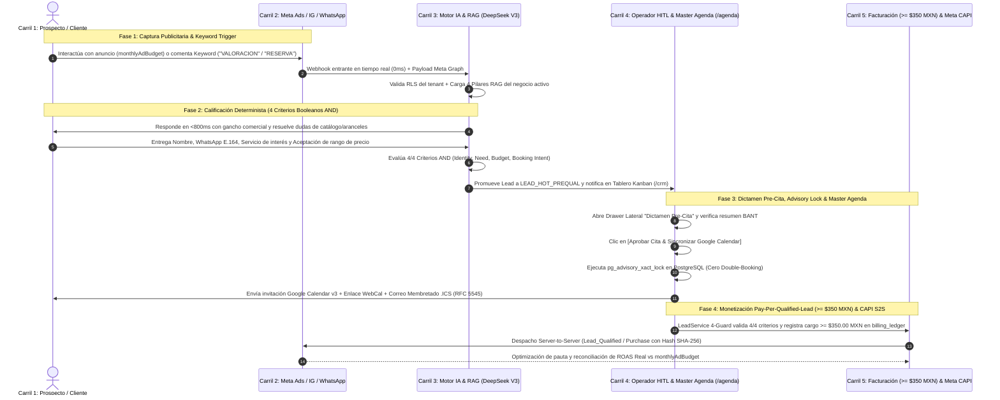
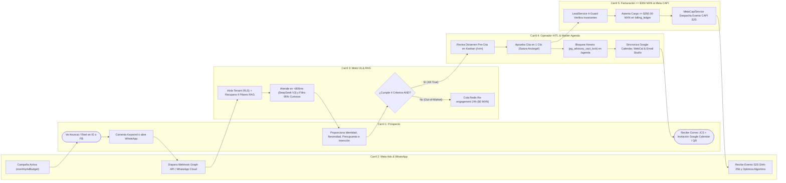
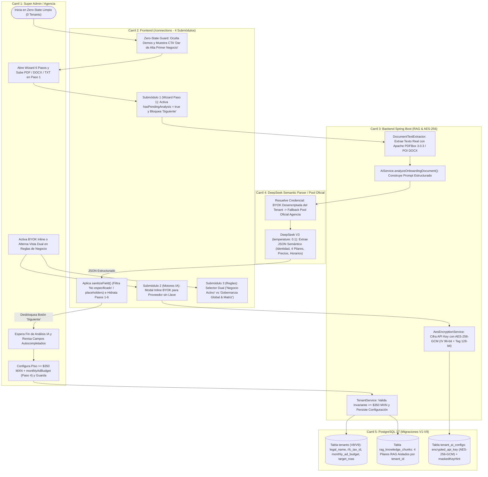
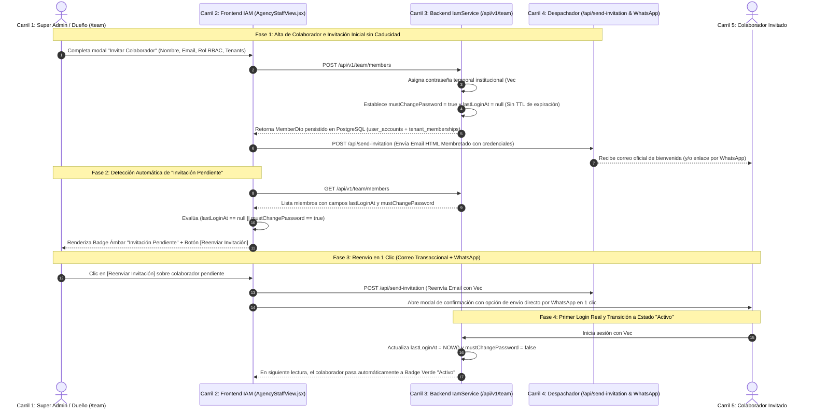
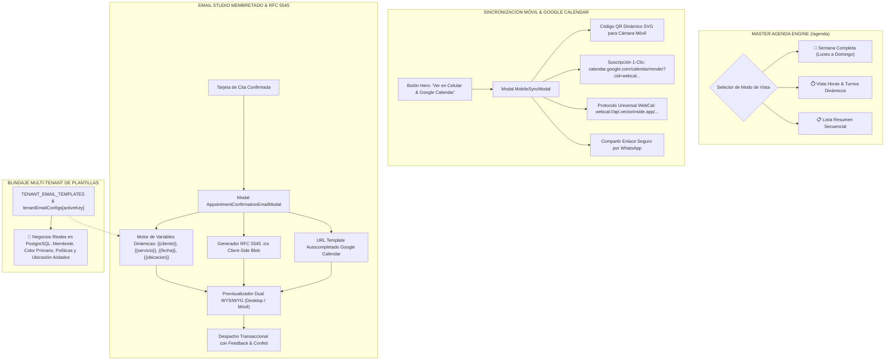
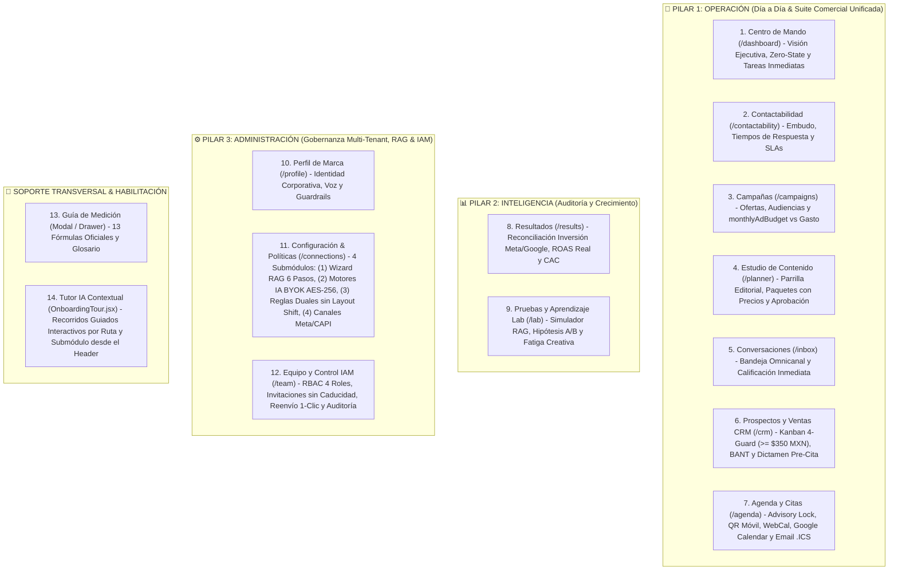

# 🚀 Vector Community — Sistema Operativo Multi-Tenant & Performance AI Engine

> **Vector Inside Operations** — Documento Maestro de Arquitectura, Frontend Control Panel & Gobernanza Human-in-the-Loop (HITL).  
> *Soberanía de Datos, Aislamiento Multi-Tenant Inviolable (RLS), Gobernanza Zero-State, Cifrado BYOK AES-256-GCM y Monetización Pay-Per-Qualified-Lead ($\ge \$350.00\text{ MXN}$).*


---

## 📖 1. Visión General del Proyecto

**Vector Community** es un sistema operativo multi-tenant y motor de performance marketing diseñado bajo la doctrina **"Agencia Primero" (Agency Co-Pilot)**. 

Transforma el Community Management tradicional en un ecosistema automatizado de alta fidelidad que:
1. **Filtra con Human-in-the-Loop (HITL):** La IA opera con autonomía en el 95%+ de interacciones rutinarias (Regla 95/5). Ninguna cita, propuesta VIP o crisis de reputación se ejecuta sin la aprobación humana en 1 clic de un operador de la agencia (**Sutura Arcángel**).
2. **Atribución Backend Server-to-Server (Meta CAPI):** Calcula el ROAS y CAC real cruzando las ventas registradas en base de datos contra la inversión de Meta Ads, con telemetría SHA-256 sin dependencia exclusiva de cookies ni del píxel web del navegador.
3. **Master Agenda Dinámica Multigiro:** Gestión inteligente de citas y turnos con disponibilidad determinista, bloqueo atómico en PostgreSQL (`pg_advisory_xact_lock`), sincronización bidireccional con Google Calendar, visualización móvil instantánea vía **Código QR** y protocolo universal **WebCal (Apple / iOS / Mac / Outlook)**, y despacho de correos transaccionales con adjunto `.ics` (RFC 5545).
4. **Aislamiento Multi-Tenant Estricto:** Segregación matemática en PostgreSQL mediante **Row-Level Security (RLS)** y enrutamiento en Frontend mediante `useTenant` e inyección automática del encabezado `X-Tenant-ID`. Cada negocio cuenta con su propio membrete, avatar, reglas arancelarias y políticas de cancelación sin riesgo de contaminación cruzada.
5. **Ontología Operativa de Módulos:** Arquitectura estructurada en 3 Pilares de Negocio: **Operación**, **Inteligencia** y **Administración**, más la Guía Oficial de Medición con 13 métricas estandarizadas.
6. **Centro de Configuración & Políticas de 4 Submódulos con Zero-State Limpio:** Wizard RAG de 6 pasos con bloqueo estricto en Paso 1 (`hasPendingAnalysis`) y sanitización (`sanitizeField`), Motores IA con configuración contextual inline de API Keys cifradas (`AES-256-GCM`), Reglas de Negocio con vista dual (`Negocio Activo` vs. `Gobernanza Global & Matriz`) sin Layout Shift, y Canales Oficiales.
7. **Tutor IA Contextual (`OnboardingTour.jsx`) & Gobernanza IAM sin Caducidad (`/team`):** Recorridos guiados interactivos por módulo/submódulo desde el Header, y gestión de colaboradores con detección automática de `Invitación Pendiente` y reenvío en 1 clic por Correo/WhatsApp.

---

## 📚 2. Matriz de Documentos de Arquitectura & Diseño (ADRs & SDD)

La suite de decisiones de arquitectura y especificaciones del sistema se encuentra completamente formalizada en el directorio [`/docs`](docs/):

| Documento | Título & Alcance Oficial | Estado |
| :--- | :--- | :---: |
| 🏛️ **[ADR-001](docs/ADR_001_MASTER_ARCHITECTURE_AND_BUSINESS_RULES.md)** | Arquitectura Maestra, Gobernanza Multi-Tenant & Reglas de Negocio (Regla 95/5) | `ACEPTADO` |
| 🏷️ **[ADR-002](docs/ADR_002_UNIVERSAL_BUSINESS_TAXONOMY_AND_RAG_PILLARS.md)** | Taxonomía Universal de 17 Giros Comerciales, Protocolo de Reacción & 4 Pilares RAG | `ACEPTADO` |
| 🎯 **[ADR-003](docs/ADR_003_META_GRAPH_INTELLIGENCE_AND_HITL_TRIAGE.md)** | Meta Graph Intelligence, Keyword-to-DM, Moderación Anti-Hate & Triage HITL | `ACEPTADO` |
| 🧠 **[ADR-004](docs/ADR_004_MODEL_ROUTING_AND_AGENT_SPECIALIZATION.md)** | Enrutamiento de Modelos (DeepSeek V3 <800ms vs. DeepSeek R1 Cognitivo) | `ACEPTADO` |
| 🌐 **[ADR-005](docs/ADR_005_UNIVERSAL_MULTI_PROVIDER_AI_TAXONOMY.md)** | Taxonomía Multi-Proveedor de Modelos AI (OpenAI, Anthropic, Gemini, DeepSeek, Groq) | `ACEPTADO` |
| 🔗 **[ADR-006](docs/ADR_006_TRI_DIMENSIONAL_COUPLING_MATRIX.md)** | Matriz Tridimensional de Acoplamiento (Giro × Canal × Fase de Conversión) | `ACEPTADO` |
| 💰 **[ADR-007](docs/ADR_007_OFFICIAL_COMMERCIAL_PRICING_AND_BILLING_RULES.md)** | Modelo Comercial Vector Deal: Setup $20,000 MXN + Mensualidad $5,000 + Piso Mínimo $\ge \$350.00\text{ MXN}$ por Lead Calificado + Presupuesto Mensual de Meta Ads (`monthlyAdBudget`) | `ACEPTADO` |
| ⚡ **[ADR-008](docs/ADR_008_PAY_PER_QUALIFIED_LEAD_STATE_MACHINE_AND_KANBAN_TRIAGE.md)** | Máquina de Estados Pay-Per-Qualified-Lead ($\ge \$350.00\text{ MXN}$ + `monthlyAdBudget`), 4 Criterios AND & Kanban Triage | `ACEPTADO` |
| 🎨 **[ADR-009](docs/ADR_009_DUAL_THEME_DESIGN_SYSTEM_RULES.md)** | Sistema de Diseño Dual-Theme (Modo Oscuro & Modo Claro) y Guardrail de la Lima | `ACEPTADO` |
| 📅 **[ADR-010](docs/ADR_010_MICRO_LANDING_TELEMETRY_AND_DYNAMIC_MASTER_AGENDA.md)** | Micro-Landing Dual, Master Agenda Semanal, QR Móvil, WebCal y Email Studio .ICS | `ACEPTADO` |
| 💼 **[ADR-011](docs/ADR_011_UX_UI_BRAND_AND_OPERATIONAL_TAXONOMY.md)** | Ontología de Módulos Operativos, Identidad de Marca y Principios UX-01 a UX-10 | `ACEPTADO` |
| 🚀 **[ADR-012](docs/ADR_012_UNIFIED_COMMERCIAL_GROWTH_SUITE_AND_OMNICHANNEL_MATRIX.md)** | Suite de Crecimiento Comercial Unificada (`/crm` + `/planner`), Catálogo de Paquetes con Precios transparentes y Matriz Omnicanal | `ACEPTADO` |
| 🛡️ **[ADR-013](docs/ADR_013_ZERO_STATE_GOVERNANCE_CONTEXTUAL_AI_TUTOR_AND_IAM_INVITATION_ARCHITECTURE.md)** | Gobernanza Zero-State, Wizard 6 Pasos con Bloqueo IA, BYOK Inline `AES-256-GCM`, Tutor IA Contextual (`OnboardingTour.jsx`) e Invitaciones IAM sin Caducidad | `ACEPTADO` |
| 📐 **[SDD v4.2](docs/SDD_SYSTEM_DESIGN_DOCUMENT.md)** | Documento Maestro de Diseño de Sistema (Zero-State Governance, Contextual AI Tutor, Inline BYOK AES-256 & IAM Invitation Lifecycle Edition), Esquemas SQL RLS V1–V9 y Contratos Backend | `ACEPTADO` |

---

## 🏛️ 3. Diagrama de Arquitectura Global & Aislamiento Multi-Tenant

El siguiente diagrama detalla la interacción desacoplada entre el Frontend en Next.js 14 (incluyendo el Tutor IA Contextual, los 4 submódulos de `/connections` y la gobernanza de equipo en `/team`), el API Gateway con inyección de cabeceras multi-tenant, el Core Backend en Spring Boot 3 con sus servicios transaccionales reales, el Motor Cognitivo de IA y la persistencia en PostgreSQL 17 con Row-Level Security:

```mermaid
flowchart TB
    subgraph FrontendTier ["CAPA CLIENTE & PRESENTACIÓN (Next.js 14 App Router)"]
        direction TB
        Switch["Tenant Switcher (useTenant + Zero-State Guard)"]
        Tour["Tutor IA Contextual (OnboardingTour.jsx - 12 Rutas + 4 Submódulos)"]
        UI_Dash["Centro de Mando (/dashboard)"]
        UI_CRM["Suite Comercial Unificada: CRM Triage (/crm) & Planner (/planner)"]
        UI_Agenda["Master Agenda Semanal, QR Móvil & Email Studio .ICS (/agenda)"]
        subgraph UI_Conn ["Centro de Configuración & Políticas (/connections - 4 Submódulos)"]
            Sub_Wizard["1. Ingestión RAG & Briefing (Wizard 6 Pasos + Bloqueo IA)"]
            Sub_AI["2. Motores IA & Enrutamiento (BYOK Inline AES-256)"]
            Sub_Rules["3. Reglas de Negocio & Taxonomía (Vista Dual sin Layout Shift)"]
            Sub_Meta["4. Canales Oficiales (Meta Graph / WhatsApp / CAPI)"]
        end
        UI_Team["Gobierno de Equipo & Accesos IAM (/team - AgencyStaffView)"]
        UI_Public["Micro-Landings Dinámicas (/m/[slug])"]
        Interceptor["Axios Interceptor: Inyecta X-Tenant-ID & JWT"]
    end

    subgraph SecurityTier ["GATEWAY DE SEGURIDAD & INGESTIÓN"]
        Cloudflare["Cloudflare Tunnels (SSL & Webhooks HTTPS)"]
        Nginx["Nginx Reverse Proxy & Load Balancer"]
        AuthFilter["JwtAuthenticationFilter + TenantContextFilter (app.current_tenant_id)"]
    end

    subgraph BackendCore ["CORE TRANSACCIONAL (Spring Boot 3.4 / Java 21)"]
        TenantService["TenantService (CRUD Multi-Tenant, Tarifa >= $350 MXN, monthlyAdBudget)"]
        IamService["IamService (RBAC 4 Roles, Vec#Auth2026!, Invitaciones sin Caducidad)"]
        AiService["AiService + AesEncryptionService (AES-256-GCM BYOK & DeepSeek Semantic Parser)"]
        DocExtractor["DocumentTextExtractor (Apache PDFBox 3.0.3 / Apache POI DOCX)"]
        LeadService["LeadService 4-Guard (4 Criterios Booleanos AND + Billing Ledger >= $350 MXN)"]
        AppointmentService["AppointmentService Advisory Lock (pg_advisory_xact_lock + Google Calendar & WebCal)"]
        MetaCapiService["MetaCapiService Server-to-Server Engine (SHA-256)"]
    end

    subgraph AIEngine ["MOTOR COGNITIVO & MULTI-AGENTE (DeepSeek & Multi-Provider)"]
        RouterAI["Model Router Determinista (Pool Oficial vs BYOK Tenant)"]
        V3["DeepSeek V3 (deepseek-chat): Chat Operativo & Extracción JSON (<800ms)"]
        R1["DeepSeek R1 (deepseek-reasoner): Razonamiento CoT & Auditoría Cognitiva"]
        AntiHate["Moderador Anti-Hate & Clasificador de Intención"]
    end

    subgraph DataStorage ["PERSISTENCIA MULTI-TENANT & EVENTOS"]
        Postgres[("PostgreSQL 17 (Flyway V1-V9 + Row-Level Security RLS)")]
        PgVector[("pgvector: RAG Chunks Aislados por tenant_id")]
        Redis[("Upstash Redis: Colas Asíncronas & Re-engagement 24h")]
    end

    Switch & Tour --> Interceptor
    UI_Dash & UI_CRM & UI_Agenda & UI_Conn & UI_Team & UI_Public --> Interceptor
    Interceptor -->|HTTP REST + Header X-Tenant-ID| Nginx
    Cloudflare -->|Webhooks Meta WhatsApp / IG| Nginx
    Nginx --> AuthFilter
    AuthFilter --> TenantService
    AuthFilter --> IamService
    AuthFilter --> AiService
    AuthFilter --> DocExtractor
    AuthFilter --> LeadService
    AuthFilter --> AppointmentService
    AuthFilter --> MetaCapiService

    DocExtractor --> AiService
    AiService --> RouterAI
    RouterAI --> V3
    RouterAI --> R1
    RouterAI --> AntiHate

    LeadService <--> Redis
    AppointmentService --> GoogleWS["Google Calendar API v3 & WebCal"]
    MetaCapiService --> MetaGraph["Meta Graph API & CAPI S2S"]

    TenantService & IamService & AiService & LeadService & AppointmentService <-->|SET LOCAL app.current_tenant_id| Postgres
    AiService <--> PgVector
```



---

## 🏊 4. Diagramas de Carriles (Swimlanes) Operativos y Arquitectónicos

A continuación se documentan los **3 Diagramas de Carriles (Swimlanes)** principales que rigen el ciclo de vida comercial, la configuración multi-tenant con IA y la gobernanza de identidad (IAM) del sistema.

---

### 4.1. Carriles 1 — Ciclo de Vida del Prospecto, 4 Criterios AND, Master Agenda & Atribución Meta CAPI ($\ge \$350\text{ MXN}$)

#### A. Diagrama de Secuencia Inter-Carril (End-to-End)



#### B. Diagrama de Flujo por Carriles (Swimlanes Horizontales)



---

### 4.2. Carriles 2 — Alta de Negocio (Wizard 6 Pasos con Bloqueo IA), BYOK Inline AES-256-GCM y Gobernanza Dual Zero-State

Este diagrama modela la creación limpia de un negocio desde estado cero (`Zero-State`), la extracción documental real con bloqueo estricto en el Paso 1 mientras la IA procesa, el cifrado de llaves propias (`BYOK`) y la separación sin *Layout Shift* en Reglas de Negocio:



---

### 4.3. Carriles 3 — Gobierno de Equipo IAM, Invitaciones sin Caducidad y Reenvío en 1 Clic (`/team`)

Este flujo detalla el ciclo de vida de los colaboradores en `/team`, garantizando que las invitaciones **no caduquen por tiempo**, se identifiquen automáticamente como `Invitación Pendiente` hasta el primer inicio de sesión real y permitan el reenvío de credenciales en 1 clic:



---

## 📅 5. Master Agenda Dinámica & Email Studio Membretado

El módulo de **Agenda y Citas (`/agenda`)** resuelve integralmente la sincronización y la comunicación transaccional con el cliente:



---

## 💼 6. Ontología de Módulos Operativos (3 Pilares + Soporte Transversal)

La interfaz se estructura en tres pilares de valor comercial y una capa de soporte transversal que incluye la **Guía Oficial de Medición** y el **Tutor IA Contextual (`OnboardingTour.jsx`)**:



---

## 💰 7. Reglas de Negocio Inviolables (Vector Deal, RAG, BYOK & Gobernanza IAM)

| Regla de Negocio | Condición Técnica | Impacto en el Sistema |
| :--- | :--- | :--- |
| **Setup de Implementación** | $20,000 MXN + IVA (Pago Único Mes 1) | Cubre ingestión de los 4 Pilares RAG, calibración del Lobo Vectorial y conexión CAPI S2S. |
| **Mensualidad Base** | $5,000 MXN + IVA (A partir del Día 31) | Corre estrictamente al terminar el mes de implementación. Garantiza mantenimiento y soporte continuo. |
| **Piso Mínimo por Lead Calificado + `monthlyAdBudget`** | $\ge \$350.00\text{ MXN}$ por evento + Presupuesto Mensual Meta Ads (`monthlyAdBudget`) | El sistema bloquea cualquier tarifa $< \$350.00\text{ MXN}$ en UI y Backend. El cargo se asienta en `billing_ledger` solo al cumplir los 4 criterios booleanos AND, y el `monthlyAdBudget` alimenta el cálculo de ROAS Real. |
| **Bloqueo Estricto en Paso 1 del Wizard (`hasPendingAnalysis`)** | `hasPendingAnalysis === true` durante extracción PDF/DOCX/TXT e inferencia DeepSeek | Si el usuario adjunta documentos pero no los ha procesado con IA, el botón **"Siguiente"** permanece bloqueado con aviso ámbar; los campos se limpian con `sanitizeField()` antes de hidratar el formulario. |
| **BYOK Inline con Cifrado `AES-256-GCM`** | Cifrado autenticado en `AesEncryptionService` (`IV 96-bit` + `Tag 128-bit`) | Las API Keys propias del cliente nunca se exponen en texto plano tras guardarse (solo `maskedKeyHint`). Permite configurar la llave inline al seleccionar un proveedor sin credencial o usar el Pool Oficial de la Agencia. |
| **Separación Dual sin *Layout Shift* en Reglas de Negocio** | Selector de alcance en Submódulo 3 (`Negocio Activo` vs. `Gobernanza Global & Matriz`) | Separa las políticas operativas del cliente activo de la matriz maestra de 17 giros de la agencia, manteniendo un contenedor de ancho estable sin saltos de layout. |
| **Zero-State Limpio (`tenantsList.length === 0`)** | Guardas de renderizado cuando no existen negocios en PostgreSQL | Prohibido inyectar tenants ficticios o datos mock cuando la base de datos está vacía; se presenta un estado vacío guiado hacia el alta del primer negocio. |
| **Invitaciones IAM sin Caducidad (`/team`)** | `lastLoginAt == null \|\| mustChangePassword == true` con contraseña inicial `Vec#Auth2026!` | Las invitaciones a colaboradores nunca caducan por tiempo. El sistema muestra el badge **"Invitación Pendiente"** y habilita el botón **[Reenviar Invitación]** en 1 clic por Correo/WhatsApp hasta que el usuario inicie sesión por primera vez. |
| **Regla 95/5 (Ehrenberg-Bass)** | 95% Out-of-Market / 5% In-Market | El 95% de evasivas no se cobran; se encolan en Redis para re-engagement a las 24h a costo $0 USD. |
| **Aislamiento Multi-Tenant** | `tenant_id` obligatorio en DB & Header `X-Tenant-ID` | Políticas RLS de PostgreSQL activadas. Ningún dato de un negocio es visible por otro. |
| **Guardrail de la Lima (`#C3F400`)** | Contraste de Color WCAG AA/AAA | Texto sobre claro usa `#506500` (6.5:1). Botones usan `#C3F400` con texto negro (14.8:1). |

---

## 🛠️ 8. Tech Stack & Estándares Visuales

| Capa | Tecnología / Herramienta | Propósito en el Sistema |
| :--- | :--- | :--- |
| **Framework UI** | React 18 / Next.js 14+ (App Router) | Renderizado SSR, cliente reactivo, rutas públicas `/m/[slug]`, Tutor IA Contextual y layouts modulares. |
| **Core Backend** | Java 21 LTS + Spring Boot 3.4 | Servicios transaccionales (`TenantService`, `IamService`, `AiService`, `LeadService`, `AppointmentService`). |
| **Seguridad & Cifrado** | Spring Security + JWT + `AES-256-GCM` | Autenticación RBAC, aislamiento multi-tenant y bóveda criptográfica para llaves BYOK. |
| **Ingestión Documental** | Apache PDFBox 3.0.3 + Apache POI 5.3.0 | Extracción real de texto desde archivos `.pdf`, `.docx`, `.txt` y `.md` para los 4 Pilares RAG. |
| **Base de Datos** | PostgreSQL 17 + Flyway (V1–V9) + RLS | Persistencia relacional multi-tenant con Row-Level Security y bloqueos `pg_advisory_xact_lock`. |
| **Estilos CSS** | Tailwind CSS + Variables CSS Dual-Theme | Soporte nativo modo oscuro (`#101114`) y modo claro (`#F5F5F8`) según ADR-009. |
| **Estado Global & HTTP** | Context API (`useTenant`) + Axios Interceptors | Sincronización con PostgreSQL, Zero-State limpio e inyección de `X-Tenant-ID` y `Authorization: Bearer`. |

---

## 🚀 9. Guía de Ejecución Local

### 1. Clonar el repositorio e instalar dependencias Frontend:
```bash
git clone https://github.com/VectorInside/Vector-Community.git
cd Vector-Community
npm install
```

### 2. Iniciar PostgreSQL 17 y el Backend Spring Boot (`vector-core`):
```bash
cd ../vector-core
./mvnw spring-boot:run
```

### 3. Iniciar el servidor de desarrollo Frontend:
```bash
cd ../Vector-Community
npm run dev
```

### 4. Abrir en el navegador:
Accede a [http://localhost:3000](http://localhost:3000) para operar el panel multi-tenant, ejecutar el Wizard RAG de 6 pasos, configurar llaves BYOK o activar el **Tutor IA Contextual** desde la barra superior.

---

## 📄 10. Licencia & Propiedad Intelectual

Desarrollado y operado por el equipo de ingeniería y estrategia de producto de **Vector Inside**.  
Todos los derechos reservados © 2026. Prohibida la reproducción parcial o total sin autorización previa.
