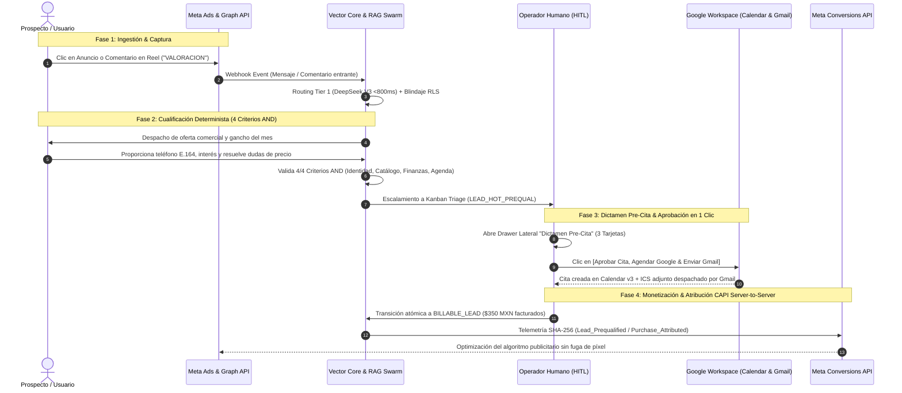
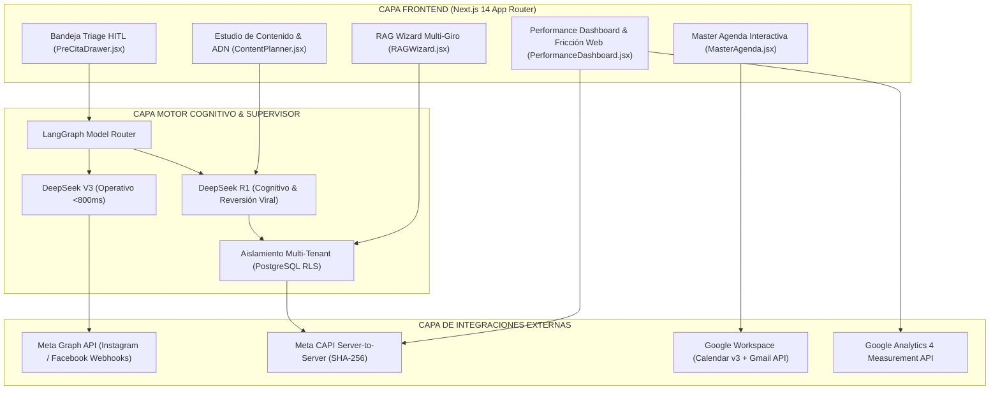

# 🚀 Vector Community — Sistema Operativo Multi-Tenant & Performance AI Engine

> **Vector Inside Operations** — Documento Maestro de Arquitectura, Frontend Control Panel & Gobernanza Human-in-the-Loop (HITL).


---

## 📖 1. Visión General del Proyecto

**Vector Community** es un sistema operativo multi-tenant y motor de performance marketing diseñado bajo la gobernanza **"Agencia Primero" (Agency Co-Pilot)**. 

Transforma el Community Management tradicional en un motor automatizado por IA que:
1. **Filtra con Human-in-the-Loop (HITL):** Ninguna cita, propuesta o interacción crítica llega al dueño del negocio sin la aprobación previa en 1 clic de un operador de la agencia.
2. **Atribución Backend Server-to-Server (Meta CAPI):** Calcula el ROAS y CAC real cruzando las ventas en base de datos contra el gasto de Meta Ads con datos hasheados en SHA-256.
3. **Parrilla de Contenido & Content Ops:** Planifica y despacha posts de Reels, Carruseles y Stories con previsualización de ganchos (Hooks) generados por IA (DeepSeek R1).
4. **Adaptabilidad a 5 Verticales:** Hospitality, Clínicas/Salud, E-Commerce, B2B High-Ticket y Creator Economy (Redes Sociales Meta).

---

## 📚 2. Documentos de Arquitectura & Diseño (ADR & SDD)

Los registros de decisiones de arquitectura y especificaciones del sistema se encuentran en el directorio [`/docs`](docs/):

- 🏛️ **[ADR-001: Arquitectura Maestra, Gobernanza Multi-Tenant & Reglas de Negocio](docs/ADR_001_MASTER_ARCHITECTURE_AND_BUSINESS_RULES.md)**
- 📐 **[SDD: Documento de Diseño de Sistema (System Design Document)](docs/SDD_SYSTEM_DESIGN_DOCUMENT.md)**

---

## 🛠️ 3. Tech Stack & Estándares Visuales

| Capa | Tecnología / Herramienta | Propósito |
| :--- | :--- | :--- |
| **Framework UI** | React 18 / Next.js 14+ (App Router) | Renderizado SSR, cliente reactivo y revalidación de datos. |
| **Estilos CSS** | Tailwind CSS | Estilizado declarativo con tokens de diseño Vector Inside (`#0D0F12`, `#D4FF00`). |
| **Iconografía** | Lucide React | Iconos vectoriales ultraligeros. |
| **Estado Global** | Zustand & Context API | Manejo reactivo de `activeTenantId`, roles RBAC y modales interactivos. |
| **Comunicación Backend** | Axios + Interceptores JWT | Inyección obligatoria de cabeceras `X-Tenant-ID` y `Authorization: Bearer`. |
| **Gráficos & Telemetría** | Recharts | Visualización de ROAS Real, CAC, Curvas de Retención y Logs CAPI en vivo. |

---

## 🎨 Sistema de Diseño (Design Tokens)

- **Fondo Base (Dark Base):** `#0D0F12` (Negro técnico Vector).
- **Contenedores & Superficies:** `#12151A` y `#1A1E26`.
- **Color Neón Oficial (Brand Primary):** `#D4FF00` (Amarillo Neón Vector Inside).
- **Bordes & Divisores:** `#1F242D`.
- **Estados Semánticos:**
  - 🟢 **Success / Active:** `#10B981` (Emerald-500)
  - 🟡 **Warning / Pending:** `#F59E0B` (Amber-500)
  - 🔴 **Critical / Danger:** `#EF4444` (Rose-500)

---

## 📂 4. Estructura del Repositorio

```text
Vector-Community/
├── docs/                     # Registros de Arquitectura (ADR) y Diseño de Sistema (SDD)
│   ├── ADR_001_MASTER_ARCHITECTURE_AND_BUSINESS_RULES.md
│   └── SDD_SYSTEM_DESIGN_DOCUMENT.md
├── public/                   # Logotipos y recursos estáticos
│   ├── favicon.ico
│   └── vector-inside-logo.svg
├── src/
│   ├── app/                  # Vistas Principales (Next.js App Router)
│   │   ├── layout.jsx        # Layout global con tema oscuro y fuentes Google
│   │   ├── page.jsx          # Redirección a Dashboard
│   │   ├── login/page.jsx    # Autenticación JWT y selector de perfiles RBAC
│   │   ├── dashboard/page.jsx# Centro de Mando Multi-Tenant
│   │   ├── triage/page.jsx   # Protocolo de Triage, HITL y moderación de crisis
│   │   ├── planner/page.jsx  # Parrilla de Contenidos & Aprobación Editorial
│   │   ├── agenda/page.jsx   # Master Agenda (Google Calendar 2-Way Sync)
│   │   ├── metrics/page.jsx  # Soberanía Financiera & Reportes Ejecutivos
│   │   ├── agents/page.jsx   # Orquestación Multi-Agente (LangGraph / CrewAI)
│   │   └── settings/page.jsx # Configuración de Sub-Bots RAG para 5 Verticales
│   ├── components/           # Componentes Modulares Reutilizables
│   │   ├── common/           # Botones, Badges, Modales, StatCards
│   │   ├── layout/           # Header, Sidebar, TenantSwitcher
│   │   ├── hitl/             # Tarjetas de aprobación HITL en 1 Clic
│   │   ├── planner/          # Calendario de publicaciones y generador IA
│   │   ├── calendar/         # Vista de Master Agenda
│   │   ├── metrics/          # Paneles de ROAS real y telemetría CAPI
│   │   ├── agents/           # Visualizador de grafo de supervisión
│   │   └── settings/         # Formularios adaptativos por vertical
│   ├── context/              # Contexto de Autenticación y Switcher de Tenants
│   ├── hooks/                # Hooks personalizados (useTenant, useHITLAlerts)
│   ├── services/             # Cliente API Axios y llamadas a endpoints
│   ├── styles/               # globals.css y utilidades Tailwind
│   └── utils/                # Constantes, formateadores y mock data
├── .env.example              # Variables de entorno de ejemplo
├── .env.local                # Variables de desarrollo local
├── next.config.mjs           # Configuración de Next.js
├── tailwind.config.js        # Configuración de diseño Tailwind
└── package.json              # Dependencias y scripts de ejecución
```

---

## 🎯 5. Matriz de las 5 Verticales de Negocio

1. 🏨 **Hospitality (Restaurantes & Bares):** Menú Digital PDF, capacidad de comensales, reservas automáticas con pre-autorización (>8 pax requieren HITL manual).
2. 🏥 **Service Appointments (Clínicas & Salud):** Calificación médica RAG, Google Calendar API v3 y confirmación de citas con anticipo.
3. 🛒 **E-Commerce (Retail & Moda):** Catálogo de productos, recuperación de carritos abandonados por DM y eventos `Purchase` en Meta CAPI.
4. 💼 **B2B Sales (High-Ticket & SaaS):** Calificación BANT, Discovery Calls y sincronización bidireccional de deals en HubSpot / Salesforce.
5. 🎬 **Creator Economy (Redes Sociales Meta):** Conversión de comentarios a DM (*Keyword Triggers*), filtro de brand deals de marcas y blindaje anti-toxicidad.

---

## 🚀 6. Guía de Ejecución Local

### 1. Instalar dependencias:
```bash
npm install
```

### 2. Iniciar el servidor de desarrollo:
```bash
npm run dev
```

### 3. Abrir en el navegador:
Accede a [http://localhost:3000](http://localhost:3000) e interactúa con cualquiera de los perfiles de la agencia o de los clientes.

### 4. Compilar para producción:
```bash
npm run build
```

---

## 🏊 7. Diagrama de Carriles del Comportamiento del Sistema (Swimlane Diagram)

El siguiente diagrama de carriles ilustra el ciclo de vida completo de un prospecto, desde el impacto publicitario en Meta Ads hasta la monetización del lead calificado ($350 MXN), la sincronización con Google Workspace y la atribución server-to-server en Meta CAPI:



---

## 🏛️ 8. Diagrama de Arquitectura de Software & Telemetría Backend

Arquitectura modular desacoplada del sistema operativo multi-tenant:




