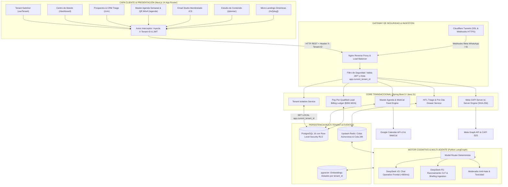
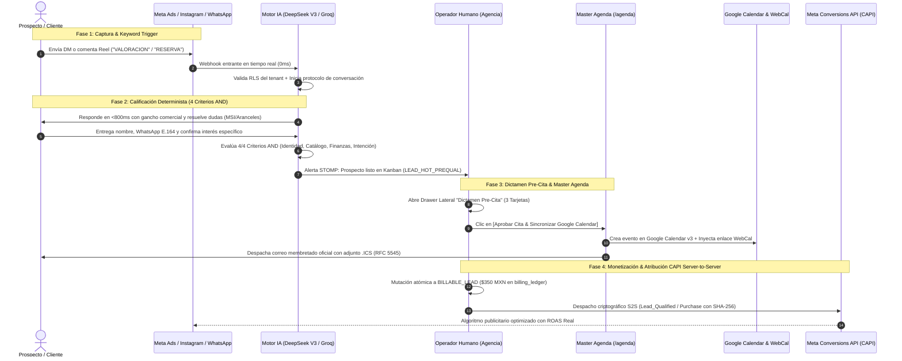
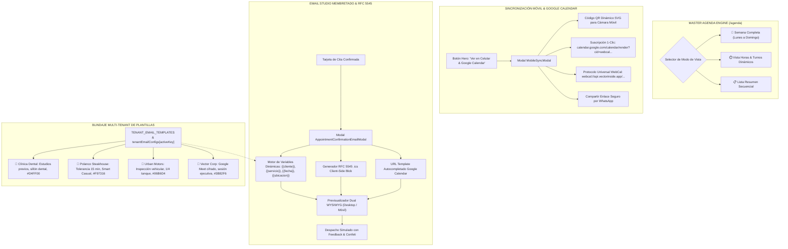
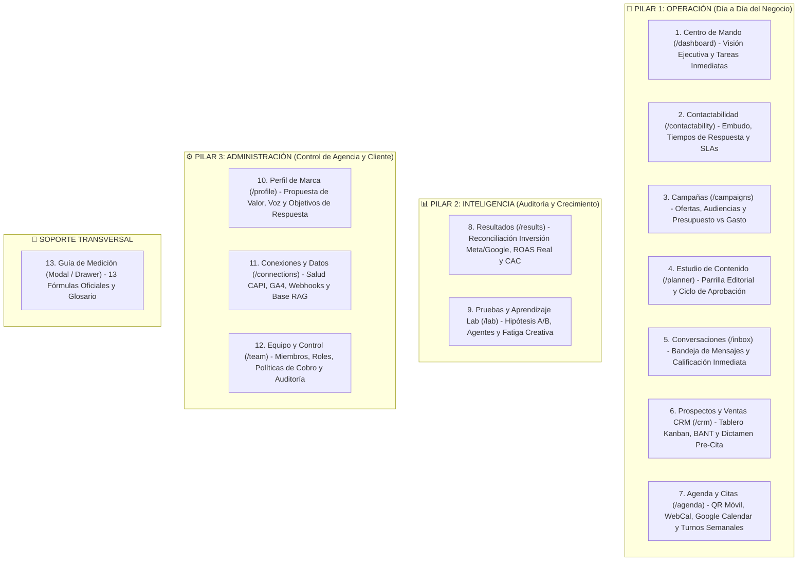

# 🚀 Vector Community — Sistema Operativo Multi-Tenant & Performance AI Engine

> **Vector Inside Operations** — Documento Maestro de Arquitectura, Frontend Control Panel & Gobernanza Human-in-the-Loop (HITL).  
> *Soberanía de Datos, Aislamiento Multi-Tenant Inviolable (RLS) y Monetización Pay-Per-Qualified-Lead.*


---

## 📖 1. Visión General del Proyecto

**Vector Community** es un sistema operativo multi-tenant y motor de performance marketing diseñado bajo la doctrina **"Agencia Primero" (Agency Co-Pilot)**. 

Transforma el Community Management tradicional en un ecosistema automatizado de alta fidelidad que:
1. **Filtra con Human-in-the-Loop (HITL):** La IA opera con autonomía en el 95%+ de interacciones rutinarias (Regla 95/5). Ninguna cita, propuesta VIP o crisis de reputación se ejecuta sin la aprobación humana en 1 clic de un operador de la agencia (**Sutura Arcángel**).
2. **Atribución Backend Server-to-Server (Meta CAPI):** Calcula el ROAS y CAC real cruzando las ventas registradas en base de datos contra la inversión de Meta Ads, con telemetría SHA-256 sin dependencia exclusiva de cookies ni del píxel web del navegador.
3. **Master Agenda Dinámica Multigiro:** Gestión inteligente de citas y turnos con disponibilidad determinista, sincronización bidireccional con Google Calendar, visualización móvil instantánea vía **Código QR** y protocolo universal **WebCal (Apple / iOS / Mac / Outlook)**, y despacho de correos transaccionales con adjunto `.ics` (RFC 5545).
4. **Aislamiento Multi-Tenant Estricto:** Segregación matemática en PostgreSQL mediante **Row-Level Security (RLS)** y enrutamiento en Frontend mediante `useTenant` e inyección automática del encabezado `X-Tenant-ID`. Cada negocio cuenta con su propio membrete, avatar, reglas arancelarias y políticas de cancelación sin riesgo de contaminación cruzada.
5. **Ontología Operativa de Módulos:** Arquitectura estructurada en 3 Pilares de Negocio: **Operación**, **Inteligencia** y **Administración**, más la Guía Oficial de Medición con 13 métricas estandarizadas.

---

## 📚 2. Matriz de Documentos de Arquitectura & Diseño (ADRs & SDD)

La suite de decisiones de arquitectura y especificaciones del sistema se encuentra completamente formalizada en el directorio [`/docs`](docs/):

| Documento | Título & Alcance Oficial | Estado |
| :--- | :--- | :---: |
| 🏛️ **[ADR-001](docs/ADR_001_MASTER_ARCHITECTURE_AND_BUSINESS_RULES.md)** | Arquitectura Maestra, Gobernanza Multi-Tenant & Reglas de Negocio (Regla 95/5) | `ACEPTADO` |
| 🏷️ **[ADR-002](docs/ADR_002_UNIVERSAL_BUSINESS_TAXONOMY_AND_RAG_PILLARS.md)** | Taxonomía Universal de 17 Giros Comerciales, Protocolo de Reacción & 4 Pilares RAG | `ACEPTADO` |
| 🎯 **[ADR-003](docs/ADR_003_META_GRAPH_INTELLIGENCE_AND_HITL_TRIAGE.md)** | Meta Graph Intelligence, Keyword-to-DM, Moderación Anti-Hate & Triage HITL | `ACEPTADO` |
| 🧠 **[ADR-004](docs/ADR_004_MODEL_ROUTING_AND_AGENT_SPECIALIZATION.md)** | Enrutamiento de Modelos (DeepSeek V3 <800ms vs. DeepSeek R1 Cognitivo) | `ACEPTADO` |
| 🌐 **[ADR-005](docs/ADR_005_UNIVERSAL_MULTI_PROVIDER_AI_TAXONOMY.md)** | Taxonomía Multi-Proveedor de Modelos AI (OpenAI, Anthropic, Gemini, DeepSeek, Groq) | `ACEPTADO` |
| 🔗 **[ADR-006](docs/ADR_006_TRI_DIMENSIONAL_COUPLING_MATRIX.md)** | Matriz Tridimensional de Acoplamiento (Giro × Canal × Fase de Conversión) | `ACEPTADO` |
| 💰 **[ADR-007](docs/ADR_007_OFFICIAL_COMMERCIAL_PRICING_AND_BILLING_RULES.md)** | Modelo Comercial Vector Deal: Setup $20,000 MXN + Mensualidad $5,000 + Lead $350 | `ACEPTADO` |
| ⚡ **[ADR-008](docs/ADR_008_PAY_PER_QUALIFIED_LEAD_STATE_MACHINE_AND_KANBAN_TRIAGE.md)** | Máquina de Estados Pay-Per-Qualified-Lead, 4 Criterios AND & Kanban Triage | `ACEPTADO` |
| 🎨 **[ADR-009](docs/ADR_009_DUAL_THEME_DESIGN_SYSTEM_RULES.md)** | Sistema de Diseño Dual-Theme (Modo Oscuro & Modo Claro) y Guardrail de la Lima | `ACEPTADO` |
| 📅 **[ADR-010](docs/ADR_010_MICRO_LANDING_TELEMETRY_AND_DYNAMIC_MASTER_AGENDA.md)** | Micro-Landing Dual, Master Agenda Semanal, QR Móvil, WebCal y Email Studio .ICS | `ACEPTADO` |
| 💼 **[ADR-011](docs/ADR_011_UX_UI_BRAND_AND_OPERATIONAL_TAXONOMY.md)** | Ontología de Módulos Operativos, Identidad de Marca y Principios UX-01 a UX-10 | `ACEPTADO` |
| 📐 **[SDD v4.0](docs/SDD_SYSTEM_DESIGN_DOCUMENT.md)** | Documento Maestro de Diseño de Sistema, Esquemas SQL RLS y Contratos Backend | `ACEPTADO` |

---

## 🏛️ 3. Diagrama de Arquitectura Global & Aislamiento Multi-Tenant

El siguiente diagrama detalla la interacción desacoplada entre el Frontend en Next.js 14, el API Gateway con inyección de cabeceras multi-tenant, el Core Backend en Spring Boot 3, el Motor de IA Python (LangGraph) y la persistencia en PostgreSQL con Row-Level Security:



---

## 🏊 4. Diagrama de Carriles del Ciclo de Vida del Prospecto (Swimlane)

Desde la interacción publicitaria en Meta Ads hasta la monetización del lead calificado ($350 MXN), la sincronización con Google Calendar, la visualización en celular por QR y la atribución server-to-server:



---

## 📅 5. Master Agenda Dinámica & Email Studio Membretado

El módulo de **Agenda y Citas (`/agenda`)** resuelve integralmente la sincronización y la comunicación transaccional con el cliente:



---

## 💼 6. Ontología de Módulos Operativos (3 Pilares + Soporte Transversal)

La interfaz se estructura en tres pilares de valor comercial y un soporte metodológico transversal:



---

## 💰 7. Reglas de Negocio Inviolables (Vector Deal & Cobro de Leads)

| Regla de Negocio | Condición Técnica | Impacto en el Sistema |
| :--- | :--- | :--- |
| **Setup de Implementación** | $20,000 MXN + IVA (Pago Único Mes 1) | Cubre ingestión de los 4 Pilares RAG, calibración del Lobo Vectorial y conexión CAPI S2S. |
| **Mensualidad Base** | $5,000 MXN + IVA (A partir del Día 31) | Corre estrictamente al terminar el mes de implementación. Garantiza mantenimiento y soporte continuo. |
| **Lead Calificado** | $350.00 MXN por evento | Mutación estricta al cumplir acumulativamente los 4 criterios booleanos AND. Se asienta en `billing_ledger`. |
| **Regla 95/5 (Ehrenberg-Bass)** | 95% Out-of-Market / 5% In-Market | El 95% de evasivas no se cobran; se encolan en Redis para re-engagement a las 24h a costo $0 USD. |
| **Aislamiento Multi-Tenant** | `tenant_id` obligatorio en DB & Header `X-Tenant-ID` | Políticas RLS de PostgreSQL activadas. Ningún dato de un negocio es visible por otro. |
| **Guardrail de la Lima (`#C3F400`)** | Contraste de Color WCAG AA/AAA | Texto sobre claro usa `#506500` (6.5:1). Botones usan `#C3F400` con texto negro (14.8:1). |

---

## 🛠️ 8. Tech Stack & Estándares Visuales

| Capa | Tecnología / Herramienta | Propósito en el Sistema |
| :--- | :--- | :--- |
| **Framework UI** | React 18 / Next.js 14+ (App Router) | Renderizado SSR, cliente reactivo, rutas públicas `/m/[slug]` y layouts modulares. |
| **Estilos CSS** | Tailwind CSS + Variables CSS Dual-Theme | Soporte nativo modo oscuro (`#101114`) y modo claro (`#F5F5F8`) según ADR-009. |
| **Iconografía** | Lucide React | Iconos vectoriales ultraligeros y semánticos. |
| **Estado Global** | Zustand & Context API | Gestión de `useTenant`, `activeTenantId`, autenticación RBAC y modales interactivos. |
| **Comunicación Backend** | Axios + Interceptores JWT | Inyección obligatoria de cabeceras `X-Tenant-ID` y `Authorization: Bearer`. |
| **Gráficos & Telemetría** | Recharts | Visualización de embudos, ROAS real, curvas de retención y logs CAPI. |
| **Efectos & Micro-interacciones** | Canvas Confetti | Celebración visual en despachos exitosos de citas y aprobaciones HITL. |

---

## 🚀 9. Guía de Ejecución Local

### 1. Clonar el repositorio e instalar dependencias:
```bash
git clone https://github.com/VectorInside/Vector-Community.git
cd Vector-Community
npm install
```

### 2. Iniciar el servidor de desarrollo:
```bash
npm run dev
```

### 3. Abrir en el navegador:
Accede a [http://localhost:3000](http://localhost:3000) e interactúa con cualquiera de los tenants o cambia de rol (Agencia vs Dueño de Negocio).

### 4. Compilar para producción y verificar tipos/rutas:
```bash
npm run build
```

---

## 📄 10. Licencia & Propiedad Intelectual

Desarrollado y operado por el equipo de ingeniería y estrategia de producto de **Vector Inside**.  
Todos los derechos reservados © 2026. Prohibida la reproducción parcial o total sin autorización previa.
