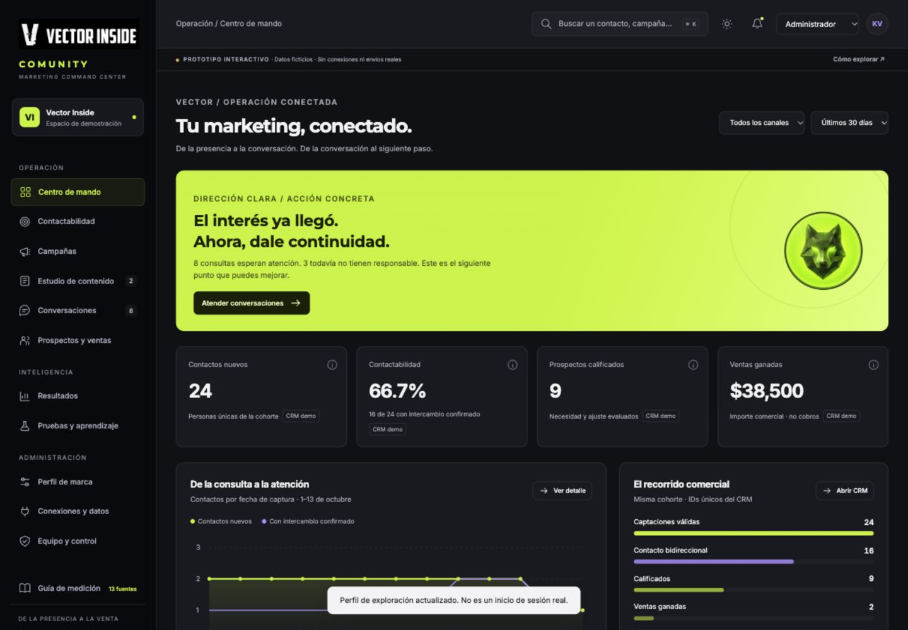
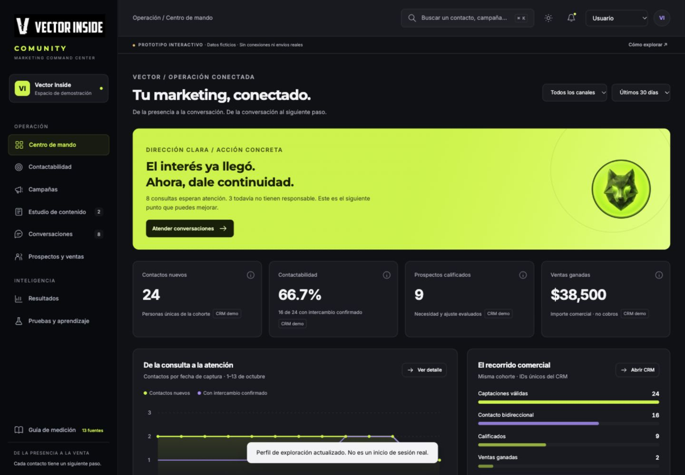
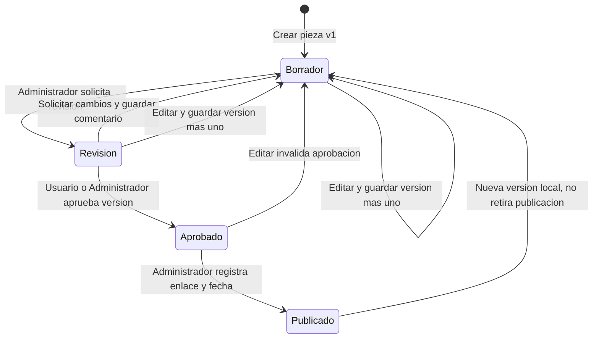
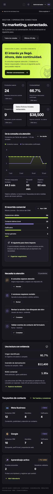
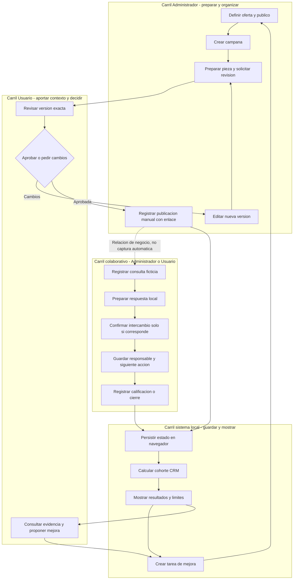
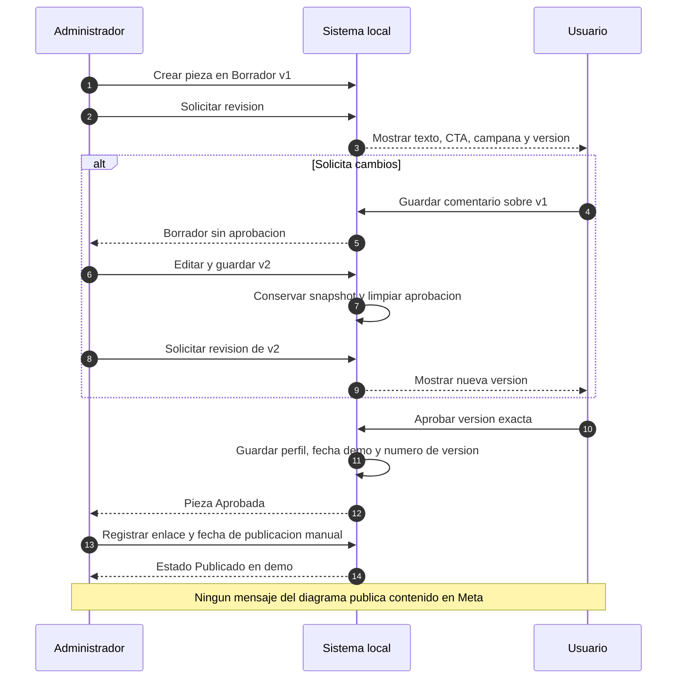
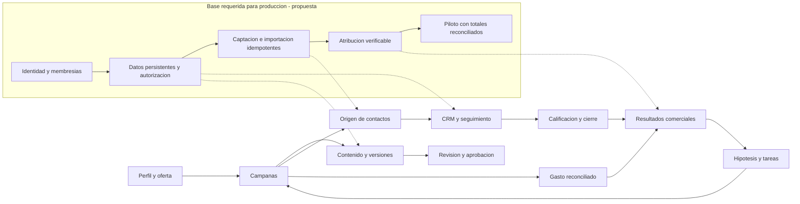
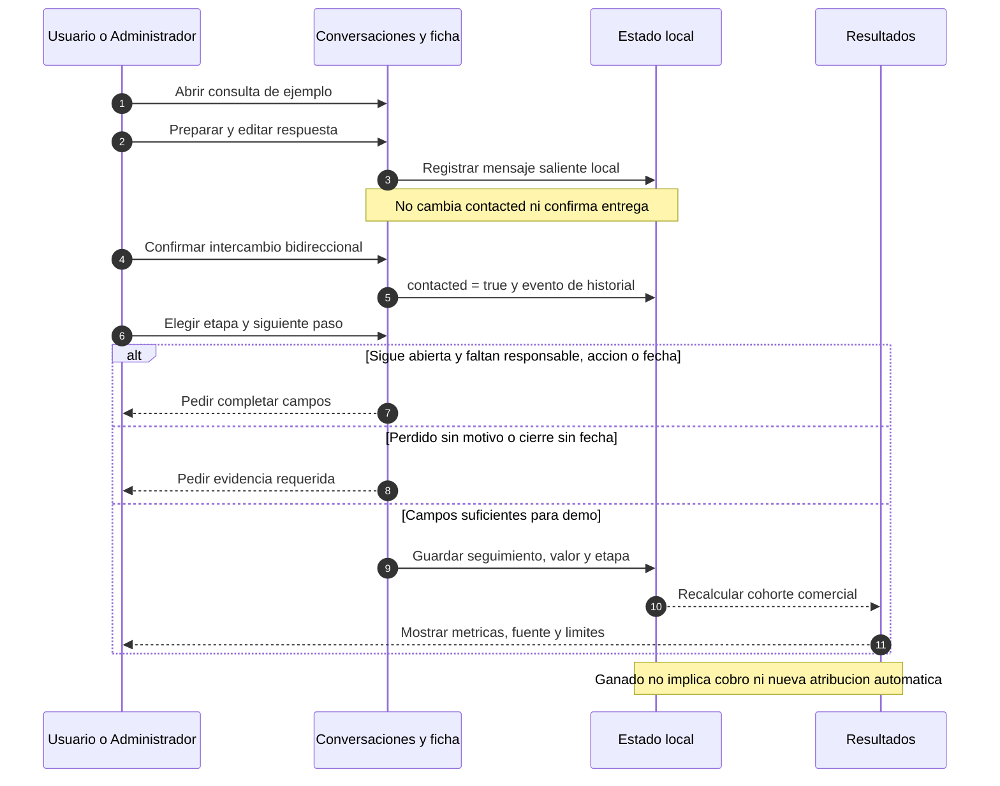
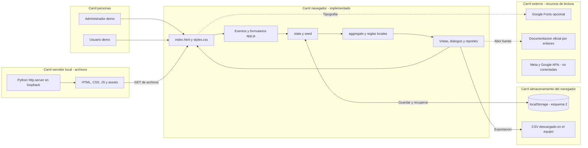
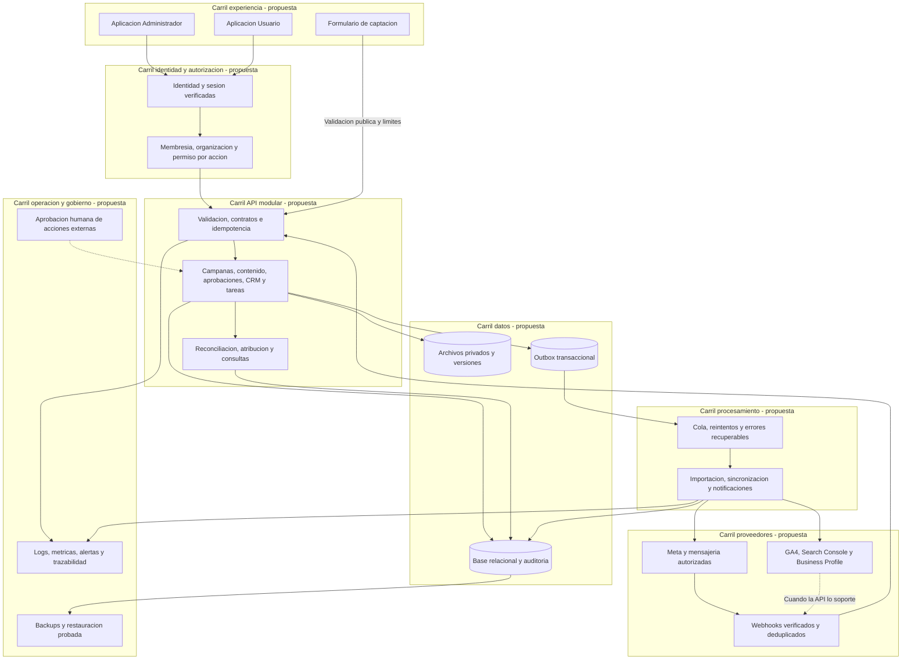

# VECTOR COMUNITY · Manual operativo, UX/UI y decisiones

**Vector Inside · Rama `UX/UI` · Manual v1.0 · 21 de octubre de 2026**

Este README es el manual central del prototipo que se revisó en localhost. Explica qué hace cada módulo, qué puede decidir cada perfil, cómo se calculan los indicadores y cómo se relacionan los procesos. Incluye diagramas de carriles, usuarios, dependencias y arquitectura.

**Estado:** prototipo interactivo v2, con datos ficticios, persistencia en el navegador y cero conexiones reales con Meta o Google. La arquitectura productiva se presenta expresamente como propuesta. El selector de perfiles sirve para explorar la experiencia; no constituye autenticación ni autorización segura.



## Índice

1. [Qué contiene esta rama y cómo abrirla](#inicio)
2. [Modelo de operación y vocabulario](#modelo)
3. [Perfiles y responsabilidades reales](#perfiles)
4. [Controles comunes, filtros y persistencia](#controles)
5. [Manual de los doce módulos](#modulos)
6. [Estados, validaciones y decisiones](#reglas)
7. [Diccionario de métricas y reconciliación](#metricas)
8. [Reglas UX/UI y lenguaje de marca](#uxui)
9. [Diagramas de carriles, usuarios y dependencias](#diagramas)
10. [Arquitectura actual y arquitectura propuesta](#arquitectura)
11. [Datos y trazabilidad técnica](#datos)
12. [Rutinas de trabajo y gobierno de decisiones](#rutinas)
13. [Límites conocidos y evolución](#limites)
14. [Pruebas, mantenimiento y fuentes](#validacion)

<a id="inicio"></a>
## 1. Qué contiene esta rama y cómo abrirla

### 1.1 Dos implementaciones diferentes dentro del mismo repositorio

El código Next.js que el equipo tenía en la raíz se conserva. La evolución visual de localhost se entrega de forma independiente en **[`prototypes/vector-comunity/dist/`](prototypes/vector-comunity/dist/)**. Este manual describe esa implementación estática, no atribuye sus funcionalidades a las pantallas anteriores de `src/`.

El README anterior se conserva en [README-ANTERIOR.md](docs/ux-ui/README-ANTERIOR.md). Los ADR históricos continúan en `docs/`; sus decisiones deben reconciliarse antes de implementar producción. Publicar este manual en `UX/UI` no modifica `main` ni convierte automáticamente los ADR o la arquitectura propuesta en decisiones aprobadas.

```text
README.md                            Manual central y diagramas integrados
prototypes/vector-comunity/dist/
  index.html                         Estructura, navegación y diálogo
  styles.css                         Identidad visual, temas y responsive
  app.js                             Datos demo, reglas, vistas y eventos
  assets/                            Logos e imagen del lobo aportados
docs/ux-ui/
  README-ANTERIOR.md                  Documentación previa conservada
  INVESTIGACION-METRICAS.md           Investigación Meta y Google
  DIRECCION-DE-MARCA.md               Narrativa y criterios visuales
  diagrams/*.mmd                     Fuentes editables de los diagramas
  evidence/                          Capturas de ambos perfiles y móvil
  INVENTARIO.json                    Huellas del prototipo entregado
scripts/verify-ux-ui.mjs              Verificación del contrato documentado
```

### 1.2 Inicio rápido desde la raíz del repositorio

Requisito para servir el prototipo: Python 3 y un navegador moderno con JavaScript. No requiere instalar los paquetes del frontend Next.js.

```bash
git clone --branch 'UX/UI' https://github.com/VectorInside/Vector-Community.git
cd Vector-Community
python3 -m http.server 4317 --bind 127.0.0.1 --directory prototypes/vector-comunity/dist
```

Abrir **[http://localhost:4317](http://localhost:4317)**. Si ese puerto está ocupado, usar otro puerto libre en el comando y en la URL. Para detener el servidor iniciado en una terminal, usar `Ctrl+C` en esa terminal.

Los comandos `npm run dev`, `npm run build` y `npm start` de la raíz siguen correspondiendo a la implementación Next.js previa. No son los comandos de este prototipo.

### 1.3 Preparación de la primera sesión

1. Entrar como **Administrador** con el selector superior.
2. Revisar el aviso de demostración y el periodo seleccionado.
3. Abrir **Cómo explorar** para conocer los recorridos.
4. Consultar **Perfil de marca** y el objetivo interno de respuesta.
5. Recorrer una conversación, su ficha CRM y una pieza en revisión.
6. Cambiar a **Usuario** para revisar la experiencia de colaboración.

No introducir información personal real: el ejercicio está diseñado con personas y empresas ficticias.

### 1.4 Fechas de la demostración

El manual se publica el **21 de octubre de 2026**, pero el conjunto de ejemplo está congelado al **13 de octubre de 2026**. El calendario muestra **13–19 de octubre**. Los rótulos «Últimos 7/30 días» representan ese escenario de prueba, no ventanas móviles calculadas respecto al día en que se abre la aplicación. Esta distinción es necesaria para interpretar los resultados.

<a id="modelo"></a>
## 2. Modelo de operación y vocabulario

### 2.1 Propósito

**Conectar estrategia, contenido y seguimiento para convertir la atención en conversaciones y oportunidades con un siguiente paso.** La marca aporta dirección; la interfaz debe permitir comprender la situación, consultar la evidencia y decidir una acción.

El recorrido de negocio propuesto es:

**Perfil de marca → oferta/campaña → pieza → distribución → intención de contacto → conversación → calificación → oportunidad → decisión comercial → aprendizaje.**

En el prototipo, las relaciones entre campañas, piezas y contactos permiten explorar ese recorrido. La distribución externa, la captura automática y la atribución real todavía no están implementadas.

### 2.2 Términos que no deben confundirse

| Término | Significado operativo | No significa |
|---|---|---|
| Alcance | Cuentas alcanzadas según la fuente y el ámbito | Personas únicas sumables entre redes |
| Intención de contacto | Clic al teléfono, WhatsApp u otro canal | Conversación confirmada |
| Captación/contacto | Persona registrada con una necesidad | Venta ni lead necesariamente calificado |
| Intercambio bidireccional | Hay comunicación de ambas partes confirmada | Solo un mensaje preparado o enviado |
| Calificado | Cumple criterios explícitos de necesidad y ajuste | Cualquier consulta, seguidor o comentario |
| Oportunidad | Necesidad comercial que requiere seguimiento | Identidad de la persona |
| Valor de pipeline | Importe estimado de oportunidades abiertas | Ingreso garantizado |
| Venta ganada | Decisión comercial registrada con importe y fecha | Cobro efectivo |
| Atribución | Crédito asignado con regla, ventana y evidencia | Demostración de causalidad |
| Hipótesis | Explicación que merece una prueba | Diagnóstico definitivo |

**Modelo actual:** cada elemento de `state.leads` reúne persona, empresa y una oportunidad. La frase de interfaz «una persona puede tener varias necesidades» expresa la dirección de producto; todavía no existe un flujo para crear varias oportunidades separadas para un mismo contacto. La arquitectura propuesta sí separa esas entidades.

### 2.3 Tres niveles de capacidad

| Nivel | Qué incluye | Cómo debe comunicarse |
|---|---|---|
| Implementado en demo | Formularios, estados, filtros, cálculos locales, versiones, CSV, tareas y reportes | «Guardado/registrado en esta demo» |
| Simulado o ilustrativo | Datos nativos Meta/Google, tiempos del fixture, crédito de atribución y mensajes de ejemplo | «Datos ficticios / fuente demo» |
| Propuesto para producción | Identidad, permisos en servidor, base persistente, APIs, eventos, workers y reconciliación real | «Arquitectura/contrato propuesto» |

<a id="perfiles"></a>
## 3. Perfiles y responsabilidades reales

Solo se contemplan dos perfiles. Ambos comparten un espacio de demostración de Vector Inside.

| Acción visible en el prototipo | Administrador | Usuario |
|---|:---:|:---:|
| Consultar Centro de mando, Contactabilidad y Resultados | Sí | Sí |
| Consultar campañas, piezas, CRM y conversaciones | Sí | Sí |
| Crear campaña «En preparación» | Sí | No |
| Proponer campaña con estado «Propuesta» | No mediante ese botón | Sí |
| Crear una pieza nueva en borrador | Sí | Sí |
| Editar una pieza existente y crear versión | Sí | No |
| Solicitar revisión de un borrador | Sí | No |
| Aprobar versión en revisión | Sí | Sí |
| Solicitar cambios a versión en revisión | Sí | Sí |
| Registrar publicación manual de pieza aprobada | Sí | No |
| Registrar contacto, seguimiento y decisión comercial | Sí | Sí |
| Preparar/registrar respuesta local y confirmar intercambio | Sí | Sí |
| Crear y completar tareas | Sí | Sí |
| Crear hipótesis y registrar aprendizaje | Sí | Sí |
| Usar UTM y exportar datos de demo | Sí | Sí |
| Editar checklist Google de Resultados | Sí | Sí |
| Configurar Perfil de marca | Sí | No |
| Consultar planes de conexión e importar CSV | Sí | No |
| Ver Equipo y control y restablecer la demo | Sí | No |

La tabla refleja los controles disponibles, no un diseño de seguridad productivo. El Usuario tiene más acciones de colaboración que un perfil de solo lectura; restringirlas en el producto real requiere una decisión explícita de negocio y autorización en servidor.

### Regla de colaboración recomendada

- **Administrador:** prepara el trabajo, organiza responsables, cuida datos, instrumentación y configuración.
- **Usuario:** aporta contexto, revisa entregables, aprueba o solicita cambios y colabora en decisiones de su espacio.
- Para evitar autoaprobaciones en producción puede exigirse que autor y aprobador sean distintos; **la demo no exige esa separación** y admite aprobación por Administrador.
- Cambiar el selector modifica el perfil de exploración y el menú. No inicia sesión, no verifica identidad y no concede permisos en Meta o Google.



<a id="controles"></a>
## 4. Controles comunes, filtros y persistencia

### 4.1 Navegación

La barra lateral agrupa **Operación**, **Inteligencia** y, para Administrador, **Administración**. El logotipo vuelve al Centro de mando. En móvil se abre un panel de navegación; puede cerrarse con su botón, con `Escape` o al elegir un módulo. Cerrado, queda fuera de la interacción de teclado mediante `inert`.

El botón de notificaciones dirige al Centro de mando. Su punto indica que existen contactos sin intercambio confirmado; no es una bandeja de notificaciones del servidor. Los contadores laterales muestran contactos pendientes y piezas en revisión de todo el conjunto, no el inventario total de tareas ni una consulta filtrada por periodo.

### 4.2 Búsqueda global y búsquedas locales

- Botón superior o `Ctrl+K` / `⌘K`: busca nombre, empresa y necesidad de contactos, y nombre de campañas.
- Devuelve hasta **5 contactos y 3 campañas**. No busca conversaciones completas, archivos, comentarios ni fuentes externas.
- Campañas tiene búsqueda local por nombre/oferta; CRM, por nombre/empresa/necesidad.
- La búsqueda global no aplica automáticamente los filtros locales de campaña/etapa. Los filtros y sus universos se deben comprobar antes de comparar resultados.

### 4.3 Alcance de los filtros

| Control | Efecto actual |
|---|---|
| Canal global | Filtra contactos por `source`: Meta, Google, Directo/referido o todos |
| Periodo global | Usa el fixture de 30 días o el corte fijo desde `2026-10-07` |
| CRM: etapa, campaña, búsqueda | Filtra la lista/pipeline mostrado, además del canal/periodo |
| KPI de cabecera CRM | Conservan canal/periodo; no se reducen por búsqueda, etapa o campaña local |
| Exportar contactos CRM | Exporta canal/periodo; no reproduce necesariamente el subconjunto visible por campaña/etapa/búsqueda |
| Estado de contenido | Filtra piezas y calendario por Borrador, Revisión, Aprobado o Publicado |
| Canal local de Campañas | Filtra tarjetas de campaña por Meta/Google, independientemente del filtro global |
| Resultados Meta | Usa contactos Meta y el periodo; muestra su selector nativo total/orgánico/pagado |
| Resultados Google | Usa el contexto de Google para el resumen comercial exportable; cada panel nativo declara su propio universo |
| Tabla de campañas en resultados | Muestra el gasto completo de las campañas; no se recorta al periodo resumido superior |

**Regla de decisión:** antes de concluir que una cifra no coincide, revisar cohorte, origen, filtros y si se está leyendo una muestra o un total. Las diferencias de alcance anteriores son límites del prototipo, no reglas recomendadas para una implementación final.

### 4.4 Guardado, temas y reinicio

- El estado se guarda en `localStorage`, clave `vector-comunity-prototype-v2`, esquema `2`.
- Se conservan contactos, piezas, campañas, mensajes, tareas, aprendizajes, checklist, perfil, tema y varias preferencias de vista.
- Las búsquedas y ciertos filtros locales viven solo en memoria. No asumir que todo filtro vuelve tras recargar.
- Si el esquema guardado no coincide o el JSON no puede leerse, se carga el fixture inicial. No hay migrador de versiones.
- Si falla la escritura, se avisa que los cambios siguen solo en la sesión. No hay copia de seguridad ni sincronización entre equipos.
- Un origen distinto —por ejemplo `localhost` frente a `127.0.0.1`, u otro puerto— tiene almacenamiento distinto. No es un error de recuperación del repositorio.
- **Equipo y control → Restablecer datos demo → Restablecer demo** recupera los datos ficticios iniciales. Esta acción no elimina archivos ni modifica GitHub o plataformas externas.
- El tema claro/oscuro modifica variables visuales. El tema oscuro es el inicio de la demo; la navegación mantiene la identidad de Vector Inside.

<a id="modulos"></a>
## 5. Manual de los doce módulos

### 5.1 Centro de mando

**Pregunta que responde:** ¿qué está pasando y cuál es el siguiente paso útil?

**Entradas:** contactos de la cohorte, campañas, piezas por revisar, tareas y objetivo interno de atención.

**Lectura y operación:**

1. Verificar canal y periodo.
2. Leer contactos nuevos, contactabilidad, calificados e importe de ventas ganadas.
3. Usar el botón informativo de una métrica para revisar definición y límite.
4. Abrir **Atender conversaciones** si existen consultas pendientes.
5. Consultar el gráfico: agrupa por fecha de captura, no por fecha de respuesta o cierre.
6. Revisar el recorrido comercial y las oportunidades sin próxima acción.
7. Entrar a piezas por revisar y completar tareas desde «Necesita tu atención».
8. Abrir Resultados para reconciliar inversión, crédito atribuido y ventas.

**Salida:** navegación al registro pertinente o tarea completada localmente. Completar una tarea no realiza automáticamente la acción externa que su título describe.

**Reglas y límites:** el contador de pendientes combina consultas sin intercambio y piezas en revisión; no suma todas las tareas. Se muestran hasta tres tareas incompletas. El objetivo de respuesta es una política interna editable, no un benchmark. El gráfico solo dibuja días de octubre del fixture; no es una serie histórica de producción.

**Decisión recomendada:** resolver asignación y seguimiento antes de concluir que hace falta más alcance o presupuesto.

### 5.2 Contactabilidad

**Pregunta:** ¿dónde se pierde la posibilidad de conversar y avanzar?

**Operación:**

1. Seleccionar canal y periodo.
2. Revisar el cociente entre intercambio bidireccional y captaciones válidas.
3. Contrastar calificación y cierres, sin confundirlos con atención.
4. Revisar primera respuesta humana, p90, cumplimiento del objetivo y falta de responsable.
5. Consultar los ejemplos de sesiones web, intención de contacto y sesiones con lead.
6. Convertir una recomendación en tarea: oferta/CTA, fricción del formulario, cobertura de atención o presencia Google.

**Qué registra:** tareas internas. No reconfigura horarios en Meta, llama a personas ni manda mensajes.

**Qué debe decidir el equipo:** si la dificultad es de descubrimiento, claridad de oferta, captura, datos, atención o seguimiento. Una observación puede tener varias explicaciones; el módulo propone trabajo, no demuestra por sí solo la causa.

**Límite:** las sesiones web y el factor de intenciones son valores ilustrativos; no provienen de Analytics. Los tiempos del fixture no se recalculan desde mensajes reales ni desde un calendario laboral. Confirmar intercambio en una ficha no inventa un tiempo de respuesta ausente.

### 5.3 Campañas

**Pregunta:** ¿qué queremos conseguir, para quién y con qué oferta?

**Consultar:** buscar por nombre/oferta, filtrar canal, abrir tarjeta y revisar objetivo, responsable, audiencia, hipótesis, periodo, presupuesto, gasto, piezas y contactos relacionados. **Ver oportunidades** abre CRM con el filtro de campaña indicado; quitar el filtro amplía el listado.

**Crear como Administrador:**

1. Elegir **Nueva campaña**.
2. Completar nombre, oferta, canal, objetivo, público, presupuesto e hipótesis.
3. Guardar. Queda **En preparación**, gasto cero y responsable de ejemplo Karloz.

**Crear como Usuario:** usar **Proponer una campaña**. Los mismos campos producen estado **Propuesta** y responsable «Usuario de marca».

**Campos y validación de interfaz:** nombre hasta 90 caracteres, oferta 400, público 180, hipótesis 300; presupuesto entre 0 y 10,000,000 MXN enteros; canal Meta/Google. La validación HTML y el recorte de espacios no sustituyen validación del servidor.

**Límites actuales:** fechas nuevas fijas 13–31 octubre 2026; no hay editor de fechas/gasto, activación/pausa ni aprobación de propuestas de campaña. Los estados «Activa» iniciales pertenecen al fixture, no confirman una campaña externa. Crear presupuesto no modifica una cuenta publicitaria.

**Decisión:** una campaña debe tener un aprendizaje esperado y una acción de contacto coherente antes de producir piezas.

### 5.4 Estudio de contenido

**Pregunta:** ¿qué pieza estamos preparando y qué versión puede aprobarse?

**Vistas:** Piezas y Calendario semanal fijo. El filtro de estado actúa en ambas. El calendario muestra fecha prevista, no una programación confirmada.

**Crear:** cualquier perfil puede abrir **Nueva pieza** y guardar Borrador. Completar nombre, gancho, texto, campaña, formato, canal, fecha y CTA. Formatos: Reel, Carrusel, Post o Story; canales: Instagram, Facebook o Web. Límites principales: nombre 100, gancho 160, texto 3,000 y CTA 180 caracteres.

**Revisar y aprobar:**

1. Administrador abre el borrador y elige **Solicitar revisión**.
2. Usuario o Administrador abre **Revisar versión**.
3. Verifica el texto, gancho, CTA, campaña, responsable y fecha de esa versión.
4. **Aprobar esta versión** guarda perfil del aprobador, fecha demo y número de versión.
5. **Solicitar cambios** exige un comentario, devuelve la misma versión a Borrador e invalida su aprobación.
6. Administrador usa **Editar / nueva versión** para guardar cambios: se conserva un snapshot anterior, aumenta el número, se borra la aprobación activa y el estado es Borrador.

**Publicar manualmente:** Administrador abre una pieza Aprobada y registra enlace HTTP(S) y fecha real en **Registrar publicación manual**. El estado pasa a Publicado. No se abre una conexión de publicación ni se verifica el enlace contra el proveedor.

**Asistencia:** **Preparar ideas** ofrece tres plantillas; elegir una rellena nombre y gancho en un nuevo borrador. No llama a un LLM y no adapta automáticamente todo el texto al perfil de marca.

**Decisión editorial:** aprobar una versión concreta. La aprobación no equivale a programar/publicar. Una versión posterior requiere otra revisión. Editar una pieza Publicada tampoco retira o altera la publicación externa: solo crea otro borrador local.

**Límite:** no hay carga de archivos audiovisuales, historial de versiones navegable, comparación visual de cambios, comentarios encadenados ni calendario mensual. Los snapshots existen en el estado local y el registro de actividad es limitado.

### 5.5 Conversaciones

**Pregunta:** ¿quién necesita atención y qué contexto debemos conservar?

**Orden:** contactos sin intercambio primero, después los confirmados. La lista se limita a doce hilos de ejemplo; CRM permite localizar los demás. No es una bandeja omnicanal conectada ni una consulta al Inbox real de Meta.

**Procedimiento:**

1. Elegir un hilo; revisar persona, empresa, necesidad, origen y responsable.
2. **Preparar respuesta** rellena una plantilla editable orientada a la necesidad.
3. Revisar el texto y usar **Registrar respuesta de prueba**.
4. Si no había responsable, el registro asigna Alexandra al Administrador o «Usuario de marca» al Usuario.
5. Abrir la ficha para asignar próximo paso y fecha.
6. Solo si corresponde en el ejercicio, registrar **Confirmar contacto bidireccional**.

**Cambios de estado:** guardar una respuesta añade un mensaje saliente local y un evento al historial. **No** cambia automáticamente `contacted` a verdadero, ni mueve etapa, ni rellena próxima acción. Confirmar intercambio marca `contacted=true`; no envía nada y no genera una duración inventada.

**Límite:** algunos mensajes entrantes se generan desde plantillas cuando no existe un hilo guardado. «Atendida» en la lista representa la bandera de contacto confirmado, no garantiza resolución integral. No hay entrega, lectura, SLA en vivo, notificaciones push ni transferencia real de bots.

**Decisión:** dar una respuesta pertinente y acordar continuidad; un borrador o una salida registrada no es prueba de que el prospecto haya respondido.

### 5.6 Prospectos y ventas — CRM

**Pregunta:** ¿qué oportunidad estamos trabajando y qué debe ocurrir después?

**Vistas:** Pipeline por etapas y Lista. Las tarjetas se abren con clic; **no hay drag-and-drop**. El cambio se realiza en la ficha y se guarda con sus campos.

**Registrar contacto:** nombre de ejemplo, empresa, necesidad, origen, responsable, siguiente acción, fecha y valor estimado. Queda Nuevo, fecha de captura fija del demo y sin campaña atribuida automáticamente. El alta manual no deduplica identidades.

**Guardar seguimiento:**

1. Abrir ficha.
2. Elegir responsable y etapa.
3. Registrar próxima acción, fecha, valor y nota si aporta contexto.
4. Si la etapa permanece abierta, deben existir responsable distinto de «Sin asignar», próxima acción y fecha.
5. Para Ganado/Perdido se requiere fecha de cierre; para Perdido, motivo.
6. Guardar. Se agrega al historial el cambio y el perfil que lo realizó.

**Valores:** Nuevo → Contactado → Calificado → Propuesta → Ganado / Perdido. Son la secuencia conceptual; la demo permite elegir directamente cualquier etapa y no obliga a recorrer todas. El valor puede ser cero si así se guarda: no se exige comprobante ni contrato.

**Calificación:** elegir Calificado, Propuesta o Ganado marca `qualified=true`. Esa bandera conserva el antecedente y no vuelve a falso solo por bajar de etapa. No hay un formulario BANT obligatorio ni marcas de tiempo de entrada a cada etapa suficientemente normalizadas para analítica productiva.

**Venta:** una ganada nueva no recibe crédito publicitario automáticamente; `attributedValue` queda cero. Al salir de Ganado se elimina su crédito. Si se edita el importe de una ganada que ya tiene crédito del fixture, no existe un motor que lo reconcilie: revisar explícitamente antes de interpretar el ROAS.

**Límites:** contacto y oportunidad comparten objeto; no hay ficha separada de empresa, cotizaciones versionadas, CRM externo, notificaciones de tareas, múltiples monedas, cobros ni adjuntos. El historial local no equivale a auditoría inmutable.

**Decisión:** mantener responsable y próxima acción para lo abierto, documentar por qué se ganó/perdió y conservar «Sin atribuir» cuando no exista evidencia.

### 5.7 Resultados

**Pregunta:** ¿qué ocurrió, con qué evidencia y qué decisión merece una revisión?

**Avance comercial:** inversión, costo por calificado atribuible, ventas ganadas, ROAS, recorrido, cierre de resueltas, abiertas y venta sin crédito atribuido. ROI queda No calculable porque no se declararon costos/margen.

**Meta Business:** selector Total nativo / Orgánico / Pagado; alcance, impresiones, CTR de enlace, frecuencia, guardados, compartidos y clics. Los contactos CRM «Todo Meta» conservan su universo de cohorte y no se recortan por ese filtro nativo. No sumar alcances como personas únicas ni tratar frecuencia/CTR como prueba definitiva de fatiga.

**Google y web:**

- Search Console: clics, CTR y muestra de consultas con impresiones/clics.
- Business Profile: clics para llamar y checklist propio de datos, verificación, horarios, servicios, fotos y reseñas.
- GA4: sesiones y plan de eventos del recorrido. `contact_intent` es un evento propio propuesto; los eventos recomendados de lead se documentan para integración futura.
- El checklist se guarda localmente. Marcar «verificado» no verifica un perfil ante Google ni mejora automáticamente su ranking.

**Calidad de datos:** proporción con campaña identificada, sin campaña, próximas acciones faltantes y estado de fuentes. **Campaña identificada no prueba atribución comercial válida.**

**Exportar reporte:** descarga un CSV comercial con periodo, canal, contactos, contactabilidad, calificados, inversión, ventas, crédito atribuido, ROAS e indisponibilidad de ROI. No descarga PDF, no exporta todo el detalle nativo de Meta/Google ni transmite el reporte.

**Decisión:** reconciliar antes de invertir, separar señal de causalidad y transformar una observación en revisión o tarea.

### 5.8 Pruebas y aprendizaje

**Pregunta:** ¿qué queremos aprender y con qué señal lo revisaremos?

Crear **Nueva hipótesis** con nombre, contexto, variante A, variante B y señal principal. Queda Por preparar y con datos cero. **Registrar aprendizaje** conserva una nota que puede actualizarse después. Las variantes y porcentajes iniciales son ficticios.

El módulo no reparte tráfico, ejecuta anuncios, calcula significación estadística ni declara un ganador. En la demo no se editan resultados experimentales desde un formulario. Las tarjetas de «clics sin contactos» o «consultas sin avance» permiten crear tareas de diagnóstico.

**Decisión:** formular una hipótesis comprobable, elegir una señal principal, revisar contexto y volumen, y registrar una siguiente prueba. Cambiar colores no equivale necesariamente a probar una propuesta distinta.

### 5.9 Perfil de marca — Administrador

**Pregunta:** ¿qué contexto debe orientar el trabajo y cómo habla la marca?

Editar nombre, sitio, oferta/narrativa, público, tono, CTA, objetivo, SLA interno y horario. Guardar persiste el perfil y registra actividad. El sitio admite HTTP(S); el objetivo de respuesta admite de 1 a 1,440 minutos.

El CTA se usa como valor inicial de nuevas piezas; el SLA cambia la lectura del cumplimiento. El enlace de referencia abre el sitio configurado. **Editar el perfil no reescribe campañas/piezas ya creadas, no cambia toda la identidad del encabezado y no entrena un agente.** Horario es un texto de contexto; todavía no configura un motor de horas hábiles.

**Decisión:** mantener una oferta comprensible, un CTA útil y un compromiso de respuesta viable para la capacidad real del equipo.

### 5.10 Conexiones y datos — Administrador

Seis planes: Meta Business Suite, GA4, Search Console, Business Profile, Captación web/CSV y Mensajería/WhatsApp.

**Ver plan de conexión** explica permisos y requisitos. **Crear tarea de integración** añade un pendiente. No ejecuta OAuth, almacena tokens ni comprueba un conector. El estado permanece **Sin conexión real**.

**Importar CSV local:**

1. Preparar UTF-8 separado por comas, hasta **500,000 bytes y 200 filas de datos**.
2. Incluir cabeceras `nombre,empresa,necesidad,origen`.
3. Usar origen `meta`, `google` o `direct`.
4. Seleccionar archivo y revisar válidas/rechazadas. La pantalla muestra hasta 30 filas de preview; el conteo incluye todas.
5. Confirmar filas válidas. Se asigna Karloz, etapa Nuevo, tarea «Revisar captación importada», fecha próxima 14 octubre 2026 y captura 13 octubre 2026.
6. Revisar en CRM y ajustar el seguimiento del ejercicio.

```csv
nombre,empresa,necesidad,origen
Contacto Ejemplo,Empresa Ejemplo,Página web,meta
Segunda Persona,Empresa Dos,Seguimiento comercial,google
```

**Errores:** comillas sin cerrar, cabeceras faltantes, límites excedidos, datos obligatorios incompletos, origen inválido y repetidos. La clave local es nombre+empresa en minúsculas; compara contra el estado y otras filas válidas del mismo archivo. Repetir el archivo después de importarlo evita esos duplicados por esa clave. **No es una política suficiente para producción**, no vincula automáticamente campañas y no importa inversión, mensajes ni archivos.

### 5.11 Equipo y control — Administrador

Describe los dos perfiles y muestra hasta catorce eventos recientes. El estado conserva como máximo treinta entradas en `audit`. No hay invitaciones, gestión real de usuarios, contraseñas, desactivación ni permisos de cuentas externas.

Restablecer muestra una confirmación dentro de la app. Confirmar reemplaza el estado local por `seed()`, vuelve a Administrador/tema oscuro/vista inicial y recupera el fixture. Antes de reiniciar puede exportarse un CSV, pero **ese CSV no restaura conversaciones, contenido, aprobaciones o tareas**; no es un backup completo.

**Decisión:** usar el registro para revisar el ejercicio, sin presentarlo como auditoría de producción o prueba de identidad del actor.

### 5.12 Guía de medición

Reúne prácticas, definiciones y trece enlaces oficiales de Meta y Google. Los botones de métricas explican fórmula, fuente prevista y limitaciones. Abrir una fuente navega a documentación externa; no vincula una cuenta.

La investigación se conserva en [INVESTIGACION-METRICAS.md](docs/ux-ui/INVESTIGACION-METRICAS.md). La fecha de consulta es 13 octubre 2026; su publicación en este manual no equivale a una nueva verificación de capacidades/permisos de cada API el 21 de octubre.

**Decisión:** consultar definición y evidencia antes de comparar fuentes o establecer objetivos.

<a id="reglas"></a>
## 6. Estados, validaciones y decisiones

### 6.1 Contenido: contrato implementado

| Evento | Estado previo | Estado posterior | Efecto |
|---|---|---|---|
| Guardar pieza nueva | No existe | Borrador v1 | Registra campos, campaña y propietario demo |
| Solicitar revisión | Borrador | Revisión | Mismo número de versión; Administrador |
| Aprobar | Revisión | Aprobado | Perfil, fecha demo y versión exacta |
| Solicitar cambios | Revisión | Borrador | Guarda comentario; misma versión, sin aprobación |
| Guardar edición | Cualquier estado existente | Borrador v+1 | Snapshot anterior, aprobación nula y comentario activo limpio |
| Registrar enlace/fecha | Aprobado | Publicado | Registro manual; Administrador; sin envío |



### 6.2 CRM y seguimiento: contrato implementado

| Condición al guardar | Regla de demo | Decisión operativa |
|---|---|---|
| Etapa abierta | Responsable, acción y fecha obligatorios | No dejar una oportunidad sin continuidad |
| Perdido | Motivo y fecha de cierre | Aprender de la razón, no inventarla |
| Ganado | Fecha de cierre; importe numérico no negativo | Separar acuerdo de cobro; validar evidencia fuera de demo |
| Mensaje saliente local | No confirma intercambio | Esperar/registrar respuesta bidireccional |
| Confirmar contacto | Cambia bandera, no etapa ni tiempo | Confirmar solo cuando exista evidencia |
| Entrada a Calificado/Propuesta/Ganado | Activa antecedente `qualified` | No confundir antecedente con etapa actual |
| Nueva venta ganada | Crédito atribuido cero | Conservar sin atribuir hasta reconciliar |
| Reabrir o perder una ganada | Crédito atribuido cero | Revisar efecto en reportes |

El formulario no valida un orden secuencial de etapas ni fuerza una próxima acción futura respecto a la fecha actual. Esas reglas necesitan decisión y pruebas en la evolución productiva.

### 6.3 Recomendaciones, tareas y experimentos

Una recomendación es un texto de regla/plantilla local. **Crear tarea** conserva título, propietario según perfil, tipo y estado incompleto. Si ya existe una tarea incompleta con el mismo título exacto, no crea otra. Si la anterior está completada, puede generarse otra igual. **Completar** cambia su bandera, sin ejecutar el contenido de la tarea.

La cadena deseada para producción es: **observación → datos y periodo → hipótesis → alternativas → prueba/acción → responsable → revisión → aprendizaje**. La demo permite explorar partes de esa cadena; no posee un motor autónomo de diagnóstico ni un planificador de campañas externas.

<a id="metricas"></a>
## 7. Diccionario de métricas y reconciliación

### 7.1 Métricas comerciales calculadas desde el estado

| Métrica | Cálculo o condición implementada | Límite de interpretación |
|---|---|---|
| Contactos nuevos | Cantidad de `leads` de canal/periodo | Alta manual no deduplica; una identidad por objeto del fixture |
| Contactabilidad | `contacted=true` / contactos de cohorte ×100 | Bandera confirmada manualmente, no acuse de mensaje |
| Pendientes de contacto | `contacted=false` | No mide por sí sola demora ni resolución del caso |
| Calificados | `qualified=true` de cohorte | Antecedente persistente, no solo etapa actual |
| Calificados atribuibles usados en CPQL | Calificados que tienen `campaign` | Vínculo de fixture, no prueba real de atribución |
| Costo por calificado | Gasto / calificados con campaña | Solo calculable con denominador positivo |
| Pipeline | Suma de `value` de etapas distintas de Ganado/Perdido | Valor estimado; no venta |
| Ventas ganadas | Suma de `value` donde etapa=Ganado | Cohorte por captura, no reporte de cobros/fecha de cierre |
| Cierre de resueltas | Ganadas / (ganadas+perdidas) ×100 | Abiertas aparte; misma cohorte |
| Venta atribuida | Suma de `attributedValue` de ganadas | Crédito del fixture/manual, no motor de atribución |
| ROAS comercial | Venta atribuida / gasto | No ROI, causalidad, utilidad ni cobro |
| Sin crédito atribuido | Venta ganada menos crédito atribuido | No inventar crédito para completar el total |
| Origen con campaña | Contactos con campo `campaign` / contactos | No equivale a atribución validada |
| Mediana de respuesta | Mediana de valores numéricos `responseMinutes` | No computa mensajes ni horario real |
| P90 | Valor ordenado en posición `ceil(n×0.9)` | Método nearest-rank, no interpolación |
| Cumplimiento de atención | Respuestas numéricas ≤ SLA / contactos elegibles del fixture | Supone cohorte madura; pendientes incluidos |
| ROI | No calculable | Faltan costos o margen declarado |

`pct()` devuelve **No calculable** con denominador cero. Algunas tarjetas usan «Sin datos», «N/C» o «Sin base» según el contexto. La evolución debe normalizar estos estados sin convertir ausencia de datos en cero.

### 7.2 Fuentes nativas y eventos propuestos

| Fuente | Lectura | Precaución |
|---|---|---|
| Meta | Alcance, impresiones, frecuencia, CTR, clics, guardados y compartidos | Total/orgánico/pagado son lecturas de ejemplo; alcance no se suma como personas únicas |
| Search Console | Clics, impresiones, CTR y consultas/páginas | La muestra de consultas no suma todo el total nativo |
| Business Profile | Clic para llamar y acciones del perfil | No acredita llamada conectada, atendida ni venta |
| GA4 | Sesiones y eventos de contacto/lead | Usuarios de Analytics no son IDs únicos del CRM |
| CRM | Contacto, calificación, oportunidad y cierre | Fuente de la decisión comercial, no reemplaza costos/conciliación |

Plan de eventos: `contact_intent` personalizado para intención; `generate_lead` para captura confirmada; `working_lead` para inicio de gestión según contrato; `qualify_lead` para calificación; `close_convert_lead` para conversión a cliente. Son **un plan de instrumentación**, no eventos que este prototipo envíe a Google.

Fuente oficial de eventos: [Google Analytics — eventos recomendados](https://developers.google.com/analytics/devguides/collection/ga4/reference/events). La denominación de clics para llamar se apoya en [Google Business Profile — rendimiento](https://support.google.com/business/answer/9918094?hl=es).

### 7.3 Conjunto de reconciliación inicial

Restablecer demo, elegir Todos los canales y 30 días:

| Control | Valor esperado |
|---|---:|
| Contactos | 24 |
| Intercambio confirmado | 16 |
| Contactabilidad | 66.7% |
| Pendientes de intercambio | 8 |
| Sin responsable | 3 |
| Calificados | 9 |
| Calificados con campaña | 8 |
| Oportunidades abiertas | 20 |
| Sin próxima acción abierta | 5 |
| Pipeline estimado | $330,000 MXN |
| Ganadas / perdidas | 2 / 2 |
| Cierre de resueltas | 50.0% |
| Gasto | $12,400 MXN |
| CPQL | $1,550 MXN |
| Venta ganada | $38,500 MXN |
| Crédito atribuido | $16,800 MXN |
| Venta sin crédito atribuido | $21,700 MXN |
| ROAS | 1.35x |
| Mediana / p90 | 44.5 / 90 minutos |
| Cumplimiento de SLA de 60 min | 10/24 = 41.7% |

En 7 días: 12 contactos, gasto $6,700, 2 calificados con campaña, CPQL $3,350 y ROAS 2.51x. Son resultados del fixture y no rendimiento demostrado de Vector Inside. Cambiar el perfil no cambia este conjunto; editar contactos o gasto de origen sí puede alterar sus cálculos.

### 7.4 Qué no se calcula dinámicamente

El gasto de 7 días está codificado para dos campañas: $2,800 web y $3,900 social. Las tarjetas Meta/Google usan cifras ilustrativas y factores fijos; en varios paneles se aplica `0.28` para 7 días. No hay consulta histórica ni unión real de identidades. El crédito atribuido del fixture tampoco recalcula una ventana de 30 días, aunque esa sea la regla propuesta descrita en el perfil.

**Regla de toma de decisiones:** usar estas cifras para evaluar comprensión y coherencia de la interfaz. No utilizarlas para contratar pauta, declarar rentabilidad o acreditar una integración.

<a id="uxui"></a>
## 8. Reglas UX/UI y lenguaje de marca

### 8.1 Principios de experiencia

| ID | Regla | Aplicación actual | Criterio de aceptación para evolución |
|---|---|---|---|
| UX-01 | Empezar por la siguiente acción | Consultas y revisión editorial en Centro de mando | El usuario identifica una prioridad y abre su contexto |
| UX-02 | Mantener relación entre módulos | Campaña → pieza/contacto → ficha | No perder campaña, filtros ni estado al volver |
| UX-03 | Una decisión dominante por contexto | Aprobar versión, guardar seguimiento, crear tarea | El botón expresa qué cambia |
| UX-04 | Explicar la métrica | Botón informativo, fuente y nota | Fórmula, periodo, unidad y base disponibles |
| UX-05 | No simular éxito real | «Respuesta de prueba», «Sin conexión real» | Fallo externo nunca termina en éxito inventado |
| UX-06 | Revelar detalles al necesitarlos | Fichas y diálogos | Operación accesible sin jerga técnica |
| UX-07 | Formularios acotados | Campos básicos y guardado explícito | Error específico, datos conservados y foco útil |
| UX-08 | Separar confirmado/estimado/ausente | Valor de pipeline, venta, ROAS e indisponibilidad de ROI | No usar cero para dato desconocido |
| UX-09 | Color acompañado de texto | Estados etiquetados e iconos | El significado sobrevive sin color |
| UX-10 | Personas antes que automatización | Respuestas editables y aprobación humana | No ejecutar nuevos compromisos sin autorización |

### 8.2 Identidad visual implementada

La iteración usa los logos aportados por el propietario y la inspiración del sitio Vector Inside: negro, lima y acentos morados/azules. Esto reemplaza la propuesta visual anterior carbón/dorado para esta evolución, conforme al pedido de usar la marca actual. No se presenta como una nueva edición oficial del manual corporativo.

| Token | Oscuro | Claro | Uso |
|---|---|---|---|
| Fondo | `#101114` | `#F5F5F8` | Lienzo de trabajo |
| Panel | `#191A1F` | `#FFFFFF` | Tarjetas, tablas y fichas |
| Superficie secundaria | `#202127` | `#F1F2F6` | Agrupación y controles |
| Texto principal | `#F3F3F5` | `#21232B` | Lectura |
| Texto secundario | `#A4A6B2` | `#666C7A` | Contexto |
| Acción lima | `#C3F400` | `#C3F400` | CTA principal con texto oscuro |
| Texto lima | `#D4FB52` | `#506500` | Enlaces/acentos legibles |
| Morado | `#AA8BFB` | `#7753CB` | Asistencia/contexto |
| Azul | `#80B8FF` | `#326FAF` | Datos/apoyo |
| Verde | `#72D4AE` | `#237E5D` | Estado favorable con etiqueta |
| Rojo | `#FF9699` | `#BD3949` | Error/pérdida con texto |
| Ámbar | `#F0B66B` | `#956016` | Revisión/pendiente |

La navegación usa negro `#090A0D`; el sitio de inspiración emplea negro cercano a `#080808`. Las diferencias de superficies responden a la legibilidad de una herramienta de trabajo.

Tipografías: **Inter** para UI y **Montserrat** para titulares, con alternativas del sistema. El CSS solicita Google Fonts; si no hay red se mantiene funcionalidad con fallback. Conservar proporción de logos; no redibujar la V, sustituir su palabra ni usar la mascota como único indicador de estado.

### 8.3 Lenguaje

- Voz estratégica, cercana y concreta: «dirección», «siguiente paso», «evidencia», «oportunidad», «revisar» y «aprender».
- «Registrar respuesta de prueba» describe lo que realmente ocurre; «enviado a WhatsApp» sería incorrecto aquí.
- «Venta ganada» no se renombra «ingreso cobrado».
- «No calculable» explica una base insuficiente, no un mal desempeño.
- Los nombres de navegación evitan depender de HITL, RAG, agentes o nombres internos de modelos.
- El asistente contextual explica una tarea y propone un borrador. No promete autonomía, un porcentaje de mejora ni una causa demostrada.

### 8.4 Responsive, interacción y accesibilidad

- Escritorio: sidebar 248 px; hasta 1,000 px se reduce a 210 px; en 760 px o menos se transforma en drawer.
- KPI: cuatro columnas amplias, dos en anchos menores; paneles de lectura se apilan.
- Campañas/contenido/conexiones pasan de tres a dos y luego una columna.
- Tablas, pipeline y calendario pueden tener desplazamiento horizontal **dentro de su contenedor**, no desbordar toda la página.
- Diálogos usan `<dialog>`, nombre accesible y cierre con botón/Escape. Formularios tienen etiquetas; hay enlace de salto al contenido y foco visible.
- Tras cambiar módulo, el foco pasa al contenido principal. Al cerrar navegación, vuelve al botón cuando corresponde.
- Se respeta `prefers-reduced-motion`. El gráfico adapta su ancho al viewport.

**Objetivo de producción:** WCAG 2.2 AA, controles táctiles cómodos, errores asociados al campo, manejo de teclado consistente y validación de contraste. El prototipo contiene textos secundarios de 9–12 px y controles compactos; no se certifica que ya cumpla ese objetivo. Las pestañas de resultados funcionan con botones, pero todavía requieren completar el patrón de flechas/roving focus esperado para un tablist accesible.



<a id="diagramas"></a>
## 9. Diagramas de carriles, usuarios y dependencias

Los diagramas siguientes están integrados en el README y sus fuentes `.mmd` se conservan en [docs/ux-ui/diagrams](docs/ux-ui/diagrams). Se usan carriles Mermaid por responsable/capa; no son archivos BPMN ejecutables ni contratos de API aprobados.

### 9.1 D01 · Carriles operativos de extremo a extremo

Cada carril representa quién prepara o registra la acción en la demo. La «respuesta» es registro local; la distribución/atención externa real queda fuera del diagrama ejecutado.



### 9.2 D02 · Carriles de usuarios y revisión editorial

La demo también permite que el Administrador apruebe. Se ilustra la separación autor/revisor recomendada, sin afirmar que esté forzada.



### 9.3 D03 · Dependencias funcionales y de evolución

Las flechas indican prerrequisito lógico. No son llamadas que el prototipo ya haga a un backend.



El bucle Resultados → aprendizaje → Campañas expresa mejora continua; el orden de construcción de producción sigue los nodos de su carril inferior, sin usar ese bucle como una dependencia de instalación.

### 9.4 D04 · Carriles de contacto y decisión comercial



<a id="arquitectura"></a>
## 10. Arquitectura actual y arquitectura propuesta

### 10.1 D05 · Diagrama de carriles de arquitectura actual

Esta es la arquitectura **implementada** del prototipo entregado. El servidor HTTP solo entrega archivos; no recibe operaciones de negocio.



No existe flecha de negocio hacia las APIs porque esa conexión no está implementada. El JSON local es manipulable; no sirve como autorización, auditoría segura ni almacenamiento multiempresa.

### 10.2 D06 · Carriles de arquitectura productiva propuesta

No es una selección aprobada de proveedor, stack, costo ni despliegue. Un monolito modular con procesamiento asíncrono cuando se necesite permite empezar sin microservicios prematuros. Si el equipo conserva Spring/Python de los ADR previos, debe justificar el alcance y los límites equivalentes; este diagrama no exige reemplazarlos por una tecnología concreta.



**Lectura:** el servidor determina organización y permisos; el navegador no los impone. Los cambios que disparan trabajos usan outbox para no perder el evento. Cada consumidor es idempotente y recuperable. Las capacidades de cada API se verifican por cuenta/proveedor: el diagrama no afirma que todas tengan webhooks o mensajería equivalente.

### 10.3 Criterios técnicos antes del piloto productivo

1. Sesión real, membresías y autorización por recurso/acción, también en exportaciones y archivos.
2. Separar contactos, oportunidades, eventos de etapa y personas de identidad global.
3. Restricciones de organización y pruebas con dos espacios, aunque el primer uso sea interno.
4. Versiones aprobadas conservadas; cambios exigen nueva revisión.
5. Capturas, importaciones y eventos externos repetidos no duplican efectos.
6. Inversión y ventas reconciliadas con fuente, moneda, periodo y modelo visible.
7. Secretos del lado del servidor; archivos privados, límites y validación.
8. Errores sin éxito ficticio, recuperación operativa y observabilidad.
9. Backup restaurado en entorno separado con resultado documentado.
10. Pruebas con ambos perfiles y recorridos móviles/teclado; no heredar permisos del selector demo.

<a id="datos"></a>
## 11. Datos y trazabilidad técnica

### 11.1 Objetos del estado actual

| Objeto | Campos relevantes | Relaciones y observaciones |
|---|---|---|
| `profile` | Oferta, público, tono, CTA, SLA, horario, sitio | Contexto local; no proveedor de identidad |
| `campaigns[]` | ID, oferta, objetivo, canal, presupuesto, gasto, propietario, fechas, hipótesis | Relaciona piezas/contactos por ID |
| `posts[]` | Campaña, título, gancho, copy, CTA, formato, canal, fecha, estado, versión, aprobación | Puede incluir snapshots, feedback y enlace publicado |
| `leads[]` | Persona, empresa, necesidad, origen, campaña, etapa, responsable, valor, siguiente acción, fechas, flags e historial | Fusiona contacto y oportunidad |
| `messages` | Diccionario por ID de lead; texto, dirección y etiqueta de tiempo | Contenido solo local |
| `tasks[]` | Título, propietario, tipo, completada | Sin vencimiento/recordatorio asíncrono implementado |
| `experiments[]` | Hipótesis, variantes, señal, sesiones/calificados de ejemplo, aprendizaje | Sin asignación ni motor estadístico |
| `googleChecks[]` | Seis booleanos | Checklist propio, no verificación de Google |
| `audit[]` | Texto y hora de actividad | Máximo 30; no inmutable |
| Preferencias | Perfil, tema, periodo, canal, vista y modos | Parte del mismo estado local |

### 11.2 Mapa de implementación

| Área | Funciones principales de [`app.js`](prototypes/vector-comunity/dist/app.js) |
|---|---|
| Inicialización/persistencia | `seed`, `save`, `log`, `render`, `navigate` |
| Cálculos | `filteredLeads`, `activeCampaigns`, `aggregate`, `pct` |
| Centro de mando | `overview`, `chart`, `funnel` |
| Contactabilidad | `contactability` |
| Campañas | `campaigns`, `campaignDetail`, `campaignForm` |
| Editorial | `content`, `calendar`, `postDetail`, `postForm`, `changesPost`, `publishPost`, `ideas` |
| Conversaciones/CRM | `inbox`, `crm`, `leadTable`, `leadDetail`, `leadForm` y evento de respuesta |
| Resultados | `results`, `businessResults`, `metaResults`, `googleResults`, `qualityResults` |
| Aprendizaje | `lab`, `newExperiment`, `createTask` |
| Administración | `profile`, `connections`, `team`, `importDialog` |
| Utilidades | `utmBuilder`, `searchDialog`, `exportCSV`, `csvCell`, `parseCSV`, `metricDetail` |
| Accesibilidad visual | `syncSidebar`, diálogos nativos, estilos `focus-visible` y media queries |

Los eventos se delegan desde `document` mediante atributos `data-*`. Las vistas se reconstruyen con plantillas; no hay router de servidor, React ni API de aplicación en esta carpeta. El escape `esc()` protege la inserción de texto en las plantillas; eso no convierte el navegador en una frontera de seguridad.

### 11.3 Exportación e importación

CSV exportado: UTF-8 con BOM, celdas entre comillas, comillas internas duplicadas, filas CRLF. Si una celda comienza —tras espacios— con `=`, `+`, `@` o `-`, se antepone apóstrofo para mitigar fórmulas al abrirla en una hoja de cálculo. El archivo se genera con Blob y se descarga en el equipo.

El importador admite comas, saltos de línea y campos entrecomillados; no ofrece mapeo configurable de columnas ni importación completa de un backup. No se deben usar sus validaciones sencillas como política definitiva de saneamiento y deduplicación.

<a id="rutinas"></a>
## 12. Rutinas de trabajo y gobierno de decisiones

Las siguientes son **rutinas propuestas**, no automatizaciones ya programadas.

### 12.1 Apertura diaria

1. Revisar pendientes y filtros del Centro de mando.
2. Asignar consultas sin responsable y revisar la cola de contacto.
3. Comprobar las versiones que necesitan revisión.
4. Registrar siguiente acción y fecha en las oportunidades abiertas.
5. Revisar fallos/datos ausentes antes de atribuirlos a desempeño.

### 12.2 Revisión editorial

Administrador comprueba oferta, objetivo, prueba, CTA, formato, fecha y responsable. Usuario revisa la versión exacta y responde con aprobación o un cambio concreto. Al editar, se abre otra revisión; la publicación se registra por separado.

### 12.3 Revisión semanal de resultados

1. Acordar periodo y cohortes comparables.
2. Verificar cobertura de fuentes y calidad de registros.
3. Revisar atención y calificación, además de alcance/clics.
4. Reconciliar gasto, ganadas y crédito de atribución.
5. Elegir una hipótesis que tenga una señal revisable.
6. Crear tarea con responsable; registrar el aprendizaje sin prometer causalidad.

### 12.4 Matriz de decisión

| Observación | Revisar primero | Decisión posible | Evitar |
|---|---|---|---|
| Alcance sin intenciones | Oferta, pertinencia, CTA y ruta de contacto | Probar mensaje/ruta | Pedir publicaciones sin hipótesis |
| Clics sin capturas | Formulario, página, medición y promesa | Prueba de fricción | Llamar lead a cada clic |
| Contactos sin intercambio | Datos, horario, cobertura y responsable | Priorizar atención | Contar envío como contacto exitoso |
| Muchos contactos poco calificados | Público, oferta y criterio comercial | Ajustar preguntas/mensaje | Rechazar calidad por un único indicador |
| Calificados sin siguiente paso | Responsable, contexto y acción acordada | Tarea comercial | Culpar automáticamente al contenido |
| Frecuencia sube y CTR baja | Audiencia, creativo, periodo y resultados | Prueba controlada | Declarar fatiga por un umbral universal |
| Venta con origen incompleto | Historial y vínculos de campaña | Reconciliar o dejar sin atribuir | Inventar crédito |
| ROAS alto con margen desconocido | Costos y base de ingresos | Pedir datos antes de concluir rentabilidad | Presentar ROAS como ROI |
| Fuente sin permiso/desactualizada | Estado de conector y fecha | Recuperar medición | Interpretar ausencia como caída real |

### 12.5 Gobierno del cambio

| ID | Decisión o criterio | Estado |
|---|---|---|
| DEC-01 | Mantener solo Administrador y Usuario en esta iteración | Solicitud expresa del propietario |
| DEC-02 | Usar narrativa, logos y colores de Vector Inside | Solicitud expresa del propietario |
| DEC-03 | Mantener el prototipo en localhost con datos demo | Alcance entregado |
| DEC-04 | Manual y prototipo en rama `UX/UI` | Solicitud expresa del propietario |
| DEC-05 | Confirmar contacto, atribución y publicación por evidencia | Criterio operativo; parcialmente explorado en demo |
| DEC-06 | Regla última interacción identificable / 30 días | Propuesta; no motor implementado ni aprobación final de negocio |
| DEC-07 | SLA inicial 60 minutos hábiles | Política de ejemplo editable; validar con capacidad |
| DEC-08 | Separar autor y aprobador en producción | Propuesta pendiente; no obligatoria en demo |
| DEC-09 | Stack y arquitectura de producción | Pendiente de reconciliar con equipo/ADR |
| DEC-10 | Activar acciones externas, clientes y canales | Futuro alcance; requiere permisos y validación específicos |

Registrar en cada cambio relevante: fecha, autor/rol, problema, decisión, evidencia, impacto en alcance/datos/permisos y estado de aprobación. La implementación no sustituye una decisión explícita del propietario.

<a id="limites"></a>
## 13. Límites conocidos y evolución

| Área | Límite actual | Qué requiere producción |
|---|---|---|
| Identidad/permisos | Selector local; un solo espacio | Sesiones, membresías, autorización y aislamiento en servidor |
| Fechas | Fixture fijo; filtro 30 no aplica rango inferior y 7 solo corte desde 7 octubre | Rango completo, zona horaria, calendario laboral y cohortes |
| Estado | localStorage manipulable, sin sincronización ni migraciones | Base persistente, contratos, auditoría y respaldo |
| Contactos | Persona/oportunidad fusionadas y deduplicación limitada | Identidad normalizada y oportunidades independientes |
| Calificación | Flag persistente, sin eventos de etapa normalizados | Criterios, historial estructurado y cohortes de transición |
| Editorial | Versiones locales; sin archivos ni comparación navegable | Objetos privados, revisión inmutable y prueba de aprobación |
| Mensajería | Registro local sin delivery/lectura | Proveedor autorizado, webhooks y estado verificable |
| Inversión/atribución | Importes y crédito de fixture | Registros de gasto, reconciliación e historial de regla |
| Filtros/exportación | Alcances diferentes entre KPI/lista/CSV | Contrato único y resumen explícito del alcance exportado |
| Conexiones | Planes informativos, cero cuentas reales | OAuth/permisos mínimos, secretos y recuperación |
| Asistencia | Plantillas, sin LLM | Contexto autorizado, evidencia y límites de ejecución |
| Tareas | Flags sin fecha/reintento/notificación | Vencimiento, recordatorios, responsables y jobs |
| Experimentos | Sin asignación/volumen/estadística | Instrumentación y criterio de decisión validado |
| Accesibilidad | Revisión funcional parcial | Evaluación AA y correcciones verificadas |

**Orden recomendado:** validar tareas de ambos perfiles → identidad/datos/autorización → CRM/campañas/contenido persistentes → captura/importación/gasto → atribución/reportes reconciliados → una integración real por flujo prioritario → automatización supervisada → extensión controlada a clientes.

No se incluyen facturación, cobros, ejecución de presupuestos o envíos autónomos como requisito de este manual. Ampliarlos requiere una decisión de alcance separada.

<a id="validacion"></a>
## 14. Pruebas, mantenimiento y fuentes

### 14.1 Verificación reproducible del contrato documentado

Con Node.js instalado, desde la raíz:

```bash
node --check prototypes/vector-comunity/dist/app.js
node scripts/verify-ux-ui.mjs
```

El verificador usa el código real del prototipo para comprobar fixture, filtros, calificados con campaña, inversión, ventas, atribución, mediana/p90 y CSV. Además revisa enlaces Markdown locales, igualdad de diagramas README/`.mmd` y huellas del contenido entregado. No reemplaza pruebas de navegador ni valida APIs inexistentes.

El detalle de lo comprobado en esta publicación está en [VERIFICACION.md](docs/ux-ui/VERIFICACION.md).

### 14.2 Casos de aceptación manual

| Caso | Procedimiento | Resultado esperado |
|---|---|---|
| QA-01 | Restablecer y consultar todos/30 | Totales de sección 7.3 |
| QA-02 | Cambiar a 7 días y canal | Cohorte/gasto cambian según fixture |
| QA-03 | Usuario aprueba v2, Administrador edita | Borrador v3 sin aprobación activa |
| QA-04 | Solicitar cambios con comentario | Borrador de misma versión y feedback visible |
| QA-05 | Registrar respuesta de prueba | Mensaje local, sin entrega ni contacto confirmado automático |
| QA-06 | Guardar abierta sin responsable/acción/fecha | Se solicita completar; no éxito |
| QA-07 | Guardar Perdido sin motivo | Error de validación |
| QA-08 | Guardar nueva Ganada | Fecha/valor; crédito atribuido no inventado |
| QA-09 | Importar CSV mixto y repetirlo | Filas inválidas/repetidas identificadas; no repetir válidas por clave local |
| QA-10 | Exportar celda que inicia con fórmula | Apóstrofo y comillas de protección |
| QA-11 | Crear tarea con título ya pendiente | Evita duplicado exacto |
| QA-12 | Recargar misma URL/origen | Cambios locales conservados si storage disponible |
| QA-13 | Cambiar a Usuario | Configuración administrativa no aparece; colaboración disponible |
| QA-14 | Abrir a 390 px y navegar con menú | Sin desbordamiento global; scroll interno donde corresponda |
| QA-15 | Abrir plan de conexión | Estado sigue Sin conexión real; no pide tokens |

La revisión del 13 de octubre cubrió navegación de todos los módulos, escenarios de versión/aprobación, alta de contacto, respuesta local, filtros, UTM, calendario y seis recorridos a 390×844 sin desbordamiento global. Las capturas pertenecen a esa revisión. En esta entrega documental se verifican integridad, reglas calculables y diagramas; no se declara una nueva certificación de accesibilidad ni un piloto productivo.

### 14.3 Mantenimiento

- Si cambia `seed`, una fórmula, un permiso visible o un flujo, actualizar este README y el verificador.
- Si cambia un diagrama, mantener la fuente `.mmd` y el bloque Mermaid iguales.
- Regenerar `INVENTARIO.json` solo cuando se entregue un snapshot nuevo y documentar por qué cambió.
- Mantener datos ficticios en el repositorio; no subir `localStorage`, credenciales ni exportaciones de clientes.
- No editar `src/` para sincronizar esta rama por inferencia: la integración del nuevo diseño al stack del equipo es otra tarea.

### 14.4 Fuentes y procedencia

- [Investigación de métricas y prácticas](docs/ux-ui/INVESTIGACION-METRICAS.md), con trece fuentes oficiales y sus límites.
- [Dirección de marca](docs/ux-ui/DIRECCION-DE-MARCA.md), con evidencia y propuestas diferenciadas.
- [Sitio de Vector Inside](https://www.vectorinside.com), referencia de identidad y narrativa consultada al diseñar la demo.
- [Meta — guía de generación de leads](https://about.fb.com/ltam/wp-content/uploads/sites/14/2023/11/LeadGenerationGuide.pdf).
- [Google — eventos recomendados GA4](https://developers.google.com/analytics/devguides/collection/ga4/reference/events).
- [Google — Search Console Performance](https://support.google.com/webmasters/answer/7042828?hl=es).
- [Google — Business Profile Performance](https://support.google.com/business/answer/9918094?hl=es).
- [Google — buenas prácticas de presencia local](https://support.google.com/business/answer/7091?hl=es).
- Documento rector VECTOR COMUNITY v0.1 y trabajos previos de estrategia/medición aportados en la conversación, usados como antecedentes; no se anexan documentos privados adicionales por defecto.

Los logos y la imagen del lobo son los recursos aportados por el propietario para este proyecto. Esta entrega no define una licencia nueva para ellos ni certifica resultados comerciales de la marca. El manual documenta el prototipo y ofrece una base explícita para decidir su evolución.
