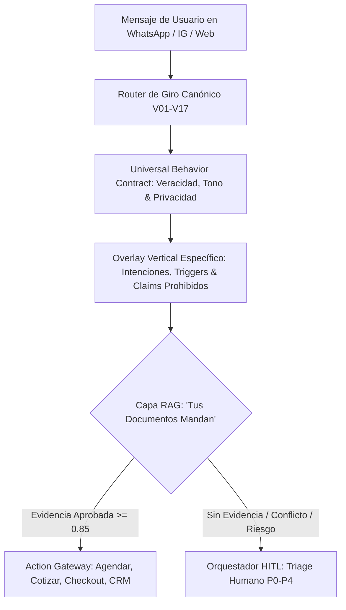

# 🏛️ ADR-002: Taxonomía Universal de 17 Giros, Protocolo de Reacción y Contrato RAG para Agentes de Ventas y Soporte 24/7

- **Estado:** ACEPTADO (v3.5 — Taxonomía Canónica de 17 Giros & Matriz de Reacción HITL)
- **Fecha:** 2026-10-22
- **Autor:** Lead Software Architect & AI Product Strategist — Vector Inside
- **Módulos Afectados:** `/config` (RAGWizard), `/planner` (ContentPlanner), `pgvector` RLS Cluster, Supervisor AI Agent, HITL Triage.
- **Documentos Relacionados:** [ADR-001: Arquitectura Maestra & Motor de IA](file:///c:/Users/EdgarGs/Documents/ProyectoWork/VectorInside/VectorComunity/Vector-Community/docs/ADR_001_MASTER_ARCHITECTURE_AND_BUSINESS_RULES.md), [ADR-003: Meta Graph Intelligence & HITL Triage](file:///c:/Users/EdgarGs/Documents/ProyectoWork/VectorInside/VectorComunity/Vector-Community/docs/ADR_003_META_GRAPH_INTELLIGENCE_AND_HITL_TRIAGE.md), [ADR-005: Taxonomía Multi-Proveedor de Modelos AI](file:///c:/Users/EdgarGs/Documents/ProyectoWork/VectorInside/VectorComunity/Vector-Community/docs/ADR_005_UNIVERSAL_MULTI_PROVIDER_AI_TAXONOMY.md).

---

## 1. Contexto & Planteamiento del Problema

En plataformas conversacionales de venta y atención al cliente, forzar a todos los negocios bajo un único prompt o flujo rígido genera fallas operativas graves:
- Una **Clínica Médica (`V02`)** no puede vender por impulso; debe calificar al paciente y agendar valoración presencial sin dar diagnósticos por chat.
- Una **Ferretería o Refaccionaria (`V10`)** no agenda llamadas corporativas; atiende consultas de existencias en mostrador, medidas de piezas, precios de mayoreo y envíos a obra.
- Una **Agencia de Marketing o Consultora B2B (`V13`)** requiere calificar presupuesto y necesidades (BANT) para agendar una *Discovery Call*.
- Un **Gimnasio (`V01`)** persigue pases de prueba y membresías recurrentes.

Asimismo, los agentes de IA **no deben inventar reglas ni forzar supuestos** (ej. imponer un examen de nivelación de idiomas a una academia que imparte danza o música). 

Se requiere:
1. Una **Taxonomía Canónica de 17 Giros (`V01` a `V17`)** organizados en 8 familias de conversión.
2. Un **Protocolo Universal de Reacción:** `Trigger → Intención → Evidencia RAG → Acción de Conversión → Escalación HITL`.
3. La institucionalización del principio **"Tus Documentos Mandan"**: la IA nunca responde sobre inventarios, aranceles ni políticas sin un `evidence_bundle` verificado del Paso 2.

---

## 2. Decisiones de Arquitectura (Decisions)

### 2.1. Arquitectura de Control: Un Motor Universal + 17 Overlays Verticales

No se programan 17 bots aislados con prompts divergentes. La arquitectura opera en capas desacopladas:

### 2.2. Taxonomía Canónica de 17 Giros Comerciales

| ID Canónico | Familia / Categoría | Giro Comercial | Avatar | Meta Principal de Conversión |
| :--- | :--- | :--- | :---: | :--- |
| **V01** | Fitness & Salud | **Gimnasios, CrossFit & Fitness Studios** | 🏋️‍♂️ | Agendar Clase Muestra / Visita a Instalaciones / Membresía. |
| **V02** | Fitness & Salud | **Clínicas Médicas, Dentales & Consultorios** | 🦷 | Calificar paciente y agendar Cita de Diagnóstico Presencial. |
| **V03** | Fitness & Salud | **Spas, Clínicas Estéticas & Barberías** | 💆🏻‍♀️ | Agendar cita de servicio, consultar catálogo y paquetes de sesiones. |
| **V04** | Educación & Cursos | **Escuelas, Colegios & Universidades** | 🎓 | Agendar Visita Guiada / Sesión Informativa de Admisiones. |
| **V05** | Educación & Cursos | **Academias de Idiomas, Música, Danza & Talleres** | 📚 | Agendar Clase Muestra / Orientación de Programa / Inscripción. |
| **V06** | Educación & Cursos | **Cursos Online, Bootcamps Tech & Infoproductos** | 💻 | Registro a Masterclass / Venta Digital / Postulación a Programa. |
| **V07** | Networking & Membresías | **Redes de Networking, Cámaras & Masterminds** | 🤝 | Invitar a Sesión Introductoria / Calificar Perfil / Membresía. |
| **V08** | Networking & Membresías | **Comunidades de Pago & Clubs Privados** | 🏛️ | Suscripción recurrente / Acceso a canales privados / Eventos. |
| **V09** | Retail & E-Commerce | **Retail & E-Commerce (Marcas D2C)** | 👟 | Cierre de Venta en Sitio Web / Resolver Dudas de Catálogo / Envíos. |
| **V10** | Retail & E-Commerce | **Ferreterías, Refaccionarias & Comercio Local** | 🔧 | Consultar existencias de piezas / Cotizar mayoreo / Envíos a obra. |
| **V11** | Hospitality & Eventos | **Restaurantes, Bares & Mixología** | 🥩 | Reservación de Mesa / Consulta de Menú & Precios / Eventos. |
| **V12** | Hospitality & Eventos | **Salones de Eventos, Bodas & Banquetes** | 🎉 | Agendar Visita al Salón / Cotización por Número de Invitados. |
| **V13** | B2B & Servicios Pro | **Agencias de Marketing, Software SaaS & Consultoría B2B** | 💼 | Calificar requerimientos de proyecto y agendar Discovery Call. |
| **V14** | B2B & Servicios Pro | **Despachos Legales, Notarías & Contadores** | ⚖️ | Agendar Consulta Inicial de Asesoría / Diagnóstico Fiscal. |
| **V15** | Bienes Raíces & Autos | **Bienes Raíces, Desarrollos & Inmobiliarias** | 🏙️ | Agendar Visita al Showroom o Desarrollo / Ficha Técnica. |
| **V16** | Bienes Raíces & Autos | **Agencias de Autos, Concesionarias & Talleres** | 🚗 | Agendar Prueba de Manejo (Test Drive) / Cita de Servicio / Cotización. |
| **V17** | Creadores & Marcas Meta | **Creadores en Redes Meta, Streamers & Podcasts** | 🎬 | Interacción con Audiencia / Responder Menciones / Acuerdos con Marcas. |

---

### 2.3. Matriz Universal de Reacción por Giro (Trigger → Intención → Acción → HITL)

Cada giro declara su comportamiento operativo para que el agente sepa exactamente cómo reaccionar y cuándo escalar:

| ID | Triggers Críticos de Entrada | Intención Reconocida | Siguiente Mejor Acción de Conversión | Escalación HITL Obligatoria (Humano) |
| :--- | :--- | :--- | :--- | :--- |
| **V01** | Costo membresía, clase prueba, horarios, lesión, congelar. | Agendar prueba, cotizar membresía, renovar. | Enlace de agenda de clase muestra, link de pago de membresía. | Lesiones, condiciones médicas graves, solicitudes de reembolso, quejas de entrenadores. |
| **V02** | Dolor agudo, aranceles, cita especialista, seguros, urgencia. | Agendar cita, triage sintomático, costo aproximado. | Agenda por especialidad médica, formulario clínico previo. | Síntomas de urgencia (dolor agudo, hemorragia), solicitud de diagnóstico por chat, menores de edad. |
| **V03** | Servicio, disponibilidad fin de semana, contraindicaciones. | Reservar tratamiento, cotizar paquete. | Booking con selección de especialista, anticipo de apartado. | Embarazo/lactancia en tratamientos químicos, alergias cutáneas, quejas por resultados estéticos. |
| **V04** | Costo colegiatura, becas, fechas de examen, mapa curricular. | Información de admisiones, tour de campus. | Envío de folleto oficial, formulario de postulación, cita de admisión. | Solicitudes de descuento fuera de reglamento, temas disciplinarios, documentación oficial confidencial. |
| **V05** | Horarios, nivel de inicio, costos por módulo, materiales. | Inscripción a curso, clase muestra, diagnóstico inicial. | Agenda de sesión muestra, formulario de interés, link de inscripción. | Menores sin tutor, solicitudes de reposición extemporáneas, cambios de grupo saturados. |
| **V06** | Contenido del curso, garantía, pago en cuotas, acceso fallido. | Compra de curso, postulación a bootcamp, soporte. | Checkout directo, envío de temario oficial, reseteo de acceso. | Reclamaciones de garantía/reembolso, fallas de pasarela de pago, disputas de certificación. |
| **V07** | Exclusividad de giro, cuota anual, sesiones de invitados. | Postulación de membresía, confirmación de asistencia. | Formulario de perfil profesional, invitación formal a desayuno/sesión. | Conflicto de giro con socio activo existente, excepciones de cuota, apelación de expulsión. |
| **V08** | Precio suscripción, reglas de comunidad, canales privados. | Suscribirse a comunidad, resolver dudas de acceso. | Checkout recurrente, invitación automática a Telegram/Discord. | Violación de normas de convivencia, spam no autorizado, cancelaciones no procesadas. |
| **V09** | Talla, catálogo, tiempo de envío, stock, cambio de producto. | Compra en línea, rastreo de pedido, devolución. | Ficha de producto, link de checkout seguro, guía de paquetería. | Envíos extraviados, producto defectuoso con foto, sospecha de fraude en tarjeta. |
| **V10** | Existencia de pieza, medida técnica, precio mayoreo, entrega en obra. | Cotización de materiales, apartado en tienda, servicio a domicilio. | Cotización formal, link de apartado de mercancía, orden de despacho. | Pedidos especiales de alto volumen, especificaciones de riesgo estructural, devoluciones de mercancía cortada. |
| **V11** | Mesa para grupos, menú, horario pico, alergias alimentarias. | Reservación de mesa, cotización de evento privado. | Confirmación de reserva en Google Calendar / OpenTable, envío de menú digital. | Alergias alimentarias severas, comensales intoxicados, quejas de servicio en salón, eventos > 10 personas. |
| **V12** | Fecha de evento, paquete por persona, menú de tiempos, degustación. | Cotizar boda/evento, apartar fecha, agendar visita a salón. | Calculadora estimada por invitado, agenda de recorrido presencial. | Negociación de contratos, cambios de fecha de última hora, disputas de anticipos no reembolsables. |
| **V13** | Propuesta comercial, pauta publicitaria, software, ROI, presupuestos. | Calificación BANT, agendar Discovery Call corporativa. | Agenda en Google Calendar del consultor, envío de credenciales/portfolio. | Solicitudes de NDA previo a cotización, clientes enterprise con requerimientos de seguridad/DPA. |
| **V14** | Costo de consulta, dictamen fiscal, juicio, revisión de contrato. | Agendar asesoría jurídica, cotizar trámite notarial/legal. | Cita presencial o por videollamada, envío de checklist de documentos legales. | Casos en litigio urgente con plazos fatales, secretos fiduciarios, consultas con conflicto de interés. |
| **V15** | Precio por m², enganche, créditos hipotecarios, visita a desarrollo. | Agendar visita a showroom, envío de brochure y planos. | Agenda de visita con asesor inmobiliario, precalificación hipotecaria básica. | Ofertas de compraventa vinculantes, negociación de descuentos en preventa, validación notarial de títulos. |
| **V16** | Disponibilidad de modelo, financiamiento, prueba de manejo, taller. | Agendar Test Drive, cotizar enganche, cita de mantenimiento. | Agendamiento de prueba de manejo (validando licencia), cita de servicio en taller. | Trámites de crédito rechazados, garantías de motor/frenos, siniestros de aseguradora. |
| **V17** | Patrocinios de marcas, dinámicas de comunidad, stickers, hate. | Filtro comercial para marcas, respuesta a fans, moderación. | Envío de Media Kit comercial, link de regalos para comunidad. | Propuestas comerciales de alto valor, comentarios de acoso/amenazas graves, crisis de relaciones públicas. |

---

### 2.4. Principio Operativo "Tus Documentos Mandan" (RAG Extraction en Paso 2)

El modelo de lenguaje (LLM) **jamás opera en base a su conocimiento preentrenado**. En el Paso 2 de onboarding, los documentos cargados (.pdf, .docx, .md) se ingieren y descomponen semánticamente en `knowledge_objects` estructurados:

#### Jerarquía de Autoridad Documental:
1. **Regulación / Ley Aplicable** (LFPDPPP, NOMs sanitarias, directrices Meta).
2. **Contrato Firmado o Términos Oficiales Vigentes del Tenant**.
3. **Listas de Precios Oficiales, Catálogos de SKUs y Horarios Verificados**.
4. **Master Briefing Aprobado en Onboarding**.
5. **Base de FAQs y Políticas Operativas**.
6. **Material Promocional y Creativos de Marketing**.
7. **Memoria de Conversación Previa del Usuario**.
8. **Conocimiento Base del LLM:** *Estrictamente prohibido como fuente transaccional*.

> [!IMPORTANT]
> Si no existe un fragmento documental aprobado con una confianza de similitud $\ge 0.85$, el agente tiene la instrucción explícita de responder:  
> *"No cuento con esa información confirmada en mis documentos oficiales. Permíteme canalizarte con nuestro equipo para brindarte los datos exactos."*

---

### 2.5. Matriz de Severidad HITL (Human-in-the-Loop)

| Nivel de Prioridad | Tipología de Caso | SLA Máximo de Respuesta | Protocolo de Handoff |
| :---: | :--- | :---: | :--- |
| **P0 (Crítico)** | Emergencia médica, agresión, amenaza de suicidio, menor en peligro, siniestro físico. | **< 1 minuto** | Silencio inmediato del bot, notificación SMS/Push a directores y número de emergencia predeterminado. |
| **P1 (Alto Riesgo)** | Consultas diagnósticas, asesoría legal en litigio, sospecha de fraude, queja de cobro no reconocido. | **< 5 minutos** | Pausa de respuestas automáticas y asignación al especialista en turno en Inbox HITL. |
| **P2 (Comercial)** | Cliente VIP de alto ticket, solicitud de descuento fuera de política, dos fallos consecutivos de comprensión. | **< 15 minutos** | Alerta en panel con resumen generado por IA de la intención y fricción detectada. |
| **P3 (Operativo)** | Solicitud de cotización mayorista compleja, duda de producto fuera de catálogo, petición de llamada. | **< 1 hora** | Registro de ticket en CRM y mensaje de confirmación al usuario de tiempo estimado. |

---

### 2.6. Interfaz del Selector de Giros: Divulgación Progresiva

Para garantizar la mejor experiencia de usuario en el frontend (`RAGWizard.jsx`):
1. **Selector Compacto por Defecto:** Reduce el espacio vertical en un 80% mediante tarjetas de 4 columnas scannables en 3 segundos.
2. **Píldoras con Conteo Dinámico:** Cada categoría muestra en tiempo real cuántos giros contiene, con distribución `flex-wrap` fluida.
3. **Panel de Calibración "A la Mano":** Al hacer clic en cualquier giro, la ficha de inteligencia (Score de Calidad, Sugerencias Proactivas de 1 clic, Meta de Conversión y Pilares RAG) se actualiza de inmediato bajo la mirada del usuario sin scroll vertical.

---

## 3. Consecuencias & Beneficios

### Positivas
- **Alineación Total del Negocio:** Una ferretería, un gimnasio o una agencia de marketing cuentan con los límites exactos de su industria sin configuraciones tediosas.
- **Cero Alucinaciones Transaccionales:** Los agentes no inventan precios, aranceles médicos ni políticas de cancelación que comprometan legalmente a la empresa.
- **Trazabilidad de Auditoría:** Cada decisión del agente queda vinculada a un `trace_id` con el documento y fragmento que respaldó su respuesta.

### Mitigaciones
- Las sugerencias proactivas mostradas en el asistente son solo guías base de seguridad; la IA adopta como verdad definitiva los archivos que el cliente sube en el Paso 2.
