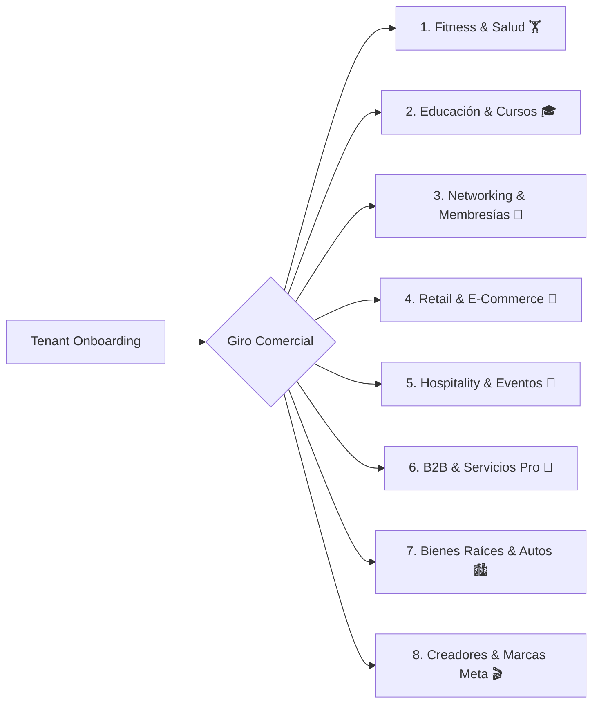

# 🏛️ ADR-002: Taxonomía Universal de Giros Comerciales, Ingestión 1-Click y Adaptación de los 4 Pilares RAG

- **Estado:** ACEPTADO (v3.0)
- **Fecha:** 2026-10-09
- **Autor:** Lead Software Architect & AI Product Strategist — Vector Inside
- **Módulos Afectados:** `/config` (RAGWizard), `/planner` (ContentPlanner), `pgvector` RLS Cluster, Supervisor AI Agent.

---

## 1. Contexto & Planteamiento del Problema
En plataformas SaaS tradicionales de Community Management, los sistemas de IA suelen forzar a todos los clientes a llenar la misma estructura rígida (e.g. listas masivas de precios, catálogos de SKUs y manuales de crisis extensos). Esto genera fricción insostenible:
- Un **Gimnasio o Centro de CrossFit** vende membresías mensuales y busca agendar pases de cortesía de 1 día, no maneja SKUs individuales.
- Una **Escuela o Academia de Idiomas** opera por ciclos de inscripción y planes de estudio en PDF, no por carritos de compra.
- Una **Red de Networking o Mastermind B2B** necesita validar la exclusividad de giro de los prospectos antes de invitar a una sesión presencial.
- Un **Creador de Contenido / Marca Personal** no tiene lista fija de precios y busca potenciar su engagement en Reels y Stories, por lo que forzar el Pilar de Precios era un bloqueador crítico.

Se requiere una **Taxonomía Universal de Negocios** que clasifique a las empresas por su **Modelo de Conversión** y adapte automáticamente los **4 Pilares de Conocimiento (RAG)**, permitiendo la ingestión en 1-clic de un *Master Briefing* con extracción semántica y sugerencias proactivas de salud RAG.

---

## 2. Decisiones de Arquitectura (Decisions)

### 2.1. Taxonomía de 8 Familias de Conversión
Se establece una matriz de 8 categorías maestras que abarcan todos los modelos comerciales:

### 2.2. Modularidad Estricta de los 4 Pilares de Conocimiento

| Pilar | Definición | Estado de Obligatoriedad | Comportamiento según el Giro |
| :--- | :--- | :--- | :--- |
| **Pilar 1: Matriz de Rentabilidad & Precios** | Catálogo de aranceles, membresías, SKUs, límites de CAC y LTV. | *Modular / Opcional* | **Crítico** en E-Commerce, Bienes Raíces y Salones de Eventos; **Modular** en Gimnasios, Clínicas y B2B (rangos BANT); **Inactivo/Opcional** en Creadores. |
| **Pilar 2: Identidad & Tono de Voz (Brandbook)** | Personalidad, arquetipo de comunicación, reglas de lenguaje, do's & don'ts y emojis. | **★ ÚNICO OBLIGATORIO** | Núcleo de verdad que consumen todos los sub-bots (Ventas, Contenido, Moderación y Triage). |
| **Pilar 3: Protocolos de Crisis & FAQs** | Políticas de cancelación, devoluciones, garantías, preguntas frecuentes y filtro de palabras de alarma. | *Modular / Recomendado* | **Crítico** en Salud (urgencias, cancelaciones 24h), Gimnasios (congelación de membresía) y E-Commerce (paquetería); **Filtro Anti-Hate** en Creadores. |
| **Pilar 4: Histórico de Datos & Casos de Éxito** | Métricas pasadas, testimonios de clientes, hooks con mayor retención en Reels y aprendizajes de campañas. | *Modular / Opcional* | **Crítico** en B2B High-Ticket (whitepapers de ROI); **Recomendado** en Educación (acreditaciones) y Creadores (viralidad). |

---

### 2.3. Modo Dual de Entrada: 1-Click Master Briefing vs 5 Etapas Guiadas
1. **Modo 1-Click Master Briefing (DeepSeek R1 Semantic Parser):**
   - El usuario o la agencia sube un solo archivo integral (`.pdf`, `.docx`, `.md`) o pega el texto del brief.
   - La IA realiza una partición semántica en streaming:
     $$\text{Master Brief} \xrightarrow{\text{IA}} \{\text{Pilar 2 (Tono)}, \text{Oferta Activa (Hook/CTA)}, \text{Pilar 3 (FAQs/Crisis)}, \text{Reglas Inviolables}\}$$
   - Pre-llena la base de datos vectorial del tenant automáticamente sin captura manual.
2. **Modo Formulario Guiado:** 5 etapas interactivas para configuración granular por parte del Administrador.

---

### 2.4. Score de Calidad RAG (`Health Score / 100`) y Sugerencias Proactivas
- El panel audita en tiempo real la completitud del conocimiento contra los requisitos mínimos de su giro:
  $$\text{Health Score} = 50\text{ (Base Pilar 2)} + 20\text{ (Brandbook Doc)} + 15\text{ (Oferta Activa)} + 10\text{ (Crisis)} + 5\text{ (Reglas Inviolables)}$$
- **Sugerencias con 1-Click Fix:** Si la IA detecta ausencias críticas (e.g. falta política de cancelación en gimnasios/clínicas o falta tiempo de envío en e-commerce), despliega tarjetas con botón de acción inmediata que inyectan plantillas pre-aprobadas en la memoria RAG.

---

### 2.5. Reglas Inviolables del Negocio (Guardrails de Seguridad)
Límites no negociables que el agente jamás romperá, garantizando que el humano solo intervenga en excepciones reales:
1. *NUNCA* emitir diagnósticos médicos definitivos por chat (Salud).
2. *NUNCA* autorizar descuentos mayores al límite pactado sin cupón verificado en sistema.
3. *NUNCA* prometer entregas o visitas sin confirmación de inventario/agenda.
4. *SIEMPRE* verificar disponibilidad de giro antes de invitar a sesiones de networking exclusivo.

---

## 3. Consecuencias & Beneficios

### Positivas:
- **Onboarding Reducido a < 60 Segundos:** Subir un único PDF configura el bot completo de forma inteligente.
- **Cero Fricción para Clientes No-Transaccionales:** Creadores, consultores y marcas personales no son forzados a cargar listas de precios.
- **Autonomía Blindada:** El bot resuelve el 95%+ de dudas y objeciones sin intervención humana, operando 24/7.

### Mitigaciones:
- Las reglas inviolables se inyectan como *System Prompt Imprimible* al inicio del contexto LLM con máxima prioridad sobre los fragmentos RAG.
