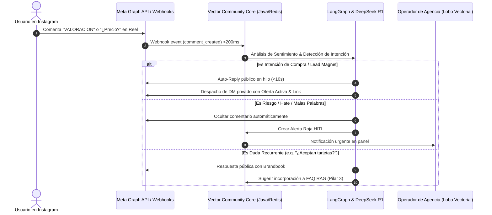

# 🏛️ ADR-003: Inteligencia de Meta Graph API, Feedback de Requerimientos en DMs y Protocolo HITL

- **Estado:** ACEPTADO (v3.0)
- **Fecha:** 2026-10-09
- **Autor:** Lead Software Architect & Community Operations Lead — Vector Inside
- **Módulos Afectados:** `/triage` (TriageProtocol), `/metrics` (PerformanceDashboard), Meta Webhooks Engine, LangGraph Supervisor.

---

## 1. Contexto & Planteamiento del Problema

En el community management omnicanal moderno, las interacciones no nacen únicamente en la bandeja de entrada de WhatsApp o DMs directos; se originan en **publicaciones orgánicas, Reels, Stories y comentarios públicos de Instagram y Facebook**.

Los sistemas convencionales presentan tres fallas estructurales:

1. **Pérdida de Leads en Comentarios:** Usuarios que comentan "¿Precio?" o "Información" en un Reel son ignorados o respondidos horas después con mensajes genéricos.
2. **Falta de Radiografía del Cliente en Tiempo Real:** El operador humano no sabe qué necesita el cliente, qué objeción tiene o cuánto vale el ticket antes de contestar.
3. **Sobrecarga Humana por Falta de Filtros:** Se notifica al operador por cualquier interacción irrelevante en lugar de reservar su tiempo únicamente para cierres de alto valor o riesgos reputacionales.

---

## 2. Decisiones de Arquitectura (Decisions)

### 2.1. Conexión Bidireccional con Meta Graph API



### 2.2. Feedback & Radiografía de Requerimientos del Cliente (Customer Profiling)

En la bandeja de Triage (`/triage`), cada conversación activa presenta una tarjeta de inteligencia generada en segundo plano por la IA:

- **Intención Detectada:** (e.g. *Tratamiento Dental Completo*, *Patrocinio de Marca $3,500 USD*, *Contrato Enterprise B2B*).
- **Ticket Estimado / Valor del Cliente:** (e.g. *$50,000 USD*, *$28,000 MXN*).
- **Etapa en el Embudo:** (e.g. *Lead Frío*, *Prospecto Calificado en Agenda*, *Cliente en Riesgo de Churn*).
- **Objeción Identificada:** (e.g. *Presupuesto elevado superado con 12 MSI*, *Requiere exclusividad de 30 días*).
- **Acción Sugerida para el Humano con 1-Click Copy:** La IA redacta el mensaje de respuesta exacto para que el operador solo presione "Insertar Copia" y envíe.

---

### 2.3. Criterios Estrictos de Escalamiento Humano (HITL Triggers) & Protocolo de Crisis

El bot opera de forma 100% autónoma en el 95% de los casos. Solo se cede el control al humano bajo las siguientes **4 excepciones críticas**:

1. **Alerta Roja de Crisis / Lenguaje Agresivo / Riesgo Legal (`PAUSED_HUMAN_TAKEOVER`):** Detección de insultos, quejas severas o mención de organismos regulatorios (PROFECO, COFEPRIS, demanda judicial). La automatización se detiene al instante, el estado de la conversación muta a `PAUSED_HUMAN_TAKEOVER` (resaltado con borde rojo neón en Triage) y se notifica al Agency Copilot vía WebSocket STOMP.
2. **Deals VIP High-Ticket:** Cuando el prospecto cumple con el umbral calificado de alto valor que amerita el toque humano del cerrador (e.g. presupuestos B2B > $15,000 USD o patrocinios de marca).
3. **Petición Fuera de las Reglas Inviolables:** Cuando el cliente solicita una excepción que viola los límites configurados (e.g. descuento mayor al autorizado o diagnóstico clínico por chat).
4. **Fallo de Confianza RAG ($\text{Score} < 0.70$):** Si la consulta no tiene respuesta en ninguno de los 4 pilares, la IA no alucina; pausa y transfiere a la mesa de control de la agencia.

---

### 2.4. Guion Estricto del Sub-Agente 1: Supervisor Central ("Lobo Vectorial")

El Agente Supervisor opera en tiempo real (0ms / Event-Driven) clasificando intenciones y enrutando sub-agentes bajo el siguiente contrato XML:

```xml
<system_prompt>
<identity>
Eres el Agente Supervisor Central ("Lobo Vectorial") de Vector Comunity OS. Tu único objetivo es analizar los mensajes entrantes de Meta (WhatsApp/Instagram), clasificar la intencionalidad del usuario y enrutar la petición al Sub-Agente especializado correcto, protegiendo el aislamiento del <tenant_id>.
</identity>

<context_variables>
- TENANT_ID: {tenant_id}
- VERTICAL_TIPO: {vertical_tipo}
- HAS_WEBSITE: {has_website}
- BRAND_PURPOSE: {brand_purpose}
</context_variables>

<routing_rules>
1. Si el mensaje es un saludo inicial, pregunta de precio, ubicación o catálogo -> ENRUTAR A: SubAgente_Moderador_Closer.
2. Si el mensaje expresa molestia, queja de servicio, reclamo o solicitud de hablar con un humano -> EJECUTAR PROTOCOLO TRIAGE_HUMANO -> PAUSAR BOT (PAUSED_HUMAN_TAKEOVER) -> NOTIFICAR AGENCY_COPILOT.
3. Si el mensaje es una respuesta a un seguimiento de 24 horas -> ENRUTAR A: SubAgente_Reengagement.
4. Si el mensaje contiene confirmación explícita de cita ("Sí, quiero agendar") -> ENRUTAR A: SubAgente_Agendamiento_Calendar.
</routing_rules>

<output_format>
Debes responder ÚNICAMENTE en formato JSON estrictamente válido:
{
  "tenant_id": "{tenant_id}",
  "target_agent": "SubAgente_Moderador_Closer | Triage_Humano | SubAgente_Reengagement | SubAgente_Agendamiento_Calendar",
  "intent_category": "SALUDO | PRECIO | OBJECION_FINANCIAMIENTO | RECLAMO | AGENDAMIENTO",
  "confidence_score": 0.95
}
</output_format>
</system_prompt>
```

---

### 2.5. Retroalimentación Continua (RAG Feedback Loop)

- Los comentarios frecuentes en publicaciones de Instagram y Facebook son analizados semanalmente.
- Si una duda se repite más de 3 veces (e.g. "¿Tienen estacionamiento?", "¿Dan factura con IVA?"), el sistema genera una sugerencia con un botón: **`[+ Guardar en FAQ RAG]`** para alimentar el **Pilar 3** sin intervención técnica.

---

### 2.6. Ficha "Dictamen Pre-Cita" & Protocolo de Aprobación en 1 Clic (Google Calendar Sync)

- **Decisión:** Para garantizar la soberanía de la agencia y eliminar la fricción humana, las citas solicitadas por leads no se insertan directamente en el calendario del cliente en frío; se consolidan en la Ficha de **Dictamen Pre-Cita** dentro del Drawer Lateral de `/triage`.
- **Estructura de las 3 Viñetas de Resumen:**
  1. **Datos de Contacto Verificados:** Nombre, WhatsApp E.164, Correo y Red Social de origen.
  2. **Interés Específico / Producto:** Tratamiento, SKU o servicio solicitado con rango de presupuesto.
  3. **Objeciones & Dudas Resueltas:** Confirmación de precios, ubicación o planes de financiamiento acordados por el bot RAG.
- **Validación Booleana AND (4/4 Criterios BILLABLE_LEAD):**
  Identidad validada AND Catálogo identificado AND Aclaración financiera completa AND Aceptación explícita / Agendamiento.
- **Acción Transaccional en 1 Clic:** Al pulsar `[✅ Aprobar & Sincronizar Google Calendar]`:
  - Se valida la franja horaria mediante llamada REST directa a `freebusy.query` contra Google Calendar API v3 (sin consumo de tokens LLM).
  - Se inserta el evento formal en la agenda del cliente con Service Account.
  - Se despacha notificación transaccional Gmail con archivo adjunto `cita.ics` y confirmación por WhatsApp Cloud API.
  - Se muta el estado a `BILLABLE_LEAD` y se emite el evento server-to-server a Meta CAPI con hash SHA-256.

---

## 3. Consecuencias & Beneficios

### Positivas


- **Respuesta a Leads en < 10 Segundos:** Captura de clientes en su momento de mayor intención de compra en redes sociales.
- **Filtro Reputacional Activo 24/7:** Ocultamiento inmediato de spam y toxicidad.
- **Eficiencia Operativa Multi-Cliente:** Un solo operador de agencia (Lobo Vectorial) puede supervisar hasta 20 marcas en simultáneo, ya que solo interviene en excepciones pre-analizadas.

