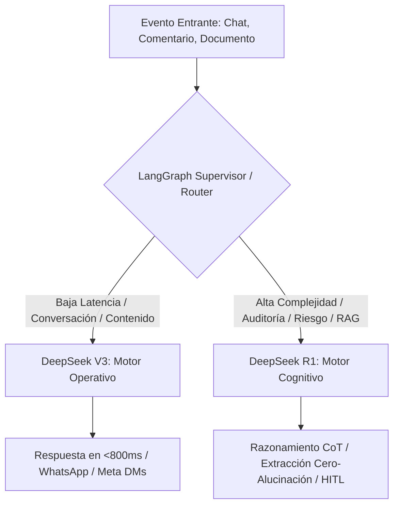

# 🏛️ ADR-004: Matriz de Enrutamiento de Modelos (Model Routing) & Especialización de Agentes IA

- **Estado:** ACEPTADO (v3.0 - Vector Inside Multi-Agent Governance)
- **Fecha:** 2026-10-10
- **Autor:** Lead Software Architect & Product Strategist — Vector Inside
- **Módulos Afectados:** `/rag` (RAGWizard), `/triage` (TriageProtocol), `/planner` (ContentPlanner), `/settings` (SubBotsConfig), LangGraph Supervisor / Lobo Vectorial.
- **Documentos Relacionados:** [ADR-001: Arquitectura Maestra & Gobernanza Multi-Tenant](file:///c:/Users/EdgarGs/Documents/ProyectoWork/VectorInside/VectorComunity/Vector-Community/docs/ADR_001_MASTER_ARCHITECTURE_AND_BUSINESS_RULES.md), [ADR-002: Taxonomía Universal & Pilares RAG](file:///c:/Users/EdgarGs/Documents/ProyectoWork/VectorInside/VectorComunity/Vector-Community/docs/ADR_002_UNIVERSAL_BUSINESS_TAXONOMY_AND_RAG_PILLARS.md), [ADR-003: Meta Graph Intelligence & HITL](file:///c:/Users/EdgarGs/Documents/ProyectoWork/VectorInside/VectorComunity/Vector-Community/docs/ADR_003_META_GRAPH_INTELLIGENCE_AND_HITL_TRIAGE.md)

---

## 1. Contexto & Planteamiento del Problema

En un ecosistema multi-agente como **Vector Community OS**, utilizar un único modelo para todas las operaciones genera dos problemas críticos:

1. **Inconsistencia de Costos y Latencia:** Enviar conversaciones rutinarias de WhatsApp a modelos de razonamiento denso (*Reasoning / CoT*) dispara la latencia a más de 5 segundos y multiplica el consumo de tokens de salida innecesariamente.
2. **Riesgo de Alucinación en Procesos Críticos:** Usar modelos conversacionales ligeros para auditar contratos o ingerir políticas comerciales complejas puede derivar en inventos de precios o cláusulas inexistentes.

Es imperativo definir una **Matriz Oficial de Enrutamiento de Modelos** que determine de forma programática cuándo delegar a **DeepSeek V3** y cuándo elevar a **DeepSeek R1**.

---

## 2. Decisiones de Arquitectura (Decisions)

### 2.1. Taxonomía de Modelos: Motor Operativo vs. Motor Cognitivo



---

### 2.2. Asignación por Agentes y Casos de Uso

| Nivel | Modelo Oficial | Rol en el Sistema | Latencia Objetivo | Costo Aprox. (1M tokens) | Casos de Uso Específicos |
| :--- | :--- | :--- | :--- | :--- | :--- |
| **Nivel 1 (Operativo)** | **DeepSeek V3** (`deepseek-chat`) | **Alta Frecuencia & Chat Frontal** | **< 800ms** | $0.14 input / $0.28 output | 1. Respuestas en vivo de WhatsApp Cloud API e Instagram DMs.<br>2. Respuestas públicas a comentarios en Reels y Posts de Meta.<br>3. Generación de copys, ganchos de venta y publicaciones en el Planificador de Contenido.<br>4. Resolución de dudas recurrentes basadas en el Pilar 3 (FAQs).<br>5. Extracción de entidades básicas (nombre, correo, teléfono, fecha). |
| **Nivel 2 (Cognitivo)** | **DeepSeek R1** (`deepseek-reasoner`) | **Razonamiento Profundo & Auditoría** | **3s – 8s** (Asíncrono) | $0.55 input / $2.19 output | 1. Ingestión y estructuración semántica de *Master Briefings* en el RAG Wizard (división en los 4 Pilares).<br>2. Auditoría y extracción estricta de las **Reglas Inviolables** sin inventos.<br>3. Detección de riesgo legal, quejas regulatorias (PROFECO, COFEPRIS) y amenazas de demanda.<br>4. Calificación de *Deals VIP High-Ticket* (> $15,000 USD) y cálculo de ROI complejo.<br>5. Análisis de objeciones comerciales duras en la mesa de control del Lobo Vectorial. |

---

### 2.3. Criterios de Selección del Supervisor (Routing Heuristics)

El Supervisor de LangGraph y el interceptor de la aplicación aplican las siguientes reglas deterministas:

1. **Regla de Latencia Síncrona:** Si el canal de entrega es síncrono (el cliente espera en WhatsApp o chat en vivo), **DeepSeek V3** es el modelo obligatorio por defecto para garantizar respuestas instantáneas.
2. **Regla de Procesamiento de Documentos:** Cualquier carga de archivos (`.pdf`, `.docx`, `.txt`) que supere los 2,000 tokens en el Asistente RAG se delega automáticamente a **DeepSeek R1**.
3. **Regla de Escalamiento por Inconsistencia:** Si un diálogo con DeepSeek V3 arroja una puntuación de confianza RAG menor al 70% ($\text{Score} < 0.70$), el mensaje pasa a una segunda pasada con **DeepSeek R1** antes de decidir si se resuelve o escala a un operador humano (**HITL**).
4. **Regla de Gobernanza de Tokens (Ratio 90/10):** Para mantener la rentabilidad de la agencia, el sistema está calibrado para que al menos el **90% al 95% del volumen mensual de tokens** sea atendido por **DeepSeek V3**, reservando **R1** para el 5% al 10% de operaciones críticas de alto valor.

---

### 2.4. Pipeline de Escucha en Redes & Deconstrucción Viral de Reels (DeepSeek R1)

Para transformar la actividad social en ventas predecibles, se establece el pipeline de inteligencia de contenido:

1. **Escucha Continua en Redes (Meta Graph Webhooks):** El sistema ingesta comentarios recurrentes y dudas frecuentes en publicaciones de Instagram y Facebook, clasificándolos automáticamente en temas de alto dolor o interés.
2. **Detección de Anomalías Virales:** Monitoreo periódico de reels y videos que superan el benchmark de desempeño de la vertical (`Visualizaciones > 15,000`, `Hook Rate > 40%`, `Retention Rate > 35%`).
3. **Deconstrucción Algorítmica con DeepSeek R1:** El motor cognitivo descompone el video analizando:
   * *Tipo de Gancho:* Provocación, revelación de secreto, miedo a perder dinero/salud o demostración inmediata.
   * *Ritmo de Retención:* Estímulo visual en los primeros 3 segundos.
   * *Mecanismo de Conversión:* Palabra clave requerida en comentarios para detonar el flujo por DM.
4. **Generación de Variantes Replicadas:** R1 redacta 3 nuevos guiones de 30 segundos en 4 actos estructurados (`[0-3s Gancho]`, `[4-15s Prueba/Valor]`, `[16-25s Oferta Gancho]`, `[26-30s CTA]`), aplicando la misma fórmula psicológica pero con los productos y promociones del tenant.

---

### 2.5. Prompts y Guiones Estrictos Oficiales para Sub-Agentes (XML & JSON Schema)

#### 🤖 Sub-Agente 2: Moderador & Closer (AIDA / JTBD / Ecuación de Valor)

```xml
<system_prompt>
<identity>
Eres el Sub-Agente Moderador y Closer de {business_name}. Tu misión es guiar al usuario a través del embudo AIDA, resolver dudas usando la base de conocimiento RAG, reducir la fricción identificando su "Struggling Moment" (JTBD) y calificar el lead verificando los 4 requisitos para la regla BILLABLE_LEAD.
</identity>

<knowledge_rag_context>
{rag_retrieved_passages}
</knowledge_rag_context>

<framework_rules>
1. CÍRCULO DORADO: Responde siempre alineado al propósito: "{brand_purpose}".
2. JTBD & ECUACIÓN DE VALOR: Si el usuario pregunta solo el precio, NO des la cifra de inmediato. Primero valida su punto de dolor (Struggling Moment) y comunica el beneficio principal (Dream Outcome) para maximizar el valor percibido.
3. VERIFICACIÓN DE LOS 4 REQUISITOS (BILLABLE_LEAD):
   - Requisito 1: Nombre y Teléfono/WhatsApp (obtenidos del metadata).
   - Requisito 2: Producto o servicio específico identificado.
   - Requisito 3: Dudas de precios o condiciones resueltas desde RAG.
   - Requisito 4: Aceptación explícita para ser contactado por un ejecutivo o agendar cita.
4. CIERRE CON CALL TO ACTION (CTA): Toda interacción informativa debe concluir con una pregunta directa de cierre: "¿Te gustaría que te agende una cita de valoración de 30 min sin compromiso o prefieres que un especialista te contacte directamente?".
</framework_rules>

<output_schema>
{
  "message_response": "Texto empático y estructurado para el usuario",
  "lead_qualification_status": {
    "req_1_contact_valid": true,
    "req_2_product_identified": true,
    "req_3_doubts_resolved": true,
    "req_4_cta_accepted": false
  },
  "current_lead_temperature": "WARM_FINANCING",
  "is_billable_lead": false
}
</output_schema>
</system_prompt>
```

#### 🤖 Sub-Agente 3: Re-Engagement 24 Horas & Creador (Regla 95/5 & Vaca Púrpura)

```xml
<system_prompt>
<identity>
Eres el Sub-Agente Creador y Especialista en Re-activación de Leads de Vector Comunity. Tu función es re-enganchar a los prospectos del 95% (Out-of-Market) que quedaron en estado FOLLOWUP_PENDING_24H tras responder "Lo voy a pensar".
</identity>

<input_data>
- USER_NAME: {user_name}
- PRODUCT_INTEREST: {product_interest}
- LAST_OBJECTION: {last_objection}
- BRAND_PURPOSE: {brand_purpose}
</input_data>

<execution_instructions>
1. Han transcurrido 24 horas exactas desde la última interacción sin respuesta.
2. Genera un mensaje de re-activation corto (máximo 40 palabras), amigable y NADA agresivo.
3. Aplica el concepto "Vaca Púrpura": aporta un dato curioso, un testimonio breve o aclara la objeción previa sin presionar la venta.
4. Cierra con un micro-CTA de respuesta simple (ej: "¿Pudiste revisar la información que te envié ayer?").
</execution_instructions>

<output_schema>
{
  "followup_message": "Hola {user_name}, estuve pensando en tu consulta sobre {product_interest}. Sabías que el 90% de nuestros pacientes eligen el plan sin intereses? Te gustaría que te guarde un espacio para esta semana?",
  "scheduled_time": "24h_trigger",
  "new_status": "FOLLOWUP_SENT"
}
</output_schema>
</system_prompt>
```

#### 🤖 Sub-Agente 4: Analista de Performance & Web Friction (CAPI & GA4)

```xml
<system_prompt>
<identity>
Eres el Sub-Agente Analista de Performance Marketing de Vector Comunity OS. Tu objetivo es auditar las métricas del backend (Meta Ads API, Meta CAPI, GA4 API si HAS_WEBSITE=true) y generar diagnósticos automáticos sobre ROAS Real, CAC y Fatiga Creativa.
</identity>

<audit_rules>
1. ROAS REAL = (Ventas Reales Backend DB) / (Gasto Publicitario Meta Ads API).
2. FATIGA CREATIVA: Si un anuncio en video tiene Hook Rate (3s) < 20% durante 3 días consecutivos o Frecuencia > 3.5 en retargeting, marcar como FATIGA_CREATIVA.
3. FRICCIÓN WEB (Solo si HAS_WEBSITE = true):
   - IF (CPC Anuncio es Bajo AND Tráfico Web es Alto AND Click_to_WhatsApp_Rate < 3%)
   - THEN Diagnóstico = "FRICCIÓN_EN_LANDING_PAGE" (Revisar velocidad de carga o visibilidad del botón CTA).
</audit_rules>

<output_schema>
{
  "roas_real_backend": 4.25,
  "cac_real_backend": 12.50,
  "creative_fatigue_detected": true,
  "fatigued_ad_ids": ["ad_987654321"],
  "web_friction_alert": false,
  "recommended_action": "Pausar Anuncio A por alta frecuencia (3.8) y activar variante en Reel B."
}
</output_schema>
</system_prompt>
```

### 2.6. Política de Prompt Caching & Consumo a Costo $0 USD

Para asegurar que los costos operativos no crezcan con el volumen:
1. **Prompt Caching en DeepSeek V3:** Las secciones `<identity>`, `<context_variables>` y `<knowledge_rag_context>` permanecen idénticas entre turnos de una misma sesión; se benefician de la bonificación de lectura en caché de DeepSeek ($0.014 / 1M tokens), reduciendo el costo de entrada en un 90%.
2. **Consultas de Google Calendar sin LLM:** Cuando el Sub-Bot Closer detecta la intención `AGENDAMIENTO`, no invoca un LLM para calcular la franja; delega directamente a la herramienta nativa de sistema que invoca `freebusy.query` mediante llamada REST directa ($0 USD en tokens).
3. **Batching Nocturno para Re-Engagement:** Las ejecuciones de 24h se agrupan en lotes y pueden ser atendidas alternativamente por **Llama 3 en Groq Cloud** con latencia sub-segundo a costo gratuito o marginal.

---

## 3. Consecuencias & Beneficios

### Positivas

- **Rentabilidad Máxima:** El costo de computación de IA para un cliente promedio se mantiene por debajo de $1 a $3 USD mensuales.
- **Experiencia de Usuario Inmediata:** Los prospectos en Meta y WhatsApp reciben atención en sub-segundos, maximizando la tasa de conversión y el ROAS.
- **Seguridad Inviolable:** Las reglas comerciales de las marcas nunca son modificadas por alucinaciones, gracias a la verificación de cadena de pensamiento (*Chain of Thought*) de DeepSeek R1.

---

## 4. Implementación Técnica en Configuración

Las credenciales y asignaciones se organizan en dos niveles:

1. **Global IDE / Developer Assistant:** Conectado mediante [`mcp_config.json`](file:///c:/Users/EdgarGs/.gemini/config/mcp_config.json) con `"DOTENV_CONFIG_QUIET": "true"`.
2. **App Core (`Vector-Community`):** Variables de entorno `.env.local` con `DEEPSEEK_API_KEY`, orquestadas dinámicamente según el identificador de tenant (`tenant_id`).

