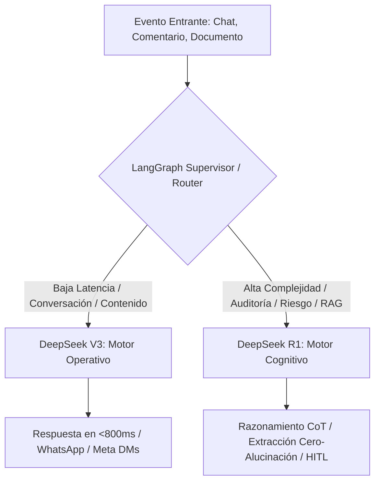

# 🏛️ ADR-004: Matriz de Enrutamiento de Modelos (Model Routing) & Especialización de Agentes IA

- **Estado:** ACEPTADO (v3.0 - Vector Inside Multi-Agent Governance)
- **Fecha:** 2026-10-10
- **Autor:** Lead Software Architect & Product Strategist — Vector Inside
- **Módulos Afectados:** `/rag` (RAGWizard), `/triage` (TriageProtocol), `/planner` (ContentPlanner), `/settings` (SubBotsConfig), LangGraph Supervisor / Lobo Vectorial.
- **Documentos Relacionados:** [ADR-001: Arquitectura Maestra & Gobernanza Multi-Tenant](file:///c:/Users/EdgarGs/Documents/ProyectoWork/VectorInside/VectorComunity/Vector-Community/docs/ADR_001_MASTER_ARCHITECTURE_AND_BUSINESS_RULES.md), [ADR-002: Taxonomía Universal & Pilares RAG](file:///c:/Users/EdgarGs/Documents/ProyectoWork/VectorInside/VectorComunity/Vector-Community/docs/ADR_002_UNIVERSAL_BUSINESS_TAXONOMY_AND_RAG_PILLARS.md), [ADR-003: Meta Graph Intelligence & HITL](file:///c:/Users/EdgarGs/Documents/ProyectoWork/VectorInside/VectorComunity/Vector-Community/docs/ADR_003_META_GRAPH_INTELLIGENCE_AND_HITL_TRIAGE.md)

---

## 1. Contexto & Planteamiento del Problema

En un ecosistema multi-agente como **Vector Community OS**, utilizar un único modelo para todas las operaciones genera dos problemas críticos:

1. **Inconsistencia de Costos y Latencia:** Enviar conversaciones rutinarias de WhatsApp a modelos de razonamiento denso (*Reasoning / CoT*) dispara la latencia a más de 5 segundos y multiplica el consumo de tokens de salida innecesariamente.
2. **Riesgo de Alucinación en Procesos Críticos:** Usar modelos conversacionales ligeros para auditar contratos o ingerir políticas comerciales complejas puede derivar en inventos de precios o cláusulas inexistentes.

Es imperativo definir una **Matriz Oficial de Enrutamiento de Modelos** que determine de forma programática cuándo delegar a **DeepSeek V3** y cuándo elevar a **DeepSeek R1**.

---

## 2. Decisiones de Arquitectura (Decisions)

### 2.1. Taxonomía de Modelos: Motor Operativo vs. Motor Cognitivo

---

### 2.2. Asignación por Agentes y Casos de Uso

| Nivel | Modelo Oficial | Rol en el Sistema | Latencia Objetivo | Costo Aprox. (1M tokens) | Casos de Uso Específicos |
| :--- | :--- | :--- | :--- | :--- | :--- |
| **Nivel 1 (Operativo)** | **DeepSeek V3** (`deepseek-chat`) | **Alta Frecuencia & Chat Frontal** | **< 800ms** | $0.14 input / $0.28 output | 1. Respuestas en vivo de WhatsApp Cloud API e Instagram DMs. 2. Respuestas públicas a comentarios en Reels y Posts de Meta. 3. Generación de copys, ganchos de venta y publicaciones en el Planificador de Contenido. 4. Resolución de dudas recurrentes basadas en el Pilar 3 (FAQs). 5. Extracción de entidades básicas (nombre, correo, teléfono, fecha). |
| **Nivel 2 (Cognitivo)** | **DeepSeek R1** (`deepseek-reasoner`) | **Razonamiento Profundo & Auditoría** | **3s – 8s** (Asíncrono) | $0.55 input / $2.19 output | 1. Ingestión y estructuración semántica de *Master Briefings* en el RAG Wizard (división en los 4 Pilares). 2. Auditoría y extracción estricta de las **Reglas Inviolables** sin inventos. 3. Detección de riesgo legal, quejas regulatorias (PROFECO, COFEPRIS) y amenazas de demanda. 4. Calificación de *Deals VIP High-Ticket* (> $15,000 USD) y cálculo de ROI complejo. 5. Análisis de objeciones comerciales duras en la mesa de control del Lobo Vectorial. |

---

### 2.3. Criterios de Selección del Supervisor (Routing Heuristics)

El Supervisor de LangGraph y el interceptor de la aplicación aplican las siguientes reglas deterministas:

1. **Regla de Latencia Síncrona:** Si el canal de entrega es síncrono (el cliente espera en WhatsApp o chat en vivo), **DeepSeek V3** es el modelo obligatorio por defecto para garantizar respuestas instantáneas.
2. **Regla de Procesamiento de Documentos:** Cualquier carga de archivos (`.pdf`, `.docx`, `.txt`) que supere los 2,000 tokens en el Asistente RAG se delega automáticamente a **DeepSeek R1**.
3. **Regla de Escalamiento por Inconsistencia:** Si un diálogo con DeepSeek V3 arroja una puntuación de confianza RAG menor al 70% ($\text{Score} < 0.70$), el mensaje pasa a una segunda pasada con **DeepSeek R1** antes de decidir si se resuelve o escala a un operador humano (**HITL**).
4. **Regla de Gobernanza de Tokens (Ratio 90/10):** Para mantener la rentabilidad de la agencia, el sistema está calibrado para que al menos el **90% al 95% del volumen mensual de tokens** sea atendido por **DeepSeek V3**, reservando **R1** para el 5% al 10% de operaciones críticas de alto valor.

---

### 2.4. Pipeline de Escucha en Redes & Deconstrucción Viral de Reels (DeepSeek R1)

Para transformar la actividad social en ventas predecibles, se establece el pipeline de inteligencia de contenido:

1. **Escucha Continua en Redes (Meta Graph Webhooks):** El sistema ingesta comentarios recurrentes y dudas frecuentes en publicaciones de Instagram y Facebook, clasificándolos automáticamente en temas de alto dolor o interés.
2. **Detección de Anomalías Virales:** Monitoreo periódico de reels y videos que superan el benchmark de desempeño de la vertical (`Visualizaciones > 15,000`, `Hook Rate > 40%`, `Retention Rate > 35%`).
3. **Deconstrucción Algorítmica con DeepSeek R1:** El motor cognitivo descompone el video analizando:
   * *Tipo de Gancho:* Provocación, revelación de secreto, miedo a perder dinero/salud o demostración inmediata.
   * *Ritmo de Retención:* Estímulo visual en los primeros 3 segundos.
   * *Mecanismo de Conversión:* Palabra clave requerida en comentarios para detonar el flujo por DM.
4. **Generación de Variantes Replicadas:** R1 redacta 3 nuevos guiones de 30 segundos en 4 actos estructurados (`[0-3s Gancho]`, `[4-15s Prueba/Valor]`, `[16-25s Oferta Gancho]`, `[26-30s CTA]`), aplicando la misma fórmula psicológica pero con los productos y promociones del tenant.

---

## 3. Consecuencias & Beneficios

### Positivas

- **Rentabilidad Máxima:** El costo de computación de IA para un cliente promedio se mantiene por debajo de $1 a $3 USD mensuales.
- **Experiencia de Usuario Inmediata:** Los prospectos en Meta y WhatsApp reciben atención en sub-segundos, maximizando la tasa de conversión y el ROAS.
- **Seguridad Inviolable:** Las reglas comerciales de las marcas nunca son modificadas por alucinaciones, gracias a la verificación de cadena de pensamiento (*Chain of Thought*) de DeepSeek R1.

---

## 4. Implementación Técnica en Configuración

Las credenciales y asignaciones se organizan en dos niveles:

1. **Global IDE / Developer Assistant:** Conectado mediante [`mcp_config.json`](file:///c:/Users/EdgarGs/.gemini/config/mcp_config.json) con `"DOTENV_CONFIG_QUIET": "true"`.
2. **App Core (`Vector-Community`):** Variables de entorno `.env.local` con `DEEPSEEK_API_KEY`, orquestadas dinámicamente según el identificador de tenant (`tenant_id`).

