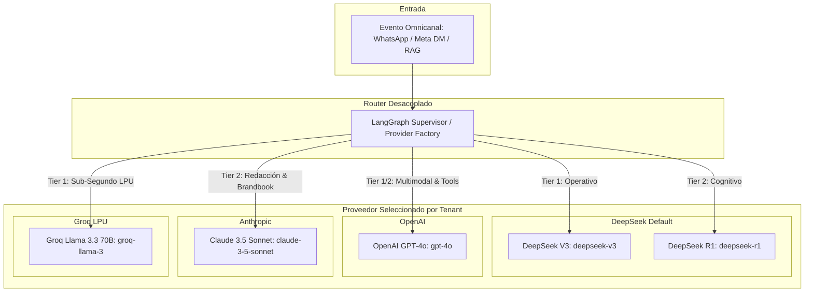

# 🏛️ ADR-005: Taxonomía Universal Multi-Proveedor (BYOK: Bring Your Own Key) & Matriz de Equivalencia de Modelos

- **Estado:** ACEPTADO (v3.0 - Universal Enterprise AI Integration)
- **Fecha:** 2026-10-10
- **Autor:** Lead Software Architect & Product Strategist — Vector Inside
- **Módulos Afectados:** `/settings` (SubBotsConfig), `/rag` (RAGWizard), `/triage` (TriageProtocol), LangGraph Supervisor / Lobo Vectorial, Model Provider Factory.
- **Documentos Relacionados:** [ADR-001: Arquitectura Maestra & Gobernanza Multi-Tenant](file:///c:/Users/EdgarGs/Documents/ProyectoWork/VectorInside/VectorComunity/Vector-Community/docs/ADR_001_MASTER_ARCHITECTURE_AND_BUSINESS_RULES.md), [ADR-004: Model Routing & Especialización de Agentes](file:///c:/Users/EdgarGs/Documents/ProyectoWork/VectorInside/VectorComunity/Vector-Community/docs/ADR_004_MODEL_ROUTING_AND_AGENT_SPECIALIZATION.md)

---

## 1. Contexto & Planteamiento del Problema

Los clientes de **Vector Community OS** operan bajo diferentes realidades corporativas, acuerdos empresariales y políticas de cumplimiento:
1. **Preferencias Corporativas (BYOK - Bring Your Own Key):** Algunas marcas ya cuentan con créditos empresariales o contratos firmados con **OpenAI (Azure)**, **Anthropic (AWS Bedrock)**, **Google Cloud (Vertex AI)** o **Groq Cloud**.
2. **Requisitos de Cumplimiento & Soberanía de Datos:** Giros médicos, financieros o legales exigen en ocasiones que los datos no salgan de proveedores certificados bajo normas específicas de su jurisdicción (HIPAA, GDPR, SOC2).
3. **Resiliencia ante Caídas (Multi-Provider Fallback):** Si un proveedor experimenta latencia o caída global de servicio (Downtime), el sistema debe conmutar automáticamente al proveedor de respaldo sin desconectar la atención al cliente.

---

## 2. Decisiones de Arquitectura (Decisions)

### 2.1. Arquitectura de Adaptadores Desacoplados (AI Model Adapter Pattern)

Independientemente del proveedor que el cliente seleccione o configure con su API Key, **la arquitectura interna de Vector Inside siempre opera bajo dos niveles funcionales inmutables**:
- **Nivel 1 (Tier 1 - Operativo Frontal):** Respuestas instantáneas (<800ms), bajo costo y alta empatía conversacional.
- **Nivel 2 (Tier 2 - Cognitivo & RAG):** Razonamiento deductivo denso, auditoría de documentos extensos y validación de Reglas Inviolables.

---

### 2.2. Matriz Universal de Equivalencia por Proveedor (Catálogo Activo en `SubBotsConfig.jsx`)

| Proveedor | ID en UI (`SubBotsConfig.jsx`) | Motor Oficial Activo | Tier & Rol Principal en Vector Community OS | Variable de Credencial (`envName`) | Costo Estimado (1M tokens) |
| :--- | :--- | :--- | :--- | :--- | :--- |
| **DeepSeek** *(Predeterminado)* | `deepseek-v3` | **DeepSeek V3 (Ultrarrápido)** | **Tier 1 (Operativo Frontal <800ms):** Chat en vivo WhatsApp/IG, comentarios públicos y copys. | `DEEPSEEK_API_KEY` | $0.14 input / $0.28 output |
| **DeepSeek** *(Predeterminado)* | `deepseek-r1` | **DeepSeek R1 (Razonamiento CoT)** | **Tier 2 (Cognitivo & RAG):** Extracción semántica del Master Briefing, Reglas Inviolables y auditoría financiera. | `DEEPSEEK_API_KEY` | $0.55 input / $2.19 output |
| **OpenAI** | `gpt-4o` | **OpenAI GPT-4o** | **Tier 1/2 (Corporativo Multimodal):** Ecosistema empresarial con llamadas a herramientas de alta precisión. | `OPENAI_API_KEY` | $2.50 input / $10.00 output |
| **Anthropic** | `claude-3-5-sonnet` | **Claude 3.5 Sonnet** | **Tier 2 (Empatía & Brandbook):** Redacción creativa de alta conversión, matices de marca y moderación delicada. | `ANTHROPIC_API_KEY` | $3.00 input / $15.00 output |
| **Groq LPU** | `groq-llama-3` | **Groq Llama 3.3 70B** | **Tier 1 (Inferencia Sub-Segundo):** Seguimientos 24h en lote y respuestas instantáneas a ~300 tokens/s. | `GROQ_API_KEY` | $0.59 input / $0.79 output |

---

### 2.3. Criterios de Selección & Recomendación por Giro Comercial

1. **E-Commerce & Creadores Meta (Alto Volumen / Margen Ajustado):**
   - **Recomendado:** **DeepSeek** (V3 + R1) o **Google Cloud** (Gemini 2.0 Flash).
   - *Justificación:* Procesan cientos de miles de interacciones de comentarios y carritos abandonados con costo prácticamente cero.
2. **Hospitality, Restaurantes & Gimnasios (Conversación Amigable / Respuestas Rápidas):**
   - **Recomendado:** **Anthropic** (Claude 3.5 Haiku para DMs) o **DeepSeek V3**.
   - *Justificación:* Tono cercano y natural, sin sonar a contestador robótico.
3. **Clínicas, Consultorios & Servicios Médicos (Rigor & Confidencialidad):**
   - **Recomendado:** **Anthropic** (Claude 3.5 Sonnet) o **OpenAI** (o3-mini).
   - *Justificación:* Obediencia quirúrgica a las Reglas Inviolables (e.g. no emitir diagnósticos ni recetar medicamentos por chat).
4. **B2B High-Ticket & Bienes Raíces (Contratos Grandes / Ingesta de Catálogos Masivos):**
   - **Recomendado:** **Google Gemini 1.5 Pro** (para catálogos y planos extensos) o **DeepSeek R1** (para matemática de financiamiento y ROI).

---

### 2.4. Protocolo de Respaldo y Auto-Conmutación (Failover Policy)

Si el proveedor activo del tenant devuelve error HTTP `429 (Rate Limit Exceeded)` o `5xx (Service Unavailable)` por más de 2 peticiones consecutivas:
1. El sistema conmuta automáticamente al proveedor secundario configurado (por defecto: DeepSeek V3/R1 en el Pool Oficial).
2. Se registra un log de advertencia en la mesa de control de la agencia (`/triage`).
3. La conversación con el cliente final nunca se interrumpe ni sufre silencios.

---

### 2.5. Gobernanza BYOK en UI: Configuración Contextual Inline, Cifrado AES-256-GCM y Pool Oficial

La experiencia de configuración BYOK en [`SubBotsConfig.jsx`](file:///c:/Users/EdgarGs/Documents/ProyectoWork/VectorInside/VectorComunity/Vector-Community/src/components/SubBotsConfig.jsx) sigue tres principios de seguridad y usabilidad:

1. **Divulgación Progresiva Contextual (Zero-Clutter UI):** No existe una tabla masiva de llaves huérfanas. Al seleccionar cualquiera de los 5 motores (`deepseek-v3`, `deepseek-r1`, `gpt-4o`, `claude-3-5-sonnet`, `groq-llama-3`) en la tarjeta de un Sub-Agente, la interfaz adapta dinámicamente su barra de estado inferior para mostrar únicamente la credencial asociada a ese motor (`DEEPSEEK_API_KEY`, `OPENAI_API_KEY`, `ANTHROPIC_API_KEY` o `GROQ_API_KEY`).
2. **Conmutación Instantánea entre Pool Oficial y Clave Propia:**
   - Si el campo de API Key está vacío, el agente opera automáticamente bajo el **Pool Oficial Vector Inside** sin fricción para la agencia.
   - Si el tenant ingresa una API Key propia, el badge cambia a `● Clave Propia`, habilitando el botón **`Test Ping`** para verificar la conectividad en tiempo real y el botón **`Volver al Pool Oficial (Limpiar clave)`** para revocar la llave custom con un clic.
3. **Almacenamiento Cifrado con AES-256-GCM:** Toda API Key suministrada por un cliente bajo el esquema BYOK se transmite exclusivamente vía HTTPS/TLS 1.3 y se almacena en PostgreSQL cifrada en reposo con **AES-256-GCM** (*Authenticated Encryption with Associated Data*), vinculada criptográficamente al `tenant_id` bajo políticas RLS estrictas.

---

## 3. Consecuencias & Beneficios

### Positivas:
- **Cero Fricción Comercial con Clientes:** La agencia puede decir con total seguridad: *"Nos integramos con el proveedor de IA que tu empresa prefiera"*.
- **Neutralidad Tecnológica:** El código de Vector Inside no se ata a la API de ninguna compañía individual.
- **Protección de Costos:** El cliente sabe de antemano el costo exacto por millón de tokens según el proveedor que elija.
