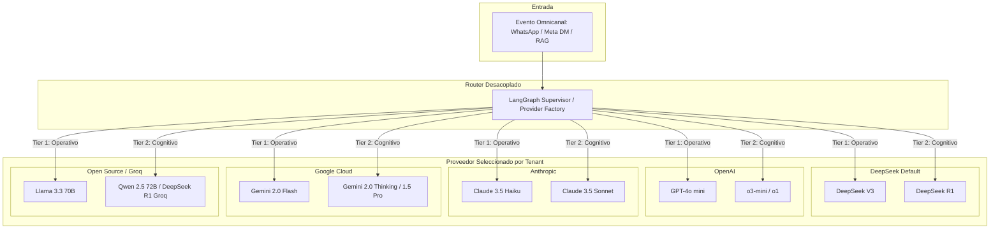

# 🏛️ ADR-005: Taxonomía Universal Multi-Proveedor (BYOK: Bring Your Own Key) & Matriz de Equivalencia de Modelos

- **Estado:** ACEPTADO (v3.0 - Universal Enterprise AI Integration)
- **Fecha:** 2026-10-10
- **Autor:** Lead Software Architect & Product Strategist — Vector Inside
- **Módulos Afectados:** `/settings` (SubBotsConfig), `/rag` (RAGWizard), `/triage` (TriageProtocol), LangGraph Supervisor / Lobo Vectorial, Model Provider Factory.
- **Documentos Relacionados:** [ADR-001: Arquitectura Maestra & Gobernanza Multi-Tenant](file:///c:/Users/EdgarGs/Documents/ProyectoWork/VectorInside/VectorComunity/Vector-Community/docs/ADR_001_MASTER_ARCHITECTURE_AND_BUSINESS_RULES.md), [ADR-004: Model Routing & Especialización de Agentes](file:///c:/Users/EdgarGs/Documents/ProyectoWork/VectorInside/VectorComunity/Vector-Community/docs/ADR_004_MODEL_ROUTING_AND_AGENT_SPECIALIZATION.md)

---

## 1. Contexto & Planteamiento del Problema

Los clientes de **Vector Community OS** operan bajo diferentes realidades corporativas, acuerdos empresariales y políticas de cumplimiento:
1. **Preferencias Corporativas (BYOK - Bring Your Own Key):** Algunas marcas ya cuentan con créditos empresariales o contratos firmados con **OpenAI (Azure)**, **Anthropic (AWS Bedrock)**, **Google Cloud (Vertex AI)** o **Groq Cloud**.
2. **Requisitos de Cumplimiento & Soberanía de Datos:** Giros médicos, financieros o legales exigen en ocasiones que los datos no salgan de proveedores certificados bajo normas específicas de su jurisdicción (HIPAA, GDPR, SOC2).
3. **Resiliencia ante Caídas (Multi-Provider Fallback):** Si un proveedor experimenta latencia o caída global de servicio (Downtime), el sistema debe conmutar automáticamente al proveedor de respaldo sin desconectar la atención al cliente.

---

## 2. Decisiones de Arquitectura (Decisions)

### 2.1. Arquitectura de Adaptadores Desacoplados (AI Model Adapter Pattern)

Independientemente del proveedor que el cliente seleccione o configure con su API Key, **la arquitectura interna de Vector Inside siempre opera bajo dos niveles funcionales inmutables**:
- **Nivel 1 (Tier 1 - Operativo Frontal):** Respuestas instantáneas (<800ms), bajo costo y alta empatía conversacional.
- **Nivel 2 (Tier 2 - Cognitivo & RAG):** Razonamiento deductivo denso, auditoría de documentos extensos y validación de Reglas Inviolables.

---

### 2.2. Matriz Universal de Equivalencia por Proveedor

| Proveedor | Tier 1: Motor Operativo Frontal (<800ms) | Tier 2: Motor Cognitivo & RAG (Razonamiento / Cero Alucinación) | Perfil Idóneo & Fortalezas del Proveedor | Costo Estimado (Tier 1 / Tier 2) |
| :--- | :--- | :--- | :--- | :--- |
| **DeepSeek** *(Predeterminado)* | **DeepSeek V3** (`deepseek-chat`) | **DeepSeek R1** (`deepseek-reasoner`) | **Mejor costo/beneficio global.** Ideal para máxima rentabilidad de la agencia sin sacrificar potencia lógica. | $0.14 / $0.28 (V3) $0.55 / $2.19 (R1) |
| **OpenAI** | **GPT-4o mini** | **o3-mini** (o `o1-preview`) | **Estándar corporativo.** Para marcas con acuerdos Azure OpenAI o preferencia por ecosistema ChatGPT. | $0.15 / $0.60 (4o-mini) $1.10 / $4.40 (o3-mini) |
| **Anthropic** | **Claude 3.5 Haiku** | **Claude 3.5 Sonnet** | **Líder en tono humano y redacción de marca.** Máxima empatía conversacional y adherencia a Brandbooks complejos. | $0.80 / $4.00 (Haiku) $3.00 / $15.00 (Sonnet) |
| **Google Cloud** | **Gemini 2.0 Flash** | **Gemini 2.0 Flash Thinking** / **1.5 Pro** | **Ventana de contexto colosal.** Capaz de digerir bibliotecas enteras de hasta 1M-2M tokens en el Asistente RAG. | $0.10 / $0.40 (Flash) $1.25 / $5.00 (1.5 Pro) |
| **Groq / Open Source** | **Llama 3.3 70B Versatile** | **Qwen 2.5 72B** / **DeepSeek R1 (LPU)** | **Velocidad extrema en hardware LPU** (300+ tok/s). Soberanía total de datos para clientes con requerimientos on-premise. | $0.59 / $0.79 (Groq Llama) $2.00 / $2.00 (R1 Groq) |

---

### 2.3. Criterios de Selección & Recomendación por Giro Comercial

1. **E-Commerce & Creadores Meta (Alto Volumen / Margen Ajustado):**
   - **Recomendado:** **DeepSeek** (V3 + R1) o **Google Cloud** (Gemini 2.0 Flash).
   - *Justificación:* Procesan cientos de miles de interacciones de comentarios y carritos abandonados con costo prácticamente cero.
2. **Hospitality, Restaurantes & Gimnasios (Conversación Amigable / Respuestas Rápidas):**
   - **Recomendado:** **Anthropic** (Claude 3.5 Haiku para DMs) o **DeepSeek V3**.
   - *Justificación:* Tono cercano y natural, sin sonar a contestador robótico.
3. **Clínicas, Consultorios & Servicios Médicos (Rigor & Confidencialidad):**
   - **Recomendado:** **Anthropic** (Claude 3.5 Sonnet) o **OpenAI** (o3-mini).
   - *Justificación:* Obediencia quirúrgica a las Reglas Inviolables (e.g. no emitir diagnósticos ni recetar medicamentos por chat).
4. **B2B High-Ticket & Bienes Raíces (Contratos Grandes / Ingesta de Catálogos Masivos):**
   - **Recomendado:** **Google Gemini 1.5 Pro** (para catálogos y planos extensos) o **DeepSeek R1** (para matemática de financiamiento y ROI).

---

### 2.4. Protocolo de Respaldo y Auto-Conmutación (Failover Policy)

Si el proveedor activo del tenant devuelve error HTTP `429 (Rate Limit Exceeded)` o `5xx (Service Unavailable)` por más de 2 peticiones consecutivas:
1. El sistema conmuta automáticamente al proveedor secundario configurado (por defecto: DeepSeek V3/R1).
2. Se registra un log de advertencia en la mesa de control de la agencia (`/triage`).
3. La conversación con el cliente final nunca se interrumpe ni sufre silencios.

---

## 3. Consecuencias & Beneficios

### Positivas:
- **Cero Fricción Comercial con Clientes:** La agencia puede decir con total seguridad: *"Nos integramos con el proveedor de IA que tu empresa prefiera"*.
- **Neutralidad Tecnológica:** El código de Vector Inside no se ata a la API de ninguna compañía individual.
- **Protección de Costos:** El cliente sabe de antemano el costo exacto por millón de tokens según el proveedor que elija.
