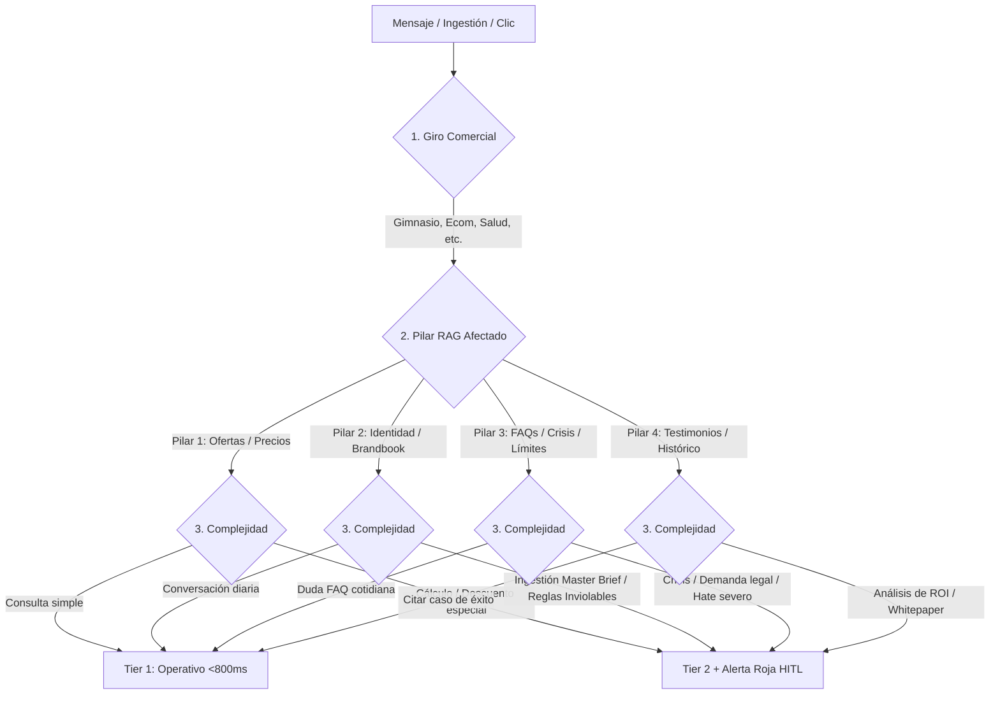

# 🏛️ ADR-006: Matriz Tridimensional de Acoplamiento: [Giros de Negocio] × [4 Pilares RAG] × [Modelos & Tiers IA]

- **Estado:** ACEPTADO (v3.0 - Unified Architectural Standard)
- **Fecha:** 2026-10-10
- **Autor:** Lead Software Architect & Product Strategist — Vector Inside
- **Módulos Afectados:** `/rag` (RAGWizard), `/settings` (SubBotsConfig), `/planner` (ContentPlanner), `/triage` (TriageProtocol), LangGraph Supervisor / Lobo Vectorial.
- **Documentos Relacionados:** [ADR-001: Arquitectura Maestra](file:///c:/Users/EdgarGs/Documents/ProyectoWork/VectorInside/VectorComunity/Vector-Community/docs/ADR_001_MASTER_ARCHITECTURE_AND_BUSINESS_RULES.md), [ADR-002: Taxonomía de Giros & 4 Pilares](file:///c:/Users/EdgarGs/Documents/ProyectoWork/VectorInside/VectorComunity/Vector-Community/docs/ADR_002_UNIVERSAL_BUSINESS_TAXONOMY_AND_RAG_PILLARS.md), [ADR-004: Model Routing](file:///c:/Users/EdgarGs/Documents/ProyectoWork/VectorInside/VectorComunity/Vector-Community/docs/ADR_004_MODEL_ROUTING_AND_AGENT_SPECIALIZATION.md), [ADR-005: Taxonomía Multi-Proveedor](file:///c:/Users/EdgarGs/Documents/ProyectoWork/VectorInside/VectorComunity/Vector-Community/docs/ADR_005_UNIVERSAL_MULTI_PROVIDER_AI_TAXONOMY.md), [ADR-007: Modelo Comercial Vector Deal](file:///c:/Users/EdgarGs/Documents/ProyectoWork/VectorInside/VectorComunity/Vector-Community/docs/ADR_007_OFFICIAL_COMMERCIAL_PRICING_AND_BILLING_RULES.md)

---

## 1. Contexto & Planteamiento del Problema

Para que la automatización de la agencia sea verdaderamente industrial y escalable, las reglas no pueden existir de forma aislada. Deben responder con precisión matemática a tres preguntas simultáneas en cada interacción:
1. **¿Qué tipo de negocio es?** (Giro Comercial de los 8 oficiales).
2. **¿Qué información se está consultando o modificando?** (Cuál de los 4 Pilares RAG).
3. **¿Qué nivel de cómputo y modelo debe responder?** (Tier 1 Operativo vs. Tier 2 Cognitivo).

Este documento formaliza el **Acoplamiento Tridimensional Total** del sistema.

---

## 2. El Esquema Tridimensional de Acoplamiento

```mermaid
cube
    title "Cubo de Inteligencia Vector Inside"
    x-axis "8 Giros Comerciales"
    y-axis "4 Pilares RAG"
    z-axis "2 Tiers de Modelos (Operativo / Cognitivo)"
```



---

## 3. Matriz Maestra de Acoplamiento por Giro Comercial

A continuación se detalla cómo cada uno de los **8 giros comerciales** acopla los **4 Pilares RAG** con los **Tiers de Modelos IA**:

---

### 🏋️ 1. Fitness & Centros Deportivos (Gimnasios, CrossFit, Estudios de Yoga)
- **Modelo de Conversión:** Pase de cortesía de 1 día → Visita física → Membresía recurrente.
- **Regla Inviolable:** NUNCA inventar promociones que no estén en la base y NUNCA asegurar cupo en clases sin verificar agenda.
- **Acoplamiento por Pilares:**
  - **Pilar 1 (Precios):** Consultas de aranceles y planes mensuales atendidas por **Tier 1 (Operativo)**.
  - **Pilar 2 (Identidad):** Tono enérgico, motivador y cercano vía **Tier 1 (Operativo)**. Ingestión del reglamento interno con **Tier 2 (Cognitivo)**.
  - **Pilar 3 (Crisis/FAQs):** Respuestas a horarios, estacionamiento y duchas por **Tier 1**. Si el cliente reclama cobro no reconocido o lesión física, **Tier 2** congela la conversación y despacha alerta **HITL**.
  - **Pilar 4 (Histórico):** Citas de transformaciones físicas y testimonios por **Tier 1**.

---

### 🎓 2. Escuelas, Academias & Cursos Online (Educación)
- **Modelo de Conversión:** Descarga de Plan de Estudios / Temario → Clase muestra → Inscripción por ciclo.
- **Regla Inviolable:** NUNCA prometer certificaciones oficiales si el RAG indica que no cuentan con RVOE/aval oficial.
- **Acoplamiento por Pilares:**
  - **Pilar 1 (Precios):** Desglose de colegiaturas y becas regulares por **Tier 1**. Negociación de financiamiento o convenios empresariales analizados por **Tier 2**.
  - **Pilar 2 (Identidad):** Tono académico, inspirador y formal por **Tier 1**.
  - **Pilar 3 (Crisis/FAQs):** Dudas de fechas límite y requisitos por **Tier 1**. Reclamaciones de titulación o quejas docentes auditadas por **Tier 2** con escalamiento humano.
  - **Pilar 4 (Histórico):** Acreditaciones y casos de alumnos egresados presentados por **Tier 1**.

---

### 🤝 3. Redes de Networking & Membresías Exclusivas (B2B Masterminds)
- **Modelo de Conversión:** Formulario de postulación → Filtro de giro exclusivo → Invitación a sesión de mesa.
- **Regla Inviolable:** SIEMPRE verificar si el giro del prospecto ya está ocupado antes de invitarlo.
- **Acoplamiento por Pilares:**
  - **Pilar 1 (Precios):** Cuotas anuales o de sesión por **Tier 1**.
  - **Pilar 2 (Identidad):** Tono ejecutivo de alto estatus por **Tier 1**.
  - **Pilar 3 (Crisis/FAQs):** Filtro de incompatibilidad de giro y reglas de asistencia analizadas por **Tier 2** para evitar invitar a competidores directos.
  - **Pilar 4 (Histórico):** Negocios cruzados generados y cifras del capítulo por **Tier 1**.

---

### 👟 4. E-Commerce & Retail (Marcas D2C / Tiendas Online)
- **Modelo de Conversión:** Catálogo de productos → Cupón de bienvenida → Compra y tracking de envío.
- **Regla Inviolable:** NUNCA modificar el costo de envío ni prometer entregas antes de los tiempos del courier.
- **Acoplamiento por Pilares:**
  - **Pilar 1 (Precios):** SKUs, existencias y códigos de descuento por **Tier 1**.
  - **Pilar 2 (Identidad):** Tono fresco y dinámico alineado a la marca por **Tier 1**.
  - **Pilar 3 (Crisis/FAQs):** Dudas de rastreo y cambios por **Tier 1**. Paquetes extraviados, productos rotos o solicitudes de reembolso procesadas por **Tier 2** con verificación antifraude.
  - **Pilar 4 (Histórico):** Reseñas de producto y fotos de clientes satisfechos insertadas por **Tier 1**.

---

### 🥩 5. Hospitality, Restaurantes & Eventos
- **Modelo de Conversión:** Menú digital → Reserva de mesa / Evento privado → Asistencia.
- **Regla Inviolable:** NUNCA confirmar eventos privados para más de 10 personas sin depósito verificado.
- **Acoplamiento por Pilares:**
  - **Pilar 1 (Precios):** Costo de platillos y paquetes por persona por **Tier 1**. Cotización de salones para bodas o corporativos por **Tier 2**.
  - **Pilar 2 (Identidad):** Tono hospitalario, gourmet y acogedor por **Tier 1**.
  - **Pilar 3 (Crisis/FAQs):** Alergias alimentarias y políticas de descorche por **Tier 1**. Reclamaciones de intoxicación o quejas en el local analizadas por **Tier 2** con alerta roja inmediata al gerente.
  - **Pilar 4 (Histórico):** Calificaciones en Google Maps y fotos de eventos por **Tier 1**.

---

### 💼 6. B2B High-Ticket & Consultoría Estratégica
- **Modelo de Conversión:** Auditoría de diagnóstico gratuita → Cita de estrategia con el CRO / Founder → Cierre de contrato.
- **Regla Inviolable:** NUNCA firmar o pactar SLAs sin aprobación expresa del Director.
- **Acoplamiento por Pilares:**
  - **Pilar 1 (Precios):** Rangos base (BANT) por **Tier 1**. Propuestas personalizadas (> $15,000 USD) estructuradas por **Tier 2**.
  - **Pilar 2 (Identidad):** Tono de autoridad experta y consultiva por **Tier 1**.
  - **Pilar 3 (Crisis/FAQs):** Dudas de confidencialidad y metodologías por **Tier 1**. Clientes en riesgo de rescisión de contrato evaluados por **Tier 2**.
  - **Pilar 4 (Histórico):** Whitepapers, ROI comprobado y casos de clientes corporativos presentados por **Tier 1** y analizados por **Tier 2**.

---

### 🏙️ 7. Bienes Raíces & Automotriz (Inversiones de Alto Valor)
- **Modelo de Conversión:** Ficha técnica / Tour virtual → Pre-calificación crediticia → Cita en desarrollo / Showroom.
- **Regla Inviolable:** NUNCA asegurar tasas de interés bancarias sin dictamen formal de la institución financiera.
- **Acoplamiento por Pilares:**
  - **Pilar 1 (Precios):** Precios de lista y enganche mínimo por **Tier 1**. Simulación de corridas financieras y amortizaciones calculadas por **Tier 2**.
  - **Pilar 2 (Identidad):** Tono patrimonial, seguro y sofisticado por **Tier 1**.
  - **Pilar 3 (Crisis/FAQs):** Ubicaciones, amenidades y acabados por **Tier 1**. Temas de escrituración o litigios de posesión auditados por **Tier 2** con bloqueo de respuestas automatizadas.
  - **Pilar 4 (Histórico):** Plusvalía histórica del desarrollo entregada por **Tier 1**.

---

### 🎬 8. Creadores de Contenido, Marcas Personales & Meta Creators
- **Modelo de Conversión:** Interacción en Reels/Stories → Comunidad privada / Lead Magnet → Patrocinios y Merch.
- **Regla Inviolable:** NUNCA pactar tarifas de colaboración publicitaria sin el Media Kit oficial.
- **Acoplamiento por Pilares:**
  - **Pilar 1 (Precios):** *Opcional/Inactivo* para seguidores; tarifas de marcas procesadas por **Tier 2** en base al Media Kit.
  - **Pilar 2 (Identidad):** Mimic total de la voz, modismos y emojis del creador por **Tier 1**.
  - **Pilar 3 (Crisis/FAQs):** Respuestas de bienvenida y agradecimiento por **Tier 1**. Filtro de **Hate masivo, acoso o difamación** clasificado por **Tier 2** para ocultamiento automático en Meta Graph API.
  - **Pilar 4 (Histórico):** Métricas de alcance (Engagement Rate, Views) compartidas por **Tier 1**.

---

## 4. Tabla Maestra de Equivalencia de Modelos por Tier

Cualquiera que sea el proveedor configurado por el cliente, este mapa garantiza la ejecución del tier correspondiente:

| Proveedor | Tier 1 (Operativo: Consultas, DMs, Comentarios, Copys) | Tier 2 (Cognitivo: RAG Wizard, Crisis, Reglas Inviolables, High-Ticket) |
| :--- | :--- | :--- |
| **DeepSeek** *(Default)* | `deepseek-chat` (DeepSeek V3) | `deepseek-reasoner` (DeepSeek R1) |
| **OpenAI** | `gpt-4o-mini` | `o3-mini` (o `o1`) |
| **Anthropic** | `claude-3-5-haiku-latest` | `claude-3-5-sonnet-latest` |
| **Google Cloud** | `gemini-2.0-flash` | `gemini-2.0-flash-thinking-exp` / `gemini-1.5-pro` |
| **Groq / Open Source** | `llama-3.3-70b-versatile` | `qwen-2.5-72b` / `deepseek-r1-distill-llama-70b` |

---

## 5. Conclusión & Garantía Operativa

Gracias a esta arquitectura tridimensional:
1. **La agencia nunca pierde el control:** Cada mensaje sabe a qué giro pertenece, qué pilar consulta y qué modelo debe ejecutarlo.
2. **Cero fugas de margen:** El 90% de las operaciones corren en el Tier 1 (ultrabarato y sub-segundo), blindando la rentabilidad.
3. **Cero alucinaciones:** Ninguna regla inviolable es interpretada por un modelo ligero; siempre pasa por el motor cognitivo de razonamiento.
