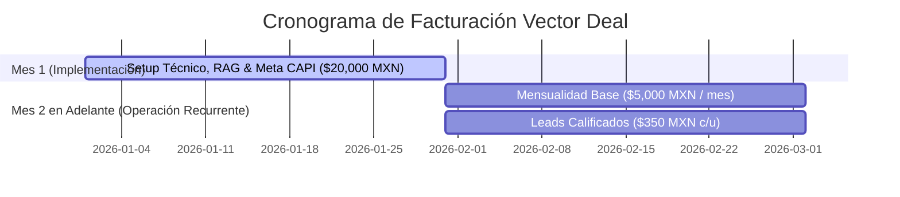

# 🏛️ ADR-007: Modelo Comercial Vector Deal: Catálogo de Precios, Implementación & Atribución de Leads

- **Estado:** ACEPTADO (v3.0 - Official Pricing & Monetization Model)
- **Fecha:** 2026-10-10
- **Autor:** Lead Software Architect & Chief Commercial Officer — Vector Inside
- **Módulos Afectados:** `/pricing` (PricingSection), `/roi` (RoiCalculator), `/settings` (SubBotsConfig), Facturación, LangGraph Supervisor (Ventas & Calificación).
- **Documentos Relacionados:** [ADR-001: Arquitectura Maestra](file:///c:/Users/EdgarGs/Documents/ProyectoWork/VectorInside/VectorComunity/Vector-Community/docs/ADR_001_MASTER_ARCHITECTURE_AND_BUSINESS_RULES.md), [ADR-002: Taxonomía Universal & 4 Pilares RAG](file:///c:/Users/EdgarGs/Documents/ProyectoWork/VectorInside/VectorComunity/Vector-Community/docs/ADR_002_UNIVERSAL_BUSINESS_TAXONOMY_AND_RAG_PILLARS.md), [ADR-006: Matriz Tridimensional de Acoplamiento](file:///c:/Users/EdgarGs/Documents/ProyectoWork/VectorInside/VectorComunity/Vector-Community/docs/ADR_006_TRI_DIMENSIONAL_COUPLING_MATRIX.md)

---

## 1. Contexto & Planteamiento del Problema

El modelo SaaS tradicional de tarifa plana no alinea los incentivos entre la agencia y el cliente final:
- Las marcas desconfían de cuotas fijas elevadas si no perciben un flujo inmediato de prospectos calificados.
- Por otro lado, un modelo 100% a comisión deja desprotegido el costo de ingeniería y configuración inicial que requiere desplegar la infraestructura de **Vector Community OS**.

Se formaliza el modelo comercial **Vector Deal**, un esquema híbrido de alto valor que combina:
1. Una tarifa de despliegue que absorbe los costos técnicos iniciales.
2. Una mensualidad accesible de infraestructura y soporte continuo.
3. Un componente de éxito variable basado estrictamente en **Leads Calificados**.

---

## 2. Decisiones de Arquitectura Comercial (Decisions)

### 2.1. Estructura Oficial de Precios (Tarifario Maestro)

| Concepto Comercial | Monto Oficial (MXN) | Frecuencia | Cobertura & Alcance |
| :--- | :--- | :--- | :--- |
| **1. Implementación & Setup Inicial** | **$20,000 MXN + IVA** | **Pago Único** | Ingestión del Master Briefing en los 4 Pilares RAG, entrenamiento del Lobo Vectorial y sub-bots, conexión de Meta CAPI (Server-to-Server), integración de WhatsApp Cloud API, pruebas de penetración y calibración de Reglas Inviolables. |
| **2. Mensualidad de Servicio & Mantenimiento** | **$5,000 MXN + IVA** | **Mensual Recurrente** | Infraestructura multi-tenant PostgreSQL RLS, monitoreo continuo 24/7, soporte prioritario, actualización de prompts y optimización de latencia en edge. |
| **3. Lead Calificado (Performance / Éxito)** | **$350 MXN** | **Por Evento Calificado** | Cobro variable por cada prospecto que cumple al 100% la matriz de cualificación del Pilar 1 y es registrado con datos verificados en el CRM / Meta CAPI. |

---

### 2.2. Regla Inviolable de Facturación Temporal (Timeline de Cobro)

> **Regla de Negocio #1:**  
> **"La mensualidad de $5,000 MXN + IVA comienza a correr estrictamente cuando concluye el mes de implementación (a partir del Día 31)."**

- **Mes 1 (Días 1 a 30):** El cliente abona únicamente los **$20,000 MXN** de implementación. Durante este periodo no se factura mensualidad base. Los leads calificados generados durante la fase de prueba/lanzamiento inicial se auditan según el acuerdo particular.
- **Mes 2 en Adelante (Día 31+):** Se factura la cuota base de **$5,000 MXN mensuales** + el total de leads calificados auditados a **$350 MXN cada uno**.

---

### 2.3. Definición Técnica & Criterios de "Lead Calificado" ($350 MXN)

Para evitar disputas comerciales y garantizar la soberanía de datos, un prospecto **solo se considera Lead Calificado** si cumple con los siguientes 4 filtros auditables:

1. **Datos de Contacto Verificados:**
   - Nombre completo.
   - Número de WhatsApp activo verificado (formato E.164).
   - Correo electrónico válido (opcional según giro).
2. **Cualificación BANT en Chat:**
   - Ha interactuado con el bot y confirmado interés explícito en el servicio/producto.
   - Cumple con los criterios de calificación del **Pilar 1** (e.g. rango de presupuesto, ubicación geográfica dentro del radio de servicio o giro comercial compatible).
3. **Registro Criptográfico en Meta CAPI:**
   - El evento `Lead` o `QualifiedLead` fue transmitido vía server-to-server a Meta con hash SHA-256 para atribución publicitaria.
4. **No Duplicidad:**
   - El prospecto no ha sido facturado en los últimos 30 días para el mismo tenant.

---

### 2.4. Proyección Financiera de Ejemplo para el Cliente

| Escenario Mensual (a partir del Mes 2) | Leads Calificados | Costo Variable ($350 c/u) | Mensualidad Base | Total Facturado a la Marca | Cierres Estimados (Conv. 20%) | Ticket Promedio | Ingreso Estimado del Cliente | ROI del Cliente |
| :--- | :--- | :--- | :--- | :--- | :--- | :--- | :--- | :--- |
| **Conservador** | 30 leads | $10,500 | $5,000 | **$15,500 MXN** | 6 ventas | $8,000 MXN | $48,000 MXN | **3.1x** |
| **Estándar** | 60 leads | $21,000 | $5,000 | **$26,000 MXN** | 12 ventas | $8,000 MXN | $96,000 MXN | **3.7x** |
| **Alto Rendimiento** | 120 leads | $42,000 | $5,000 | **$47,000 MXN** | 24 ventas | $8,000 MXN | $192,000 MXN | **4.1x** |

---

### 2.5. Sustento Estratégico del Modelo de Negocio (Hormozi & Ehrenberg-Bass)

El modelo comercial **Vector Deal** se sustenta en dos marcos económicos clave:

1. **Ecuación de Valor de Alex Hormozi:**
   $$\text{Valor Percibido} = \frac{\text{Dream Outcome (Resultado Soñado)} \times \text{Perceived Likelihood of Achievement}}{\text{Time Delay (Retraso Temporal)} \times \text{Effort \& Sacrifice (Esfuerzo y Sacrificio)}}$$
   - **Time Delay $\to 0$:** La respuesta inmediata (<10s) y el agendamiento instantáneo con Google Calendar API maximizan la probabilidad de conversión.
   - **Effort \& Sacrifice $\to 0$:** La agencia y el cliente no tienen que perseguir prospectos manualmente; el sistema califica y entrega el prospecto pre-cerrado en bandeja de Triage.
   - Por ello, el cliente percibe que pagar **$350 MXN** por un lead listo para cierre es exponencialmente más rentable que contratar community managers manuales.

2. **Monetización Dual bajo la Regla 95/5 (Ehrenberg-Bass):**
   - **5% En Mercado Hoy (In-Market):** Prospectos con urgencia alta que compran o agendan en la primera sesión $\to$ Mutan de inmediato a `BILLABLE_LEAD` ($350 MXN).
   - **95% Fuera de Mercado Hoy (Out-of-Market):** Prospectos que responden "lo voy a pensar" o pausaron $\to$ No se descartan ni se cobran en falso. Se encolan en **Upstash Redis Queue** para re-engagement a las 24h con el Sub-Agente Creador (Vaca Púrpura). Cuando reactivan y confirman cita, se monetizan en el segundo ciclo a costo publicitario $0 adicional.

---

## 3. Consecuencias & Beneficios

### Para la Agencia:
- **Flujo de Caja Inmediato:** Los $20,000 MXN iniciales financian el costo del setup de ingeniería.
- **Ingreso Recurrente Predecible:** Base sólida de $5,000 MXN por cliente activo.
- **Upside Ilimitado:** El cobro de $350 por lead calificado escala conforme crecen las campañas publicitarias del cliente.

### Para el Cliente:
- **Riesgo Compartido:** No paga mensualidad durante la implementación.
- **Transparencia Total:** Cada lead facturado cuenta con un registro en el panel con fecha, hora, transcripción y hash CAPI.
