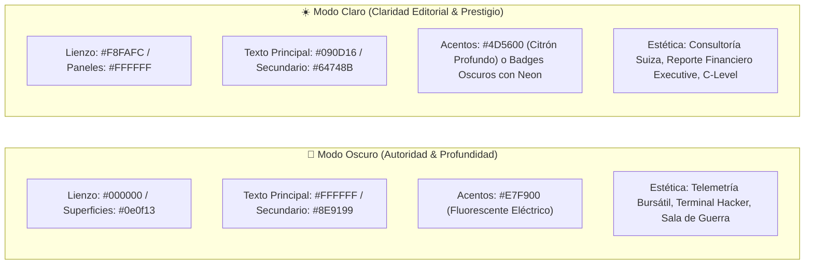

# 🏛️ ADR-009: Sistema de Diseño Dual-Theme (Modo Oscuro & Modo Claro Ejecutivo), Ontología de Tokens & Accesibilidad WCAG

- **Estado:** ACEPTADO (v3.0 - Dual-Theme Executive Governance Standard)
- **Fecha:** 2026-10-10
- **Autor:** Principal UI/UX Lead, Design Systems Architect & Brand Sentinel — Vector Inside
- **Módulos Afectados:** Aplicación Global (`src/styles/globals.css`, `tailwind.config.js`), Layout (`Header`, `Sidebar`), `/triage` (TriageProtocol), `/dashboard`, `/metrics`, `/planner`, `/calendar`.
- **Documentos Relacionados:** [ADR-001: Arquitectura Maestra](file:///c:/Users/EdgarGs/Documents/ProyectoWork/VectorInside/VectorComunity/Vector-Community/docs/ADR_001_MASTER_ARCHITECTURE_AND_BUSINESS_RULES.md), [ADR-008: Máquina de Estados & Kanban Triage](file:///c:/Users/EdgarGs/Documents/ProyectoWork/VectorInside/VectorComunity/Vector-Community/docs/ADR_008_PAY_PER_QUALIFIED_LEAD_STATE_MACHINE_AND_KANBAN_TRIAGE.md), [SDD: Documento de Diseño de Sistema](file:///c:/Users/EdgarGs/Documents/ProyectoWork/VectorInside/VectorComunity/Vector-Community/docs/SDD_SYSTEM_DESIGN_DOCUMENT.md)

---

## 1. Contexto & Diagnóstico del Diseñador Principal

En sistemas operacionales de alta intensidad y gobernanza multitenant como **Vector Community OS**, los operadores humanos (agentes HITL, directores de cuenta y clientes VIP) operan en entornos de iluminación radicalmente distintos:

1. **Jornadas Nocturnas / Centros de Operación:** Requieren un **Modo Oscuro (Dark Mode)** profundo, cibernético y de fatiga visual mínima.
2. **Reuniones Ejecutivas / Entornos Diurnos / Reportes para C-Level:** Requieren un **Modo Claro (Light Mode)** prístino, de alta claridad editorial, donde los paneles comuniquen orden, seriedad corporativa y nitidez táctica.

### Diagnóstico de Fallas Previas en Modo Claro (Anti-patrones erradicados)

- **Ceguera de Contraste (Texto Invisible):** Clases rígidas como `text-white` en fondos que cambiaban a `#f8fafc`, resultando en títulos totalmente invisibles (1:1 de contraste).
- **Colapso del Amarillo Vectorial:** El color corporativo `#E7F900` tiene un contraste brillante (>18:1) sobre negro, pero al ser renderizado directamente como texto sobre blanco cae a **~1.2:1**, violando severamente los estándares de accesibilidad WCAG AA.
- **Efecto Parche (Patchwork / Cajas Negras Huérfanas):** Componentes con fondos oscuros fijos (`bg-zinc-950/80`) flotando sin adaptación sobre un lienzo claro, rompiendo la armonía visual del sistema.

---

## 2. Filosofía Dual-Theme: "Terminal Cibernética vs. Sala de Juntas Ejecutiva"



---

## 3. Ontología Maestra de Tokens de Diseño

La arquitectura CSS se apoya en variables CSS dinámicas en `globals.css` complementadas con la variante declarativa `dark:` de Tailwind CSS (`darkMode: 'class'`).

| Token Semántico | Variable CSS | Modo Oscuro (`:root`) | Modo Claro (`.light`) | Función y Rol en la UI | WCAG Ratio |
| :--- | :--- | :--- | :--- | :--- | :--- |
| **Lienzo Base** | `--bg-base` | `#000000` | `#F8FAFC` | Fondo general de la ventana y el viewport. | N/A |
| **Superficie Panel** | `--bg-panel` | `#07080A` | `#FFFFFF` | Sidebar, Header y paneles primarios. | N/A |
| **Superficie Tarjeta** | `--bg-card` | `#0E0F13` | `#FFFFFF` | Tarjetas Kanban, módulos interactivos. | N/A |
| **Superficie Pozo** | `--bg-card-subtle` | `#14171F` | `#F1F5F9` | Cajas de mensajes, auditorías internas. | N/A |
| **Borde Estructural** | `--border-color` | `#1A1C22` | `#E2E8F0` | Separadores y bordes nítidos de módulos. | 3.5:1 |
| **Texto Primario** | `--text-main` | `#FFFFFF` | `#090D16` | Títulos `h1`-`h4`, nombres y datos clave. | **>15:1 (AAA)** |
| **Texto Secundario** | `--text-muted` | `#8E9199` | `#64748B` | Metadatos, subtítulos y marcas de tiempo. | **>4.8:1 (AA)** |
| **Amarillo Vectorial** | `--neon-primary` | `#E7F900` | `#E7F900` | Botones de acción principal y badges. | >12:1 con negro |
| **Tinta de Acento** | `--neon-text` | `#E7F900` | `#4D5600` | Texto de énfasis corporativo y enlaces. | **>6.5:1 (AAA)** |
| **Azul Cognitivo** | `--azul-cognitivo` | `#8A95B6` | `#384568` | Telemetría IA, RAG, datos analíticos. | **>5.5:1 (AA)** |

---

## 4. Reglas Mandatorias de Implementación para Desarrolladores & Agentes

### Regla 1: Prohibición de Texto Neón Desnudo sobre Blanco

> [!CAUTION]
> **ESTÁ PROHIBIDO** usar `#E7F900` como color de texto plano sobre superficies claras.
> En su lugar, se aplican dos técnicas estándar:
>
> 1. **Uso de `--neon-text` o clase `.text-neon`:** En modo oscuro resuelve automáticamente a `#E7F900`; en modo claro resuelve al citrón profundo `#4D5600` garantizando contraste AAA.
> 2. **Encapsulamiento en Contenedores de Alto Contraste:** Para mantener el brillo fluorescente de marca (ej. precio de tickets `$28,000 MXN`), se encierra en una píldora oscura:
>
>    ```jsx
>    <span className="px-2.5 py-1 rounded-xl bg-zinc-900 dark:bg-zinc-950 border border-neon/40 text-neon font-black">
>      $28,000 MXN
>    </span>
>    ```

### Regla 2: Emparejamiento Semántico Dual Obligatorio

Todo componente interactivo o tipográfico debe declarar explícitamente su variante clara y oscura:

- **Títulos y Textos:**

  ```jsx
  // CORRECTO:
  <h2 className="text-zinc-900 dark:text-white font-heading font-black">
  <p className="text-zinc-600 dark:text-zinc-400 font-sans">
  
  // INCORRECTO:
  <h2 className="text-white"> // Invisible en modo claro
  ```

- **Contenedores y Tarjetas:**

  ```jsx
  // CORRECTO:
  <div className="bg-white dark:bg-zinc-950/80 border border-zinc-200 dark:border-zinc-800/80 shadow-sm dark:shadow-md">
  
  // INCORRECTO:
  <div className="bg-zinc-950/80 border border-zinc-800"> // Cajas negras en fondo blanco
  ```

### Regla 3: Botones de Acción Primaria (Call-To-Action)

Los botones de acción principal conservan el **Amarillo Vectorial (`bg-neon text-black`)** en ambos modos, ya que el texto negro `#000000` sobre `#E7F900` produce un contraste estelar de **~15.2:1**, manteniendo la identidad electrizante de Vector Inside tanto de día como de noche.

### Regla 4: Pozos de Mensajes y Globos de Chat

Para evitar el efecto visual plano, los globos de mensaje de chat y extractos de conversación se renderizan en una capa hundida:

- Modo Claro: `bg-zinc-50 border border-zinc-200 text-zinc-900`
- Modo Oscuro: `bg-black/40 border border-zinc-800 text-zinc-100`

---

## 5. Matriz de Componentes en `/triage` (Tablero HITL)

| Elemento UI | Modo Oscuro | Modo Claro | Justificación UX |
| :--- | :--- | :--- | :--- |
| **Título Tablero** | Blanco con Neón `#E7F900` | Carbón `#090D16` con Citrón `#4D5600` | Claridad ejecutiva sin destello molesto. |
| **Barra de Telemetría** | `bg-zinc-950/80 border-zinc-800` | `bg-white border-zinc-200 shadow-sm` | Muelle centrado y flotante de control. |
| **Filtros de Clasificación** | `bg-zinc-900 text-zinc-400` | `bg-white text-zinc-700 border-zinc-200` | Botones tipo píldora accesibles al tacto. |
| **Columnas Kanban** | `bg-zinc-950/80 border-zinc-800/90` | `bg-white border-zinc-200 shadow-sm` | Separación limpia entre carriles operativos. |
| **Tarjeta Lead Calificado** | `border-neon/50 bg-zinc-900/90` | `border-2 border-lime-500/50 bg-white` | Destacado inequívoco del lead facturable. |
| **Tarjeta Riesgo HITL** | Borde rojo neón pulsante, degradado oscuro | Fondo rojo suave `bg-rose-50`, borde rojo `rose-500` | Urgencia inmediata sin agredir la vista. |
| **Inspector CAPI Modal** | Fondo negro terminal, código neón | Fondo blanco porcelana, visor de código negro | Integridad técnica de auditoría forense. |
| **Drawer Dictamen Pre-Cita** | `bg-zinc-950/95 border-l border-zinc-800` | `bg-white/98 border-l border-zinc-200 shadow-2xl` | Panel deslizable con 3 viñetas resumen (Lead, Producto, Objeción) y botón CTA `[✅ Aprobar & Sync Google Calendar]`. |
| **Role Switcher (RBAC)** | Badges neón oscuros con selector de rol | Badges carbón con selector ejecutivo | Alterna entre Admin Agencia (Lobo Vectorial) y Cliente Final (Read-Only: ROAS + Citas + Creativos). |

---


## 6. Estado y Persistencia del Tema

- **Persistencia:** Gestionada mediante `localStorage` bajo la clave `'vector_theme'`.
- **Sincronización:** Clase inyectada en tiempo real en `document.documentElement` (`.dark` / `.light`).
- **Gobernanza:** Sincronizada a través de `AuthContext.jsx` para acceso unificado en toda la suite.

