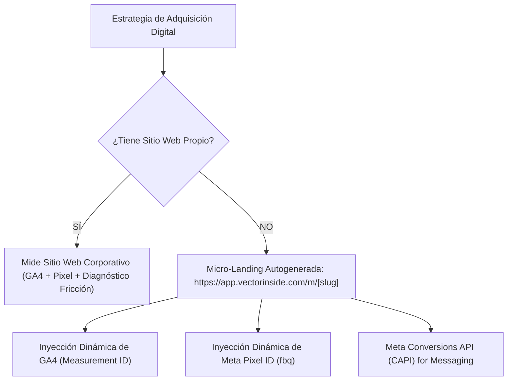

# 🏛️ ADR-010: Arquitectura de Micro-Landing Autogenerada, Telemetría Dual (GA4 & Meta CAPI) y Master Agenda Dinámica Multigiro

- **Estado:** ACEPTADO (v1.0)
- **Fecha:** 2026-10-14
- **Autor:** Lead Software Architect & AI Product Strategist — Vector Inside
- **Módulos Afectados:** `/m/[slug]` (Micro-Landing SSR/CSR), `/agenda` (MasterAgenda), `/config` (RAGWizard), `MicroLandingPreviewModal`, Meta Graph CAPI Engine.

---

## 1. Contexto & Planteamiento del Problema

En la fase de aceleración y onboarding de negocios para Vector Inside surgieron dos necesidades críticas de arquitectura comercial y operativa:

1. **La Fricción de la Página Web Propia:**
   - Muchos prospectos y clientes no cuentan con un sitio web corporativo propio (`.com`).
   - Anteriormente, el sistema bloqueaba u ocultaba los campos de analítica (`GA4 Measurement ID` y `Meta Pixel ID`) cuando el usuario marcaba *"SIN Página Web"*, dejando la pauta de Meta Ads y la atribución algorítmica a ciegas.
   - Todo negocio requiere un punto de contacto digital de alta conversión con carga ultrarrápida para Click-to-WhatsApp.

2. **La Diversidad Operativa de Horarios (Rigidez de Calendario):**
   - No todos los 16 giros del proyecto operan como consultorios médicos con horarios continuos de 9 a 5.
   - Los **Restaurantes** manejan turnos de Comida y Cena con mesas simultáneas (capacidad concurrente) y cierran los lunes.
   - Los **Creadores de Contenido** no reciben público; tienen días exclusivos de grabación de contenido y franjas privadas para pitching de marcas/patrocinios (`$3,500 USD`).
   - Las **Empresas B2B** manejan llamadas de calificación BANT de 30 minutos vía Zoom.
   - Si un horario ya tiene una cita confirmada, **la IA de WhatsApp jamás debe sugerir ese horario**.

---

## 2. Decisiones de Arquitectura (Decisions)

### 2.1. Estrategia Dual de Adquisición Digital & Micro-Landing Autogenerada

Se formaliza la decisión de desacoplar la posesión de un dominio propio del tracking algorítmico:



1. **Autogeneración Inmediata de Micro-Landing:**  
   Al dar de alta un tenant, se aprovisiona una ruta pública SSR optimizada en Next.js 14 App Router: `src/app/m/[slug]/page.jsx`.
2. **Telemetría Dual Siempre Activa:**  
   Incluso en la opción *"SIN Página Web"*, los campos de `GA4 Measurement ID` y `Meta Pixel ID` permanecen **visibles, activos y configurables** en el Onboarding y en el Modal de Personalización.
3. **Disparo de Eventos Estándar:**
   - `PageView` al abrir la micro-landing.
   - `Contact` / `click_whatsapp` al presionar cualquier botón de contacto o llamada.
   - `Lead` al completar el formulario de pre-agendamiento en 1 tap.
4. **Branding Vector Inside:**  
   Al pie de toda micro-landing se incluye el sello oficial *"Potenciado por Vector Inside — La infraestructura de IA y Adquisición Digital (https://vectorinside.com)"*, sirviendo como motor de referidos orgánicos.

---

### 2.2. Esquema Dinámico de Calendario por Giro (`calendarConfig`)

Cada uno de los 16 giros comerciales define su propio modelo de agenda estructurado en PostgreSQL / Tenant Metadata:

```json
{
  "calendarConfig": {
    "type": "shifts_split | hospitality_tables | creator_sponsorships | b2b_discovery",
    "slotDurationMin": 30 | 45 | 60 | 90,
    "concurrencyLimit": 1 | 8 | 12,
    "capacityLabel": "Cita / Paciente | Mesas Disponibles | Sesión PR",
    "operatingDays": ["mon", "tue", "wed", "thu", "fri", "sat"],
    "shifts": [
      {
        "id": "shift_1",
        "name": "Turno Matutino / Comida",
        "icon": "sun",
        "start": "09:00",
        "end": "14:00",
        "hours": ["09:00", "10:00", "11:00", "12:00", "13:00"]
      },
      {
        "id": "shift_2",
        "name": "Turno Vespertino / Cena",
        "icon": "sunset",
        "start": "15:00",
        "end": "19:00",
        "hours": ["15:00", "16:00", "17:00", "18:00"]
      }
    ],
    "breakInterval": {
      "start": "14:00",
      "end": "15:00",
      "label": "Receso / Esterilización Médica / Mise en place"
    }
  }
}
```

---

### 2.3. Regla de Oro de Disponibilidad en Master Agenda & Bot IA

La disponibilidad de citas se calcula mediante un motor algebraico determinista:

$$\text{Slots Disponibles} = \text{Shifts}(\text{Tenant}) - \text{Citas Confirmadas en Google Calendar} - \text{Bloqueos Manuales}$$

- **El Bot de WhatsApp (IA):**  
  Ejecuta la función `consultar_disponibilidad_google_calendar()`. Si un horario ya está reservado o en receso, el bot automáticamente sugiere los horarios contiguos libres sin provocar colisiones ni dobles reservas.
- **La Master Agenda (`/agenda`):**  
  Renderiza dinámicamente los turnos según el negocio activo en la plataforma. Muestra estados ricos con micro-badges (`● Confirmada`, `○ Pre-Cita Triage`), valor económico estimado en MXN, affordance interactivo en slots libres (`+ Cita`, `Bloquear`) y sincronización bidireccional vía Google Calendar API y notificaciones transaccionales Gmail con archivo `.ics`.

---

## 3. Consecuencias & Beneficios

### Positivas

1. **Cero Clientes Desatendidos:** Aquellos negocios sin sitio web corporativo cuentan con una landing page profesional de alta conversión lista para pautar anuncios en Meta Ads en minutos.
2. **Atribución Algorítmica al 100%:** Meta Pixel y Google Analytics 4 optimizan los anuncios hacia usuarios que efectivamente inician conversaciones por WhatsApp.
3. **Escalabilidad Multigiro:** El calendario se adapta de forma orgánica a restaurantes, consultorios, agencias B2B o creadores de contenido sin código hardcodeado.
4. **Protección de Tiempos:** Los profesionales que graban contenido o tienen descansos entre turnos tienen sus espacios bloqueados de manera inviolable.
