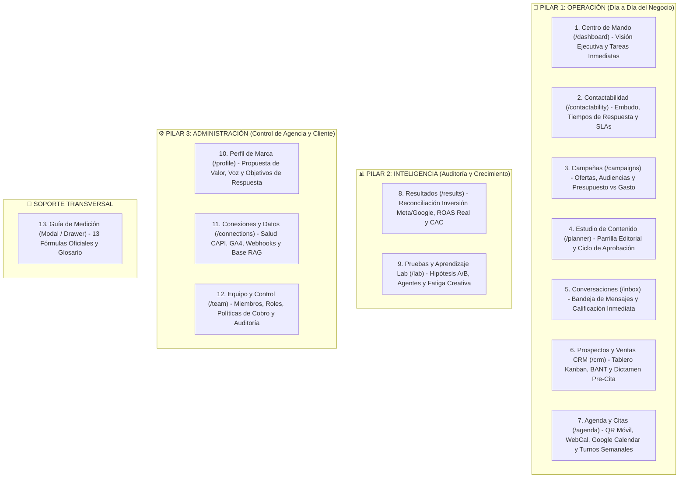

# 🏛️ ADR-011: Ontología Operativa de 12 Módulos, Identidad de Marca Vector Inside y Principios de Interfaz (UX-01 a UX-10)

- **Estado:** ACEPTADO (v1.0 - Harmonized Production Standard)
- **Fecha:** 2026-10-21
- **Autores:** Edgar González (Lead Architect & Founder) & Karloz (UI/UX Design Lead)
- **Módulos Afectados:** Toda la suite de vistas Next.js 14 (`src/app/`, `src/components/layout/Sidebar.jsx`, `Header.jsx`, `src/styles/globals.css`, `tailwind.config.js`).
- **Documentos Relacionados:** [ADR-001: Arquitectura Maestra](file:///c:/Users/EdgarGs/Documents/ProyectoWork/VectorInside/VectorComunity/Vector-Community/docs/ADR_001_MASTER_ARCHITECTURE_AND_BUSINESS_RULES.md), [ADR-008: Máquina de Estados & Kanban Triage](file:///c:/Users/EdgarGs/Documents/ProyectoWork/VectorInside/VectorComunity/Vector-Community/docs/ADR_008_PAY_PER_QUALIFIED_LEAD_STATE_MACHINE_AND_KANBAN_TRIAGE.md), [ADR-009: Dual-Theme Design System](file:///c:/Users/EdgarGs/Documents/ProyectoWork/VectorInside/VectorComunity/Vector-Community/docs/ADR_009_DUAL_THEME_DESIGN_SYSTEM_RULES.md), [ADR-010: Master Agenda & Telemetría](file:///c:/Users/EdgarGs/Documents/ProyectoWork/VectorInside/VectorComunity/Vector-Community/docs/ADR_010_MICRO_LANDING_TELEMETRY_AND_DYNAMIC_MASTER_AGENDA.md), [SDD: Documento de Diseño de Sistema](file:///c:/Users/EdgarGs/Documents/ProyectoWork/VectorInside/VectorComunity/Vector-Community/docs/SDD_SYSTEM_DESIGN_DOCUMENT.md)

---

## 1. Contexto & Justificación

Durante la evolución de **Vector Community OS**, se generaron dos ramas de trabajo complementarias:
1. **Rama `develop`:** Construcción de la infraestructura técnica avanzada en Next.js 14 (App Router), con motores interactivos de agendamiento (`MasterAgenda`), triaje HITL (`TriageProtocol` y `PreCitaDrawer`), orquestación multi-agente (`OrchestrationView`), estudio editorial (`ContentPlanner`), RAG multinivel (`RAGWizard`), telemetría CAPI (`PerformanceDashboard`) y reglas de facturación (`BusinessPolicyEngine`).
2. **Rama `UX/UI`:** Definición de la identidad visual de marca oficial (negro carbón `#101114`, lima `#C3F400`, morado `#AA8BFB`, azul `#80B8FF`), una arquitectura de información estructurada en 12 módulos de negocio organizados en tres pilares (`Operación`, `Inteligencia` y `Administración`), y un manual de lenguaje humano que elimina la jerga técnica innecesaria.

Este ADR establece la **reconciliación y unificación oficial**: se adopta la visual, el ordenamiento de negocio y las reglas de diseño de `UX/UI`, **sin planchar ni eliminar las reglas de negocio, los modelos de datos ni las bases técnicas requeridas para el backend**.

---

## 2. Decisión Arquitectónica Mandatoria: Principio de "No-Planchado" de Reglas de Negocio

> [!IMPORTANT]
> **REGLA DE ORO DE DESARROLLO (NO PLANCHAR EL BACKEND):**
> La modernización y pulido estético de las vistas **NUNCA DEBE REDUCIR LA RIQUEZA DE LOS MODELOS DE DOMINIO**.
> Ningún campo, estado de máquina (ej. `BILLABLE_LEAD`, `FOLLOWUP_PENDING_24H`), validación booleana ni encabezado multi-tenant (`X-Tenant-ID`) podrá ser removido para "simplificar" una vista.
> La interfaz actúa como la **capa de presentación ejecutiva** de las reglas complejas; la profundidad técnica se conserva intacta en el estado, los contextos y los contratos de datos para la futura construcción del backend en cada módulo.

---

## 3. Taxonomía de los Módulos Operativos (Ontología Oficial UX/UI)

La interfaz de usuario se reordena formalmente bajo tres pilares de valor comercial y un soporte metodológico transversal:

---

## 4. Matriz de Principios de Interfaz (UX-01 a UX-10)

Todos los componentes de vistas deben cumplir de forma estricta con los siguientes 10 principios de experiencia de usuario:

| ID | Principio UX/UI | Aplicación en Código y Vistas | Criterio de Aceptación Inviolable |
| :--- | :--- | :--- | :--- |
| **UX-01** | **Empezar por la siguiente acción** | Consultas pendientes y piezas por aprobar visibles en el Centro de Mando. | El operador identifica en <3 segundos su prioridad sin tener que navegar por submenús. |
| **UX-02** | **Mantener relación entre módulos** | Campaña ➔ Piezas asociadas ➔ Conversaciones ➔ Ficha CRM del prospecto. | No perder el contexto del filtro (campaña, cohorte o canal) al regresar o abrir un modal. |
| **UX-03** | **Una decisión dominante por contexto** | Botones de alta visibilidad: `[Aprobar Versión]`, `[Dictaminar Pre-Cita]`, `[Registrar Tarea]`. | En cada tarjeta o vista solo existe un botón con color de acción principal (`bg-lime-action text-black`). |
| **UX-04** | **Explicar la métrica** | Icono informativo `(i)` junto a cada KPI (ROAS, CAC, Contactabilidad, etc.). | Al hacer clic se despliega la fórmula, base matemática, periodo y advertencia de limitación. |
| **UX-05** | **No simular éxito real ficticio** | Badges transparentes: `«Datos demostrativos»`, `«Respuesta simulada»`, `«Sin conexión activa»`. | Ninguna falla de API externa (Meta/Google) se enmascara con una pantalla de falso éxito. |
| **UX-06** | **Revelar detalles progresivamente** | Fichas en acordeón y Drawers laterales (`PreCitaDrawer`). | La vista principal permanece despejada; los datos técnicos forenses se abren bajo demanda. |
| **UX-07** | **Formularios acotados y directos** | Validación en línea con guardado explícito y mensajes de error específicos. | No limpiar campos al fallar; mantener foco en el primer campo que requiere corrección. |
| **UX-08** | **Separar confirmado / estimado / ausente** | Distinción explícita entre `Venta Ganada` (cerrada), `Pipeline Estimado` y `Dato No Calculable`. | Está **terminantemente prohibido** mostrar `$0` o `0%` cuando la base de datos no tiene información. Se debe renderizar `N/D` con explicación. |
| **UX-09** | **Color siempre acompañado de texto** | Badges de estado con texto explícito (Verde: Calificado, Ámbar: Revisión, Rojo: Riesgo). | La interfaz debe ser 100% comprensible para personas con daltonismo (WCAG 2.1 AA). |
| **UX-10** | **Personas antes que automatización (HITL)** | Respuestas de IA editables antes de envío; pre-citas requieren validación humana. | Ninguna acción crítica hacia el cliente final se ejecuta sin el dictamen explícito de la agencia. |

---

## 5. Reglas de Lenguaje de Negocio (Desintoxicación de Jerga)

Para garantizar que el Dueño de Negocio (Cliente Final) y el Administrador operen con absoluta fluidez, se prohíbe el uso de terminología esotérica en la navegación pública y operativa:

| ❌ Término Prohibido en UI | ✅ Término Oficial Vector Inside | Motivo Operativo |
| :--- | :--- | :--- |
| *HITL Triage Protocol* | **Conversaciones & Triaje de Prospectos** | El cliente entiende conversaciones, no protocolos militares. |
| *Soberanía Financiera* | **Resultados Comerciales & ROAS** | Habla el lenguaje del director financiero y de marketing. |
| *Telemetría Web & CAPI* | **Contactabilidad & Salud de Conversión** | Pone el foco en el contacto efectivo, no en la tubería técnica. |
| *Orquestación Multi-Agente* | **Pruebas, Agentes & Laboratorio (Lab)** | Se presenta como herramientas que resuelven hipótesis de contenido. |
| *RAG Wizard & Sub-Bots* | **Conexiones, Datos & Cerebro de Marca** | Destaca el conocimiento del negocio por encima del acrónimo RAG. |

---

## 6. Gobernanza de Roles (RBAC)

El sistema conserva el control de acceso en dos niveles:
1. **Administrador (Lobo Vectorial - Agencia):** Acceso total a los 12 módulos, incluyendo los módulos de Administración (`Perfil de Marca`, `Conexiones y Datos`, `Equipo y Control`), configuración de sub-agentes y dictamen de pre-citas.
2. **Usuario (Dueño de Negocio - Cliente):** Acceso enfocado a `Centro de Mando`, `Contactabilidad`, `Campañas`, `Estudio de Contenido` (revisión/aprobación de piezas), `Conversaciones` y `Resultados`. Las configuraciones de infraestructura se mantienen en modo lectura o restringidas.

---

## 7. Criterios de Aceptación para la Fusión
1. Toda vista renderizada en `develop` adopta los tokens de color oficiales (`#101114` en fondo, `#191A1F` en paneles y `#C3F400` en acentos primarios).
2. El Sidebar y el Header implementan los 12 módulos sin romper enlaces existentes (utilizando redirects o alias transparentes).
3. Todas las reglas de negocio de `ADR-001` a `ADR-010` permanecen intactas y vinculadas en el SDD para la construcción del backend.
