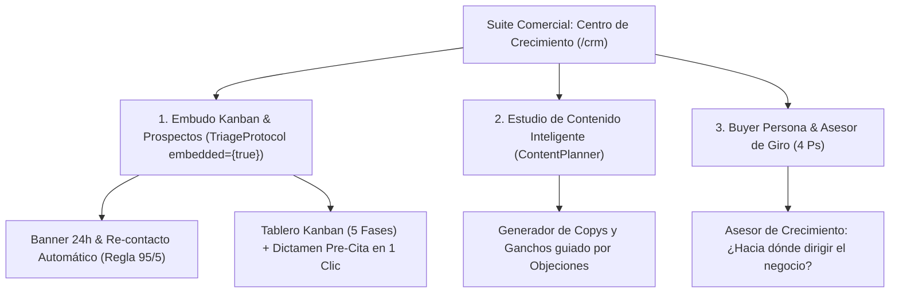

# 🏛️ ADR-012: Suite Comercial Unificada (CRM & Contenido), Arquitectura Omnicanal Dinámica y Matriz de Crecimiento del Negocio (Buyer Persona 4Ps)

- **Estado:** ACEPTADO (v1.0 — Unified Commercial Architecture Standard)
- **Fecha:** 2026-10-27
- **Autores:** Edgar González (Lead Architect & Founder) & Vector Inside Core Engineering
- **Módulos Afectados:** `/crm`, `/planner`, `/contactability`, `/profile`, `/connections` (`CommercialGrowthSuite.jsx`, `ChannelConnectionsManager.jsx`, `PerformanceDashboard.jsx`, `PerfilMarcaView.jsx`, `TriageProtocol.jsx`).
- **Documentos Relacionados:** [ADR-001: Arquitectura Maestra](file:///c:/Users/EdgarGs/Documents/ProyectoWork/VectorInside/VectorComunity/Vector-Community/docs/ADR_001_MASTER_ARCHITECTURE_AND_BUSINESS_RULES.md), [ADR-002: Taxonomía Universal y RAG](file:///c:/Users/EdgarGs/Documents/ProyectoWork/VectorInside/VectorComunity/Vector-Community/docs/ADR_002_UNIVERSAL_BUSINESS_TAXONOMY_AND_RAG_PILLARS.md), [ADR-007: Modelo Comercial Vector Deal](file:///c:/Users/EdgarGs/Documents/ProyectoWork/VectorInside/VectorComunity/Vector-Community/docs/ADR_007_OFFICIAL_COMMERCIAL_PRICING_AND_BILLING_RULES.md), [ADR-008: Máquina de Estados & Kanban Triage](file:///c:/Users/EdgarGs/Documents/ProyectoWork/VectorInside/VectorComunity/Vector-Community/docs/ADR_008_PAY_PER_QUALIFIED_LEAD_STATE_MACHINE_AND_KANBAN_TRIAGE.md), [ADR-011: Ontología Operativa UX/UI](file:///c:/Users/EdgarGs/Documents/ProyectoWork/VectorInside/VectorComunity/Vector-Community/docs/ADR_011_UX_UI_BRAND_AND_OPERATIONAL_TAXONOMY.md), [SDD: Documento de Diseño de Sistema](file:///c:/Users/EdgarGs/Documents/ProyectoWork/VectorInside/VectorComunity/Vector-Community/docs/SDD_SYSTEM_DESIGN_DOCUMENT.md).

---

## 1. Contexto & Justificación

A partir de los **Requerimientos del Sistema v.2**, se detectaron tres necesidades clave de evolución en la plataforma comercial de Vector Community OS:

1. **Fragmentación Operativa entre Ventas y Contenido:**  
   Tener el Embudo Kanban (`/crm`) y el Estudio de Contenido (`/planner`) como módulos completamente separados obligaba al operador a conmutar entre pantallas para revisar las objeciones de los prospectos y redactar contenido publicitario. Se requería **fusionar ambos en una sola Suite Comercial** con un Asesor de Crecimiento continuo.

2. **Saturación Visual de Canales No Activos:**  
   Los negocios solo deben visualizar la telemetría y salud de aquellos canales que efectivamente tienen contratados o dados de alta (Meta, Google, WhatsApp, TikTok, LinkedIn, YouTube, X, Telegram). Mostrar canales inactivos genera desconfianza y saturación visual. Por ello, la gestión de credenciales se traslada a la configuración del negocio (`/config` o `/connections`), mientras que el monitor de `/contactability` filtra estrictamente los activos.

3. **Inteligencia de Negocio Basada en el Buyer Persona y las 4 Ps:**  
   El chatbot y los redactores de contenido no pueden operar en el vacío; deben alimentarse de la radiografía demográfica/psicográfica del cliente ideal (rango de edad, estado civil, dolores, disparadores de compra) y de la matriz del Marketing Mix (Producto, Precio, Plaza y Promoción).

---

## 2. Decisiones de Arquitectura (Decisions)

### 2.1. Fusión en la Suite Comercial (`CommercialGrowthSuite`)

Se unifica el flujo en `/crm` (con alias transparente para `/planner`) a través de un contenedor de 3 pestañas maestras:

- **Principio de Doble Encabezado Erradicado:** Al utilizar `embedded={true}`, el subcomponente Kanban oculta su encabezado $H2$ y adopta una barra de subcanales horizontal de perfil bajo, recuperando más de 260 píxeles de altura útil (*Above the Fold*).

---

### 2.2. Catálogo Omnicanal Dinámico & Zero-Clutter

Se instituye el catálogo maestro `OMNICHANNEL_API_CATALOG` con soporte para 8 ecosistemas:

| Canal | Tipo de Conexión | Credenciales Requeridas | Métricas Clave |
| :--- | :--- | :--- | :--- |
| **Meta Ads & Graph** | API Graph v20.0 | System User Access Token + Pixel ID + WABA ID | Eventos CAPI, Conversiones, Latencia (ms) |
| **WhatsApp Cloud** | Cloud API (Meta) | Phone Number ID + Permanent Bearer Token | Conversaciones bidireccionales, Tasa de respuesta |
| **Google Analytics / Ads** | GA4 Data API v1beta | Measurement ID + API Secret + Customer ID | Sesiones, Fricción Web, CPC, Tasa de rebote |
| **TikTok for Business** | Marketing API v1.3 | Access Token + Advertiser ID + Pixel Code | Hook Rate (3s), Tasa de visualización, CPA |
| **LinkedIn Marketing** | Restli API v2 | OAuth 2.0 Client ID + Secret + Organization URN | Leads B2B, InMail replies, CTR profesional |
| **YouTube Data & Ads** | Data API v3 | Google Cloud API Key + Channel ID | Retención de video (<15%), reproducciones |
| **X (Twitter) Ads** | Ads API v12 | Consumer Key + Access Token + Account ID | Engagement, Menciones públicas |
| **Telegram Bot API** | Bot API HTTPS | Bot Token (@BotFather) + Channel/Chat ID | Suscriptores, Conversaciones 1 a 1 |

- **Regla de Filtrado Estricto:** `/contactability` y `/connections` solo renderizan las plataformas que el `activeTenant.connectedChannels[key]?.enabled === true`.

---

### 2.3. Detección Algorítmica de Fatiga Publicitaria y Abandono de Contenido

Se formalizan dos alertas de telemetría automática en `PerformanceDashboard.jsx`:

1. **Alerta de Fatiga Publicitaria (Frecuencia > 3.5x):**
   $$\text{IF } \text{Frequency} \ge 3.5 \implies \text{Alerta de Saturación: Rotar creativos o ampliar audiencia para evitar incremento de CPC.}$$

2. **Alerta de Abandono de Contenido (Retención < 15%):**
   $$\text{IF } \text{AvgWatchRetention} < 15\% \implies \text{Alerta de Drop-off: Reformular gancho de los primeros 3 segundos.}$$

---

### 2.4. Matriz del Buyer Persona & Marketing Mix (4 Ps) en Perfil de Marca

Se amplía el contrato del tenant en `/profile` (`PerfilMarcaView.jsx`) para incluir:
- **Buyer Persona:** `name`, `ageRange`, `maritalStatus`, `location` (códigos postales prioritarios), `digitalHabits`, `mainPainPoint` (*Struggling Moment*) y `buyingTrigger`.
- **Marketing Mix (4 Ps):** `product` (propuesta de valor), `price` (aranceles y facilidades), `place` (canales de entrega) y `promotion` (ofertas activas y cupones).
- **Asesor de Giro:** Algoritmo contextual que cruza el dolor principal del prospecto con el giro comercial del negocio para sugerir mejoras de ticket y nuevos canales de adquisición.

---

## 3. Estado de Cumplimiento e Impacto en Backend

- **Frontend:** 100% implementado, compilando sin errores en Next.js 14.
- **Preparación de Backend:** Los modelos de datos se mapean limpiamente a las tablas `tenants`, `connected_channels`, `buyer_personas`, `marketing_mix_4p` y `creative_fatigue_logs` con políticas PostgreSQL RLS.
