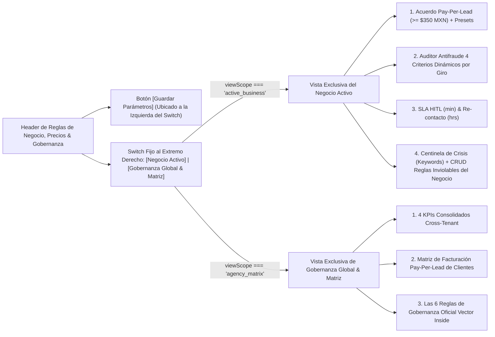
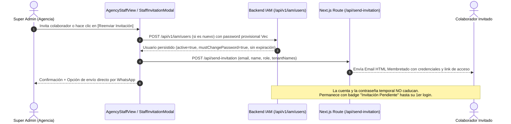

# 🏛️ ADR-013: Gobernanza Zero-State Limpio, Separación Dual de Políticas de Negocio vs. Agencia, Tutor IA Contextual por Módulo e Invitaciones IAM sin Caducidad

- **Estado:** ACEPTADO (v1.0 — Production Governance, UX Stability & IAM Lifecycle Standard)
- **Fecha:** 2026-11-11
- **Autores:** Edgar González (Lead Architect & Founder) & Vector Inside Core Engineering
- **Módulos Afectados:**
  - `/connections` (`RAGWizard.jsx`, `SubBotsConfig.jsx`, `BusinessPolicyEngine.jsx`, `ChannelConnectionsManager.jsx`)
  - `/team` (`AgencyStaffView.jsx`, `StaffInvitationModal.jsx`, `src/app/api/send-invitation/route.js`)
  - Layout Transversal (`Header.jsx`, `OnboardingTour.jsx`, `AuthContext.jsx`)
  - Backend Core (`TenantController.java`, `TenantService.java`, `IamController.java`, `IamService.java`, `V9__add_tenant_policy_governance_fields.sql`)
- **Documentos Relacionados:** [ADR-001](file:///c:/Users/EdgarGs/Documents/ProyectoWork/VectorInside/VectorComunity/Vector-Community/docs/ADR_001_MASTER_ARCHITECTURE_AND_BUSINESS_RULES.md), [ADR-004](file:///c:/Users/EdgarGs/Documents/ProyectoWork/VectorInside/VectorComunity/Vector-Community/docs/ADR_004_MULTI_AGENT_ORCHESTRATION_AND_DATA_CLEANLINESS.md), [ADR-007](file:///c:/Users/EdgarGs/Documents/ProyectoWork/VectorInside/VectorComunity/Vector-Community/docs/ADR_007_OFFICIAL_COMMERCIAL_PRICING_AND_BILLING_RULES.md), [ADR-008](file:///c:/Users/EdgarGs/Documents/ProyectoWork/VectorInside/VectorComunity/Vector-Community/docs/ADR_008_PAY_PER_QUALIFIED_LEAD_STATE_MACHINE_AND_KANBAN_TRIAGE.md), [ADR-011](file:///c:/Users/EdgarGs/Documents/ProyectoWork/VectorInside/VectorComunity/Vector-Community/docs/ADR_011_UX_UI_BRAND_AND_OPERATIONAL_TAXONOMY.md), [SDD: Documento de Diseño de Sistema](file:///c:/Users/EdgarGs/Documents/ProyectoWork/VectorInside/VectorComunity/Vector-Community/docs/SDD_SYSTEM_DESIGN_DOCUMENT.md).

---

## 1. Contexto & Problemática Resuelta

Durante las auditorías operativas en producción de **Vector Community OS** se identificaron cuatro áreas críticas que requerían estandarización arquitectónica y de experiencia de usuario:

1. **Contaminación Visual y Mezcla de Alcances en `BusinessPolicyEngine.jsx` (Apartado 3 de Configuración):**
   - Al seleccionar la vista **"Negocio Activo"**, al final de la pantalla se seguían mostrando las 6 Reglas de Gobernanza Global de la Agencia, duplicando información que pertenecía exclusivamente a **"Gobernanza Global & Matriz"**.
   - Al alternar entre los botones `[Negocio Activo]` y `[Gobernanza Global & Matriz]`, la aparición/desaparición del botón `[Guardar Parámetros]` a la derecha empujaba horizontalmente el switch de vistas (*Layout Shift*), generando incomodidad visual y errores de clic.
2. **Pre-carga de Datos Simulados cuando la Agencia tiene `0` Negocios (Violación de Zero-State):**
   - Cuando el selector global marcaba `0 Negocios Registrados` (`tenantsList.length === 0`), algunos submódulos del Centro de Configuración seguían mostrando valores pre-cargados (teléfono `+52 55 4433 2211`, palabras de crisis, reglas o formularios de motores IA) en lugar de un estado limpio que guiara al administrador a dar de alta su primer negocio.
3. **Adopción de Producto y Capacitación In-App Contextual:**
   - El recorrido guiado original era monolítico. Se requería un **Tutor IA Contextual (`OnboardingTour.jsx`)** invocable desde el `Header` que detectara automáticamente el módulo activo (y el submódulo activo en `/connections`) para explicar paso a paso cada sección.
4. **Visibilidad y Reenvío de Invitaciones para Colaboradores Pendientes en `/team` (`AgencyStaffView.jsx`):**
   - Cuando un Super Admin invitaba a varios colaboradores y algunos aún no iniciaban sesión por primera vez (`lastAccess === 'Sin actividad registrada'` o `mustChangePassword === true`), era necesario clarificar que **las invitaciones y contraseñas provisionales (`Vec#Auth2026!`) no tienen límite de tiempo ni caducan**, y habilitar en la tarjeta del colaborador un botón directo de **`[Reenviar Invitación]`** (Correo + WhatsApp).

---

## 2. Decisiones de Arquitectura

### 2.1. Separación Estricta de Alcances y Estabilidad Geométrica (Zero Layout Shift) en `BusinessPolicyEngine.jsx`

1. **Aislamiento de Vistas (`viewScope`):**
   - **`active_business` (Negocio Activo):** Renderiza exclusivamente los acuerdos financieros del tenant seleccionado (`leadPriceMXN >= 350`), el simulador antifraude de 4 criterios adaptados al giro del negocio, tiempos de SLA/incubación, el Centinela de Crisis y el editor CRUD de **Reglas Inviolables específicas del negocio** (`inviolableRules`), sincronizado vía `PUT /api/v1/tenants/{id}`.
   - **`agency_matrix` (Gobernanza Global & Matriz):** Renderiza exclusivamente los KPIs globales de la agencia, la tabla consolidada de clientes y **Las 6 Reglas de Gobernanza Oficial Vector Inside** (`OFFICIAL_GOVERNANCE_RULES`, cuyas métricas se calculan dinámicamente a partir de `tenantsList` real sin cifras hardcodeadas).
2. **Anclaje Geométrico sin Layout Shift:**
   - El selector segmentado (`[Negocio Activo | Gobernanza Global & Matriz]`) permanece **fijo en el extremo derecho** del contenedor.
   - El botón `[Guardar Parámetros]` se posiciona **a la izquierda** del selector segmentado cuando `viewScope === 'active_business'`, garantizando que el switch jamás se desplace bajo el cursor del usuario al alternar de pestaña.

---

### 2.2. Protocolo de Zero-State Limpio en los 4 Submódulos de `/connections`

Cuando `tenantsList.length === 0` (ningún negocio dado de alta en la base de datos PostgreSQL), los 4 submódulos del Centro de Configuración y Políticas aplican la regla de **Zero-State Limpio**:

| Submódulo | Componente | Comportamiento cuando `tenantsList.length === 0` | Persistencia con Negocio Activo |
| :--- | :--- | :--- | :--- |
| **1. Multi-Tenant RAG (4 Pilares)** | `RAGWizard.jsx` | Si `!isCreatingNew`, muestra tarjeta Zero-State con botón `[+ Dar de Alta Primer Negocio]`. En Paso 1 bloquea el botón `[Siguiente]` si hay documento o texto pendiente de clasificar con IA (`hasPendingAnalysis`). | `POST /api/v1/tenants` y `PUT /api/v1/tenants/{id}` + ingesta RAG `/api/v1/rag/ingest-file`. |
| **2. Motores & Sub-Bots AI** | `SubBotsConfig.jsx` | Muestra pantalla Zero-State limpia invitando a registrar el primer negocio antes de configurar motores o llaves BYOK. | Acordeón inline de API Key dentro de la tarjeta del motor seleccionado (`POST /api/v1/ai/credentials` con AES-256-GCM y reset en 1 clic al Pool Oficial). |
| **3. Reglas de Negocio & Precios** | `BusinessPolicyEngine.jsx` | En `active_business` muestra Zero-State limpio (sin teléfono ni keywords mock). En `agency_matrix` muestra contadores en `0` y estado vacío en la tabla de clientes. | `PUT /api/v1/tenants/{id}` persistiendo `leadPriceMXN`, `slaHitlMinutes`, `reengagementDelayHours`, `crisisKeywords`, `inviolableRules`, `isAiActive` y `retainedDepositMXN`. |
| **4. Canales & APIs Oficiales** | `ChannelConnectionsManager.jsx` | Muestra Zero-State limpio indicando que se requiere un negocio activo para vincular credenciales de Meta, WhatsApp, Google o TikTok. | Sincronización de `connectedChannels` en el perfil del tenant activo. |

---

### 2.3. Tutor IA Contextual por Módulo (`OnboardingTour.jsx`)

El componente `OnboardingTour.jsx` se transforma en un sistema de asistencia interactiva sensible a la ruta (`pathname`):

1. **Detección Dinámica de Ruta:** Utiliza `usePathname()` de Next.js para identificar si el usuario se encuentra en `/dashboard`, `/contactability`, `/campaigns`, `/crm`, `/inbox`, `/agenda`, `/results`, `/lab`, `/profile`, `/connections` o `/team`.
2. **Selector de Submódulos en Configuración (`/connections`):** Permite elegir entre el recorrido general de los 4 apartados o el tour especializado de cada submódulo (`RAG 4 Pilares`, `Motores IA`, `Reglas & Precios`, `Canales Oficiales`), cambiando automáticamente la pestaña activa mediante el evento custom `vector:select-config-tab`.
3. **Resaltado Spotlight Adaptativo:** Localiza el elemento DOM objetivo (`targetSelector`), hace scroll suave hacia él y posiciona el popover explicativo sin desbordar el viewport; si un selector no está visible en el estado actual, muestra la tarjeta centrada sin romper la experiencia.

---

### 2.4. Ciclo de Vida de Invitaciones IAM sin Caducidad & Reenvío en 1 Clic (`/team`)

1. **Ausencia de Límite de Tiempo (Sin Expiración de Invitación):**
   - Los usuarios creados en `users` (`IamService.java`) nacen con `active = true` y `mustChangePassword = true` sin ningún TTL ni fecha de caducidad en base de datos.
   - Si un colaborador tarda días o semanas en entrar por primera vez, su cuenta y contraseña provisional (`Vec#Auth2026!`) siguen 100% válidas.
2. **Detección Automática de `Invitación Pendiente` en `AgencyStaffView.jsx`:**
   - Todo colaborador con `lastAccess === 'Sin actividad registrada'` (es decir, `lastLoginAt == null` en PostgreSQL) o `mustChangePassword === true` se identifica automáticamente como `isPending = true`.
   - Muestra el badge ámbar **`Invitación Pendiente`** junto a su rol y habilita el botón **`[Reenviar Invitación]`** (o **`[Invitación Enviada]`** con confirmación visual) en su tarjeta operativa, abriendo `StaffInvitationModal` con sus datos pre-cargados para reenviar el correo transaccional vía `/api/send-invitation` o compartir por WhatsApp en 1 clic.

