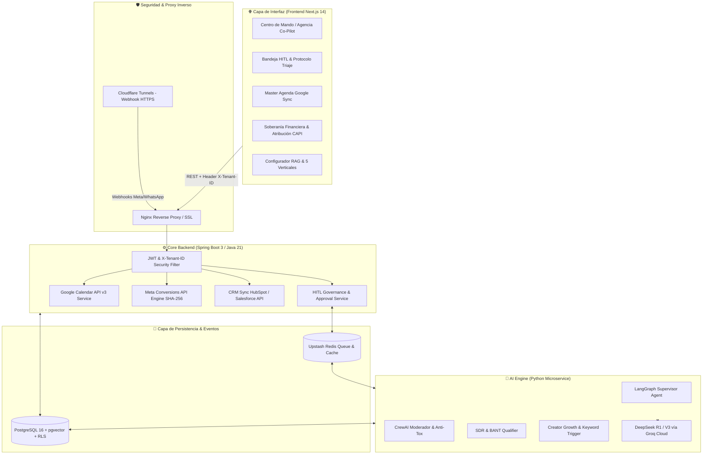

# 📐 Documento de Diseño de Sistema (SDD) — Vector Community

- **Sistema:** Vector Community OS ("La Puerta Trasera")
- **Versión:** 2.5 (Multi-Tenant & Creator Engine Edition)
- **Organización:** Vector Inside Operations

---

## 1. Introducción y Alcance
Este documento especifica la arquitectura técnica, diagramas de secuencia, modelos de datos, protocolos de seguridad y diseño de interfaz para **Vector Community**, el motor de gestión de comunidad automatizada, performance marketing y gobernanza Human-in-the-Loop (HITL).

---

## 2. Arquitectura Global del Sistema



---

## 3. Modelo de Dominio & Esquema de Base de Datos (PostgreSQL RLS)

### 3.1. Tabla `tenants` (Aislamiento de Clientes)
```sql
CREATE TABLE tenants (
    id VARCHAR(64) PRIMARY KEY,
    name VARCHAR(255) NOT NULL,
    short_name VARCHAR(100) NOT NULL,
    vertical_tipo VARCHAR(50) NOT NULL CHECK (vertical_tipo IN ('hospitality', 'service_appointments', 'ecommerce', 'b2b_sales', 'creator_economy')),
    giro_comercial VARCHAR(150),
    meta_pixel_id VARCHAR(100),
    meta_capi_token TEXT,
    google_calendar_id VARCHAR(255),
    crm_provider VARCHAR(50),
    crm_api_key TEXT,
    instagram_handle VARCHAR(100),
    cac_max_threshold NUMERIC(10, 2),
    created_at TIMESTAMP WITH TIME ZONE DEFAULT CURRENT_TIMESTAMP
);
```

### 3.2. Tabla `hitl_alerts` (Gobernanza Human-in-the-Loop)
```sql
CREATE TABLE hitl_alerts (
    id VARCHAR(64) PRIMARY KEY,
    tenant_id VARCHAR(64) NOT NULL REFERENCES tenants(id) ON DELETE CASCADE,
    type VARCHAR(50) NOT NULL, -- 'APPOINTMENT_REQUEST', 'B2B_DISCOVERY_CALL', 'BRAND_SPONSORSHIP_PROPOSAL', 'CREATIVE_FATIGUE', 'TOXICITY_CONTAINMENT'
    status VARCHAR(30) NOT NULL DEFAULT 'PENDING_AGENCY_APPROVAL', -- 'PENDING_AGENCY_APPROVAL', 'APPROVED', 'REJECTED'
    confidence_score INT NOT NULL,
    client_name VARCHAR(255),
    client_phone VARCHAR(50),
    bot_summary TEXT NOT NULL,
    proposed_payload JSONB NOT NULL,
    transcript_snippet JSONB,
    urgency VARCHAR(20) DEFAULT 'NORMAL',
    approved_by VARCHAR(100),
    approved_at TIMESTAMP WITH TIME ZONE,
    created_at TIMESTAMP WITH TIME ZONE DEFAULT CURRENT_TIMESTAMP
);

-- Política RLS para aislamiento estricto
ALTER TABLE hitl_alerts ENABLE ROW LEVEL SECURITY;

CREATE POLICY tenant_isolation_policy ON hitl_alerts
    USING (tenant_id = current_setting('app.current_tenant_id', true));
```

### 3.3. Tabla `capi_events` (Atribución y Telemetría Server-Side)
```sql
CREATE TABLE capi_events (
    id VARCHAR(64) PRIMARY KEY,
    tenant_id VARCHAR(64) NOT NULL REFERENCES tenants(id),
    event_name VARCHAR(100) NOT NULL,
    event_time BIGINT NOT NULL,
    event_value NUMERIC(12, 2),
    currency VARCHAR(10) DEFAULT 'MXN',
    user_data_hashed JSONB NOT NULL, -- email/phone SHA-256
    status VARCHAR(50) NOT NULL, -- 'MATCHED_CAPI_98%', 'SENT_SUCCESS'
    signal_source VARCHAR(100) NOT NULL,
    created_at TIMESTAMP WITH TIME ZONE DEFAULT CURRENT_TIMESTAMP
);
```

---

## 4. Especificación de las 5 Verticales Adaptativas

### Vertical 1: Hospitality (Restaurantes & Bares)
- **Tools RAG:** `menu_digital()`, `reservar_mesa()`, `consultar_zonas()`
- **Regla Estricta:** Reservas ordinarias pre-autorizadas. Eventos con >8 comensales entran automáticamente a la bandeja HITL con urgencia ALTA.

### Vertical 2: Service Appointments (Clínicas & Servicios)
- **Tools RAG:** `google_calendar_api()`, `verificar_disponibilidad()`, `registrar_cita()`
- **Regla Estricta:** La cita se almacena como tentativa (`PENDING_AGENCY_APPROVAL`); al aprobarse en 1 clic se inserta en Google Calendar del doctor y se despacha confirmación por WhatsApp.

### Vertical 3: E-Commerce (Productos Físicos & Retail)
- **Tools RAG:** `catalogo_rag()`, `link_checkout()`, `recuperar_carrito()`
- **Regla Estricta:** Enlaces de checkout dinámicos con cupones de caducidad corta. Evento `Purchase` transmitido a Meta CAPI para aprendizaje de la campaña.

### Vertical 4: B2B Sales (High-Ticket & SaaS Enterprise)
- **Tools RAG:** `calificar_lead_bant()`, `agendar_discovery_call()`, `sync_crm()`
- **Regla Estricta:** Calificación basada en Presupuesto (> $5k USD), Autoridad (C-Level/Director) y Tiempo (< 30 días). Sincronización nativa de deals con HubSpot / Salesforce.

### Vertical 5: Creator Economy (Redes Sociales Meta & Creadores)
- **Tools RAG:** `keyword_to_dm()`, `calificar_patrocinio()`, `moderar_toxicidad()`, `generar_guion_viral()`
- **Regla Estricta:** Automatización de comentarios en Reels a DM; separación de propuestas de marcas patrocinadoras (Brand Deals) para aprobación de la agencia; supresión de toxicidad/spam.

---

## 5. Protocolo de Seguridad del Frontend (Axios Interceptor)

Cada solicitud HTTP enviada desde el cliente Next.js inyecta obligatoriamente el identificador del tenant en los headers:

```javascript
// src/services/api.js
api.interceptors.request.use((config) => {
  const { activeTenantId } = useTenantStore.getState();
  const token = localStorage.getItem('jwt_token');

  if (activeTenantId) {
    config.headers['X-Tenant-ID'] = activeTenantId;
  }
  if (token) {
    config.headers['Authorization'] = `Bearer ${token}`;
  }
  return config;
});
```
