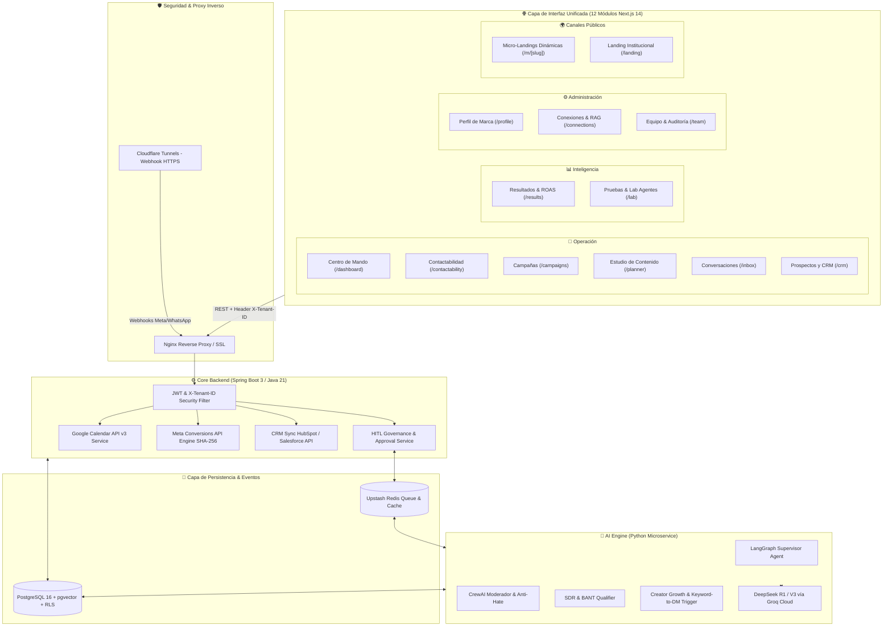
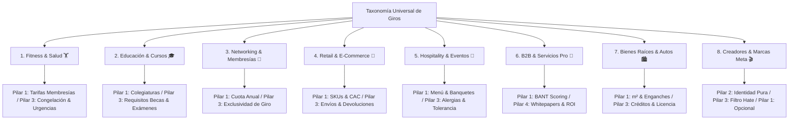

# 📐 Documento de Diseño de Sistema (SDD) — Vector Community

- **Sistema:** Vector Community OS ("La Puerta Trasera")
- **Versión:** 4.0 (Unified UX/UI Operational Taxonomy & Backend Readiness Edition)
- **Organización:** Vector Inside Operations
- **ADRs Asociados:** [ADR-001](file:///c:/Users/EdgarGs/Documents/ProyectoWork/VectorInside/VectorComunity/Vector-Community/docs/ADR_001_MASTER_ARCHITECTURE_AND_BUSINESS_RULES.md), [ADR-002](file:///c:/Users/EdgarGs/Documents/ProyectoWork/VectorInside/VectorComunity/Vector-Community/docs/ADR_002_UNIVERSAL_BUSINESS_TAXONOMY_AND_RAG_PILLARS.md), [ADR-003](file:///c:/Users/EdgarGs/Documents/ProyectoWork/VectorInside/VectorComunity/Vector-Community/docs/ADR_003_META_GRAPH_INTELLIGENCE_AND_HITL_TRIAGE.md), [ADR-008](file:///c:/Users/EdgarGs/Documents/ProyectoWork/VectorInside/VectorComunity/Vector-Community/docs/ADR_008_PAY_PER_QUALIFIED_LEAD_STATE_MACHINE_AND_KANBAN_TRIAGE.md), [ADR-009](file:///c:/Users/EdgarGs/Documents/ProyectoWork/VectorInside/VectorComunity/Vector-Community/docs/ADR_009_DUAL_THEME_DESIGN_SYSTEM_RULES.md), [ADR-010](file:///c:/Users/EdgarGs/Documents/ProyectoWork/VectorInside/VectorComunity/Vector-Community/docs/ADR_010_MICRO_LANDING_TELEMETRY_AND_DYNAMIC_MASTER_AGENDA.md), [ADR-011](file:///c:/Users/EdgarGs/Documents/ProyectoWork/VectorInside/VectorComunity/Vector-Community/docs/ADR_011_UX_UI_BRAND_AND_OPERATIONAL_TAXONOMY.md)

---

## 1. Introducción y Alcance

Este documento especifica la arquitectura técnica, diagramas de flujo, modelos de datos, protocolos de seguridad, taxonomía de giros comerciales, diseño de interfaz y **contratos de backend para cada uno de los 12 módulos operativos** para **Vector Community**, garantizando que el pulido de vistas no altere ni reduzca la complejidad de las reglas de negocio del sistema.

---

## 2. Arquitectura Global del Sistema



---

## 3. Taxonomía de 8 Familias de Conversión y Comportamiento RAG



---

## 4. Modelo de Dominio & Esquema de Base de Datos (PostgreSQL RLS)

### 4.1. Tabla `tenants` (Aislamiento de Clientes & Giro)

```sql
CREATE TABLE tenants (
    id VARCHAR(64) PRIMARY KEY,
    name VARCHAR(255) NOT NULL,
    short_name VARCHAR(100) NOT NULL,
    legal_name_tax_id VARCHAR(150),
    vertical_categoria VARCHAR(50) NOT NULL, -- 'fitness_health', 'education', 'networking', 'retail_ecom', 'hospitality', 'b2b_services', 'realestate_auto', 'creators'
    vertical_tipo VARCHAR(50) NOT NULL, -- 'hospitality', 'service_appointments', 'ecommerce', 'b2b_sales'
    giro_especifico VARCHAR(150) NOT NULL, -- 'Gimnasios, CrossFit & Fitness Studios', 'Escuelas & Universidades', etc.
    owner_name VARCHAR(150),
    owner_phone VARCHAR(50),
    has_website BOOLEAN DEFAULT true,
    website_url TEXT,
    ga4_measurement_id VARCHAR(50),
    meta_pixel_id VARCHAR(100),
    meta_capi_token TEXT,
    google_calendar_id VARCHAR(255),
    google_credentials_json TEXT,
    business_hours JSONB DEFAULT '{"monday_friday": "09:00-18:00", "saturday": "09:00-14:00"}'::jsonb,
    appointment_duration_minutes INT DEFAULT 45,
    crm_provider VARCHAR(50),
    crm_api_key TEXT,
    instagram_handle VARCHAR(100),
    target_cac_limit NUMERIC(10, 2),
    cost_per_qualified_lead NUMERIC(10, 2) DEFAULT 350.00,
    monthly_ad_budget NUMERIC(10, 2),
    rag_health_score INT DEFAULT 85,
    inviolable_rules JSONB DEFAULT '[]'::jsonb,
    created_at TIMESTAMP WITH TIME ZONE DEFAULT CURRENT_TIMESTAMP
);
```

### 4.2. Tabla `hitl_alerts` (Gobernanza Human-in-the-Loop)

```sql
CREATE TABLE hitl_alerts (
    id VARCHAR(64) PRIMARY KEY,
    tenant_id VARCHAR(64) NOT NULL REFERENCES tenants(id) ON DELETE CASCADE,
    type VARCHAR(50) NOT NULL, -- 'APPOINTMENT_REQUEST', 'B2B_DISCOVERY_CALL', 'BRAND_SPONSORSHIP_PROPOSAL', 'CRISIS_TOXICITY', 'INVIOLABLE_RULE_BREACH'
    status VARCHAR(30) NOT NULL DEFAULT 'PENDING_AGENCY_APPROVAL',
    confidence_score INT NOT NULL,
    client_name VARCHAR(255),
    client_phone VARCHAR(50),
    customer_needs_summary JSONB, -- intent, stage, potentialTicket, objection, suggestedAction
    bot_summary TEXT NOT NULL,
    transcript_snippet JSONB,
    urgency VARCHAR(20) DEFAULT 'NORMAL',
    approved_by VARCHAR(100),
    approved_at TIMESTAMP WITH TIME ZONE,
    created_at TIMESTAMP WITH TIME ZONE DEFAULT CURRENT_TIMESTAMP
);

-- Política RLS para aislamiento estricto
ALTER TABLE hitl_alerts ENABLE ROW LEVEL SECURITY;

CREATE POLICY tenant_isolation_policy ON hitl_alerts
    USING (tenant_id = current_setting('app.current_tenant_id', true));
```

### 4.3. Tabla `meta_comments_stream` (Telemetría de Redes Sociales)

```sql
CREATE TABLE meta_comments_stream (
    id VARCHAR(64) PRIMARY KEY,
    tenant_id VARCHAR(64) NOT NULL REFERENCES tenants(id),
    post_id VARCHAR(100) NOT NULL,
    post_type VARCHAR(30) NOT NULL, -- 'Reel', 'Carousel', 'Post', 'Story'
    author_handle VARCHAR(100) NOT NULL,
    comment_text TEXT NOT NULL,
    sentiment VARCHAR(30) NOT NULL, -- 'POSITIVE', 'BUYING_INTENT', 'INQUIRY_FAQ', 'TOXIC_HATE'
    auto_action_dispatched VARCHAR(100), -- 'AUTO_DM_COMMERCIAL_OFFER', 'COMMENT_HIDDEN', 'PUBLIC_REPLY'
    created_at TIMESTAMP WITH TIME ZONE DEFAULT CURRENT_TIMESTAMP
);
```

---

## 5. Protocolo de Seguridad del Frontend (Axios Interceptor)

Cada solicitud HTTP inyecta obligatoriamente el identificador del tenant en los encabezados para aplicar las políticas de Row-Level Security:

```javascript
// src/services/api.js
api.interceptors.request.use((config) => {
  const { activeTenantId } = useTenantStore.getState();
  const token = localStorage.getItem('jwt_token');

  if (activeTenantId) {
    config.headers['X-Tenant-ID'] = activeTenantId;
  }
  if (token) {
    config.headers['Authorization'] = `Bearer ${token}`;
  }
  return config;
});
```

---

## 6. Arquitectura del Sistema de Diseño Dual-Theme (Modo Oscuro & Modo Claro)

La experiencia de usuario de **Vector Community** implementa un motor de diseño dual sincronizado mediante tokens CSS (`src/styles/globals.css`) y clases utilitarias de Tailwind (`darkMode: 'class'`), normado formalmente en [ADR-009](file:///c:/Users/EdgarGs/Documents/ProyectoWork/VectorInside/VectorComunity/Vector-Community/docs/ADR_009_DUAL_THEME_DESIGN_SYSTEM_RULES.md) y ratificado en [ADR-011](file:///c:/Users/EdgarGs/Documents/ProyectoWork/VectorInside/VectorComunity/Vector-Community/docs/ADR_011_UX_UI_BRAND_AND_OPERATIONAL_TAXONOMY.md):

### 6.1. Principios de Contraste y Accesibilidad (WCAG AA/AAA)

1. **Lienzo y Superficies:**
   - **Modo Oscuro:** Lienzo `#101114` con superficies elevadas `#191A1F` y `#202127`, bordes `#303139`.
   - **Modo Claro:** Lienzo `#F5F5F8` (porcelana ejecutiva) con paneles `#FFFFFF` y bordes nítidos `#E2E3EA`.
2. **Jerarquía Tipográfica:**
   - Tipografía principal de interfaz en **Inter** y títulos de alta personalidad en **Montserrat**.
   - Emparejamiento semántico: `text-zinc-900 dark:text-white` para títulos primarios y `text-zinc-600 dark:text-zinc-400` para metadatos.
3. **El Guardrail de la Lima Vectorial (`#C3F400`):**
   - **En Texto:** Queda prohibido el uso de `#C3F400` como texto plano sobre superficies claras. El sistema mapea dinámicamente `.text-neon` a `--neon-text` (`#506500` en modo claro, superando 6.5:1 de contraste AAA).
   - **En Botones y Badges:** Conserva el Amarillo/Lima Vectorial `#C3F400` con tipografía negra (`bg-lime-action text-black`), alcanzando un contraste supremo de **14.8:1** en ambos modos.

---

## 7. Historias de Usuario & Criterios de Aceptación (User Stories)

### Story 7.1: Aislamiento Multi-Tenant Estricto (Supabase PostgreSQL RLS)
- **GIVEN:** Un usuario o cliente autenticado perteneciente al `tenant_001`.
- **WHEN:** Consulta la base de datos transaccional o el índice vectorial `pgvector`.
- **THEN:** El motor aplica automáticamente la política `WHERE tenant_id = 'tenant_001'` vía RLS en Supabase, bloqueando matemáticamente cualquier acceso o fuga de datos cruzados entre competidores.

### Story 7.2: Seguimiento Asíncrono a las 24 Horas (Nurture de Evasivas)
- **GIVEN:** Un prospecto en chat que responde con una evasiva (*"Lo voy a pensar"* o pausó tras consultar precio).
- **WHEN:** El sub-bot clasifica el estado en `FOLLOWUP_PENDING_24H` (`LEAD_WARM_24H`).
- **THEN:** Encola una tarea asíncrona en **Upstash Redis**. Al cumplirse exactamente las 24 horas, el worker de LangGraph genera y despacha un mensaje personalizado con gancho RAG para revivir la conversación sin intervención humana.

### Story 7.3: Registro y Atribución Financiera `BILLABLE_LEAD` ($350 MXN)
- **GIVEN:** Un prospecto que cumple acumulativamente con los 4 criterios (Identidad, Interés en Catálogo, Dudas/Pagos Resueltos y Aceptación de Cita).
- **WHEN:** El backend o la mesa de control valida la transacción.
- **THEN:** Muta el estado a `BILLABLE_LEAD`, registra la partida de $350.00 MXN en `billing_ledger` y transmite el evento `Lead` / `Schedule` con hash SHA-256 a Meta Conversions API (CAPI) para alimentar el ROAS Real.

### Story 7.4: Diagnóstico Algorítmico de Fricción Web (`has_website`)
- **GIVEN:** Un tenant configurado con sitio web activo (`has_website = true`).
- **WHEN:** El sub-bot analista detecta un costo por clic bajo (adquisición eficiente), volumen alto de visitas y una tasa de clic a WhatsApp menor al 3%.
- **THEN:** Dispara una alerta de consultoría en el panel del Lobo Vectorial: *"Fricción en Página Web detectada: Alto tráfico con baja conversión hacia mensajería"*, recomendando optimización de velocidad y botón flotante.

---

## 8. Matriz de Contratos de Backend por Módulo de Negocio (Directiva "No Planchar Reglas de Negocio")

Para garantizar que el pulido de vistas no elimine ningún cimiento del backend, cada uno de los 12 módulos de la interfaz queda blindado con sus correspondientes contratos técnicos, tablas de base de datos y eventos asíncronos:

| Módulo Frontend (Ruta) | Microservicio / Endpoints Backend | Tablas PostgreSQL (RLS Activo) | Eventos Redis / Asíncronos | Regla de Negocio Intocable |
| :--- | :--- | :--- | :--- | :--- |
| **1. Centro de Mando** (`/dashboard`) | `GET /api/v1/dashboard/overview`<br>`GET /api/v1/dashboard/tasks` | `tenants`, `hitl_alerts`, `leads`, `daily_aggregates` | `stream:kpi_updates` | Agrupa captaciones por cohorte de fecha de registro, no por fecha de cobro. |
| **2. Contactabilidad** (`/contactability`) | `GET /api/v1/telemetry/funnel`<br>`GET /api/v1/telemetry/sla` | `contactability_logs`, `sla_tracking`, `meta_webhook_events` | `queue:sla_breach_alert` | Mide tiempo de primera respuesta humana (p90, promedio); detecta fugas de chat si respuesta > 15 min. |
| **3. Campañas** (`/campaigns`) | `GET /api/v1/campaigns`<br>`POST /api/v1/campaigns` | `campaigns`, `ad_sets`, `creative_pieces` | `job:meta_ads_sync` | Toda campaña debe vincular presupuesto asignado, gasto real Meta Ads y piezas creativas aprobadas. |
| **4. Estudio de Contenido** (`/planner`) | `GET /api/v1/content/posts`<br>`POST /api/v1/content/generate-copy` | `editorial_posts`, `copy_variants`, `brand_voice_rules` | `worker:deepseek_generation` | Las piezas transitan obligatoriamente: `Borrador` ➔ `Revisión` ➔ `Aprobado` ➔ `Programado` ➔ `Publicado`. |
| **5. Conversaciones** (`/inbox`) | `GET /api/v1/conversations`<br>`POST /api/v1/conversations/{id}/messages` | `conversations`, `chat_messages`, `leads` | `webhook:whatsapp_incoming` | El operador puede intervenir en tiempo real pausando el bot; ninguna respuesta ficticia se marca como enviada. |
| **6. Prospectos y CRM** (`/crm`) | `GET /api/v1/leads/kanban`<br>`POST /api/v1/leads/{id}/pre-cita` | `leads`, `hitl_alerts`, `appointments`, `billing_ledger` | `queue:calendar_sync`<br>`queue:meta_capi_lead` | Validación booleana acumulativa de 4 requisitos para mutar a `BILLABLE_LEAD`. Dictamen Pre-Cita en 1 clic. |
| **7. Resultados** (`/results`) | `GET /api/v1/finance/roas`<br>`GET /api/v1/finance/reconciliation` | `ad_spend_reconciliation`, `billing_ledger`, `transactions` | `job:daily_finance_audit` | Separación matemática estricta: `Venta Ganada` (facturada) vs. `Pipeline Estimado`. Prohibido mostrar $0 si el dato no existe. |
| **8. Pruebas y Lab** (`/lab`) | `GET /api/v1/lab/experiments`<br>`POST /api/v1/lab/orchestrate` | `experiments`, `agent_eval_metrics`, `creative_fatigue_logs` | `stream:agent_trace` | Detección algorítmica de fatiga creativa: si Hook Rate (3s) < 20% durante 3 días, enciende alerta automática. |
| **9. Perfil de Marca** (`/profile`) | `GET /api/v1/brand/profile`<br>`PUT /api/v1/brand/profile` | `tenants`, `brand_dna`, `sla_policies` | `cache:purge_tenant_dna` | Política de SLA de respuesta y propósito de marca inyectados como System Prompt base para todos los sub-agentes. |
| **10. Conexiones y Datos** (`/connections`) | `GET /api/v1/integrations/health`<br>`POST /api/v1/rag/documents` | `integration_tokens`, `rag_documents`, `rag_embeddings` | `queue:embedding_chunking` | Verificación de token SHA-256 de Meta CAPI, GA4 Measurement Protocol y vectorización en `pgvector`. |
| **11. Equipo y Control** (`/team`) | `GET /api/v1/team/members`<br>`POST /api/v1/team/roles` | `organization_members`, `audit_trail_logs`, `billing_rules` | `stream:audit_events` | Bitácora append-only de auditoría forense para cada cambio de estado, aprobación HITL y regla de precios. |
| **12. Canales Públicos** (`/m/[slug]`, `/landing`) | `GET /api/v1/public/landing/{slug}`<br>`POST /api/v1/public/leads` | `microlandings`, `leads`, `pageview_telemetry` | `worker:capi_pageview_dispatch` | Captación de prospecto con micro-agendamiento directo, telemetría sin cookies y aislamiento de layout. |

---

## 9. Checklist de Readiness para Construcción de Backends por Módulo

Al terminar el pulido visual y de vistas de cada sección, el equipo de backend podrá construir cada microservicio o endpoint siguiendo este checklist de preparación determinista:

1. **DTOs y Tipos de Datos:** Cada vista en Next.js cuenta con un archivo TypeScript / JSDoc con los esquemas de entrada y salida exactos consumidos por el componente.
2. **Encabezado Multitenant Obligatorio:** Toda llamada HTTP inyecta `X-Tenant-ID` verificado contra el `activeTenantId` de `AuthContext.jsx`.
3. **Manejo de Estados de Red:** Cada componente soporta los 4 estados canónicos: `loading` (esqueleto animado), `empty` (estado vacío con siguiente paso útil), `error` (mensaje de error específico sin recargar) y `success`.
4. **Respeto a la Máquina de Estados:** Ninguna vista fuerza transiciones prohibidas (ej. pasar un lead directamente de `Nuevo` a `Ganado` sin haber pasado por `Calificado` y haber dictaminado la pre-cita).
5. **Trazabilidad y Auditoría:** Toda mutación generada desde la interfaz envía el usuario autenticado (`authorId` / `role`) para su inserción en `audit_trail_logs`.

