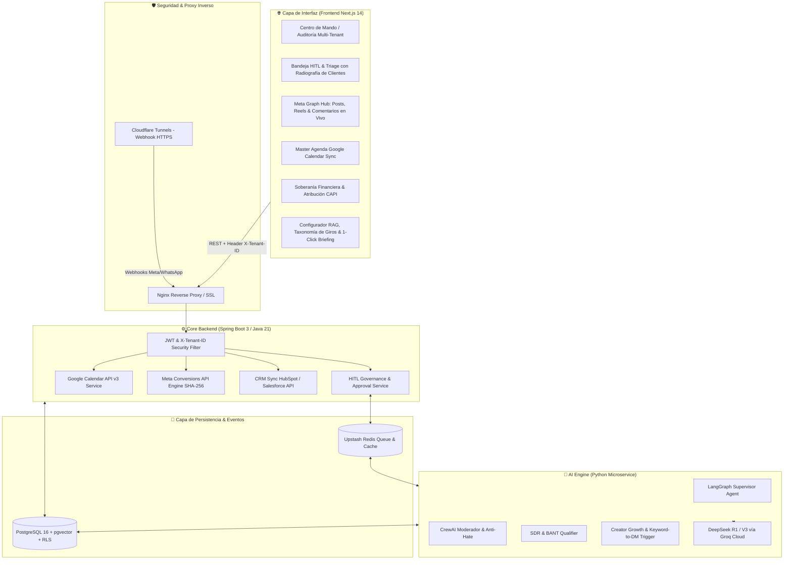
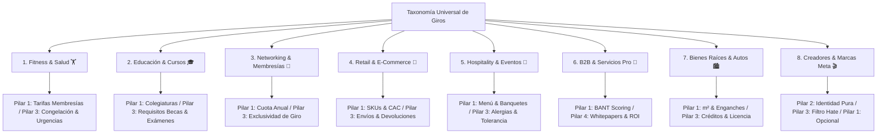

# 📐 Documento de Diseño de Sistema (SDD) — Vector Community

- **Sistema:** Vector Community OS ("La Puerta Trasera")
- **Versión:** 3.0 (Universal Business Taxonomy & Meta Intelligence Edition)
- **Organización:** Vector Inside Operations
- **ADRs Asociados:** [ADR-001](file:///c:/Users/EdgarGs/Documents/ProyectoWork/VectorInside/VectorComunity/Vector-Community/docs/ADR_001_MASTER_ARCHITECTURE_AND_BUSINESS_RULES.md), [ADR-002](file:///c:/Users/EdgarGs/Documents/ProyectoWork/VectorInside/VectorComunity/Vector-Community/docs/ADR_002_UNIVERSAL_BUSINESS_TAXONOMY_AND_RAG_PILLARS.md), [ADR-003](file:///c:/Users/EdgarGs/Documents/ProyectoWork/VectorInside/VectorComunity/Vector-Community/docs/ADR_003_META_GRAPH_INTELLIGENCE_AND_HITL_TRIAGE.md), [ADR-008](file:///c:/Users/EdgarGs/Documents/ProyectoWork/VectorInside/VectorComunity/Vector-Community/docs/ADR_008_PAY_PER_QUALIFIED_LEAD_STATE_MACHINE_AND_KANBAN_TRIAGE.md), [ADR-009](file:///c:/Users/EdgarGs/Documents/ProyectoWork/VectorInside/VectorComunity/Vector-Community/docs/ADR_009_DUAL_THEME_DESIGN_SYSTEM_RULES.md)

---

## 1. Introducción y Alcance
Este documento especifica la arquitectura técnica, diagramas de flujo, modelos de datos, protocolos de seguridad, taxonomía de giros comerciales y diseño de interfaz para **Vector Community**, el motor de gestión de comunidad autónoma, performance marketing, análisis en Meta Graph y gobernanza Human-in-the-Loop (HITL).

---

## 2. Arquitectura Global del Sistema



---

## 3. Taxonomía de 8 Familias de Conversión y Comportamiento RAG



---

## 4. Modelo de Dominio & Esquema de Base de Datos (PostgreSQL RLS)

### 4.1. Tabla `tenants` (Aislamiento de Clientes & Giro)
```sql
CREATE TABLE tenants (
    id VARCHAR(64) PRIMARY KEY,
    name VARCHAR(255) NOT NULL,
    short_name VARCHAR(100) NOT NULL,
    vertical_categoria VARCHAR(50) NOT NULL, -- 'fitness_health', 'education', 'networking', 'retail_ecom', 'hospitality', 'b2b_services', 'realestate_auto', 'creators'
    giro_especifico VARCHAR(150) NOT NULL, -- 'Gimnasios, CrossFit & Fitness Studios', 'Escuelas & Universidades', etc.
    meta_pixel_id VARCHAR(100),
    meta_capi_token TEXT,
    google_calendar_id VARCHAR(255),
    crm_provider VARCHAR(50),
    crm_api_key TEXT,
    instagram_handle VARCHAR(100),
    cac_max_threshold NUMERIC(10, 2),
    rag_health_score INT DEFAULT 85,
    inviolable_rules JSONB DEFAULT '[]'::jsonb,
    created_at TIMESTAMP WITH TIME ZONE DEFAULT CURRENT_TIMESTAMP
);
```

### 4.2. Tabla `hitl_alerts` (Gobernanza Human-in-the-Loop)
```sql
CREATE TABLE hitl_alerts (
    id VARCHAR(64) PRIMARY KEY,
    tenant_id VARCHAR(64) NOT NULL REFERENCES tenants(id) ON DELETE CASCADE,
    type VARCHAR(50) NOT NULL, -- 'APPOINTMENT_REQUEST', 'B2B_DISCOVERY_CALL', 'BRAND_SPONSORSHIP_PROPOSAL', 'CRISIS_TOXICITY', 'INVIOLABLE_RULE_BREACH'
    status VARCHAR(30) NOT NULL DEFAULT 'PENDING_AGENCY_APPROVAL',
    confidence_score INT NOT NULL,
    client_name VARCHAR(255),
    client_phone VARCHAR(50),
    customer_needs_summary JSONB, -- intent, stage, potentialTicket, objection, suggestedAction
    bot_summary TEXT NOT NULL,
    transcript_snippet JSONB,
    urgency VARCHAR(20) DEFAULT 'NORMAL',
    approved_by VARCHAR(100),
    approved_at TIMESTAMP WITH TIME ZONE,
    created_at TIMESTAMP WITH TIME ZONE DEFAULT CURRENT_TIMESTAMP
);

-- Política RLS para aislamiento estricto
ALTER TABLE hitl_alerts ENABLE ROW LEVEL SECURITY;

CREATE POLICY tenant_isolation_policy ON hitl_alerts
    USING (tenant_id = current_setting('app.current_tenant_id', true));
```

### 4.3. Tabla `meta_comments_stream` (Telemetría de Redes Sociales)
```sql
CREATE TABLE meta_comments_stream (
    id VARCHAR(64) PRIMARY KEY,
    tenant_id VARCHAR(64) NOT NULL REFERENCES tenants(id),
    post_id VARCHAR(100) NOT NULL,
    post_type VARCHAR(30) NOT NULL, -- 'Reel', 'Carousel', 'Post', 'Story'
    author_handle VARCHAR(100) NOT NULL,
    comment_text TEXT NOT NULL,
    sentiment VARCHAR(30) NOT NULL, -- 'POSITIVE', 'BUYING_INTENT', 'INQUIRY_FAQ', 'TOXIC_HATE'
    auto_action_dispatched VARCHAR(100), -- 'AUTO_DM_COMMERCIAL_OFFER', 'COMMENT_HIDDEN', 'PUBLIC_REPLY'
    created_at TIMESTAMP WITH TIME ZONE DEFAULT CURRENT_TIMESTAMP
);
```

---

## 5. Protocolo de Seguridad del Frontend (Axios Interceptor)

Cada solicitud HTTP inyecta obligatoriamente el identificador del tenant en los encabezados para aplicar las políticas de Row-Level Security:

```javascript
// src/services/api.js
api.interceptors.request.use((config) => {
  const { activeTenantId } = useTenantStore.getState();
  const token = localStorage.getItem('jwt_token');

  if (activeTenantId) {
    config.headers['X-Tenant-ID'] = activeTenantId;
  }
  if (token) {
    config.headers['Authorization'] = `Bearer ${token}`;
  }
  return config;
});
```

---

## 6. Arquitectura del Sistema de Diseño Dual-Theme (Modo Oscuro & Modo Claro)

La experiencia de usuario de **Vector Community** implementa un motor de diseño dual sincronizado mediante tokens CSS (`src/styles/globals.css`) y clases utilitarias de Tailwind (`darkMode: 'class'`), normado formalmente en [ADR-009](file:///c:/Users/EdgarGs/Documents/ProyectoWork/VectorInside/VectorComunity/Vector-Community/docs/ADR_009_DUAL_THEME_DESIGN_SYSTEM_RULES.md):

### 6.1. Principios de Contraste y Accesibilidad (WCAG AA/AAA)
1. **Lienzo y Superficies:**
   - **Modo Oscuro:** Lienzo `#000000` con superficies elevadas `#07080A` y `#0E0F13`.
   - **Modo Claro:** Lienzo `#F8FAFC` (porcelana ejecutiva) con paneles `#FFFFFF` y bordes nítidos `#E2E8F0`.
2. **Jerarquía Tipográfica Invertida:**
   - Todo texto operativo utiliza emparejamiento semántico: `text-zinc-900 dark:text-white` para títulos primarios y `text-zinc-600 dark:text-zinc-400` para metadatos.
3. **El Guardrail del Amarillo Vectorial (`#E7F900`):**
   - **En Texto:** Queda prohibido el uso de `#E7F900` como texto plano sobre superficies claras (<1.4:1). El sistema mapea dinámicamente `.text-neon` a `--neon-text` (`#4D5600` en modo claro, superando 6.5:1 de contraste AAA).
   - **En Botones y Badges:** Conserva el Amarillo Vectorial `#E7F900` con tipografía negra (`bg-neon text-black`), alcanzando un contraste supremo de **15.2:1** en ambos modos.

